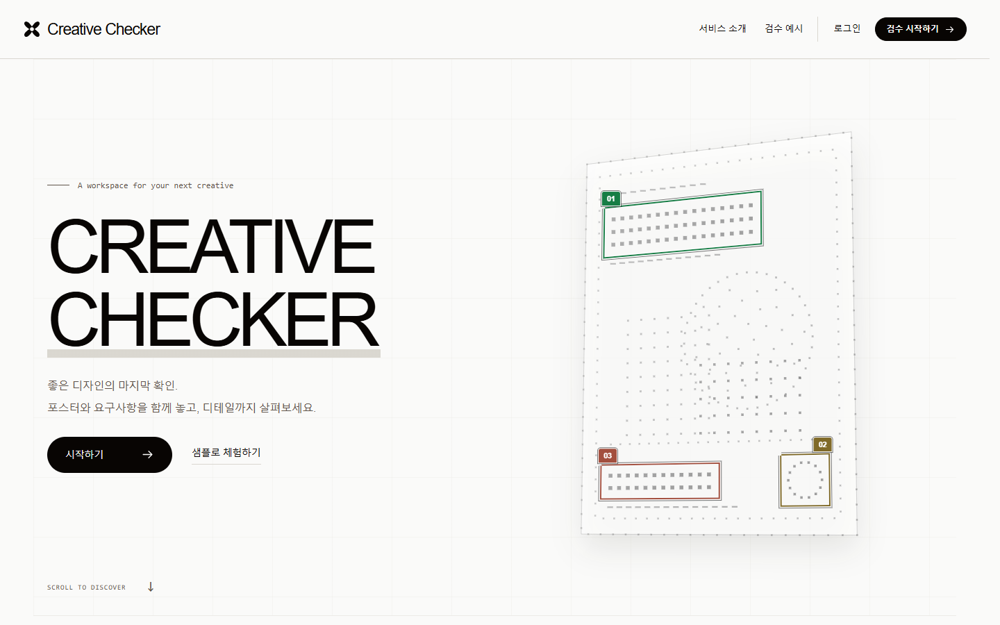
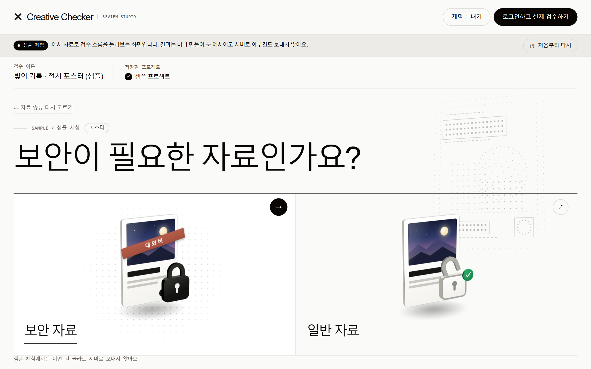
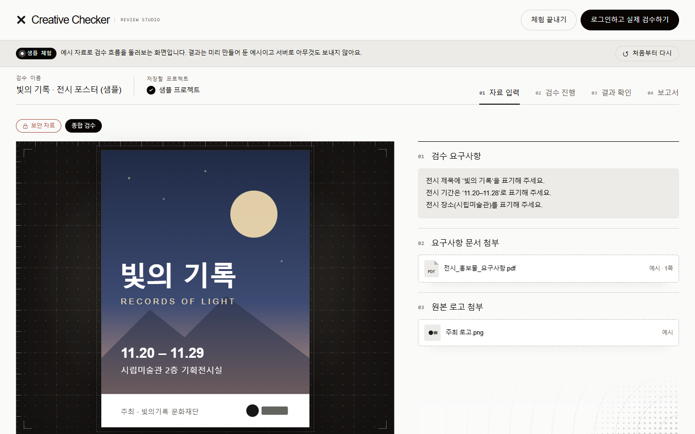
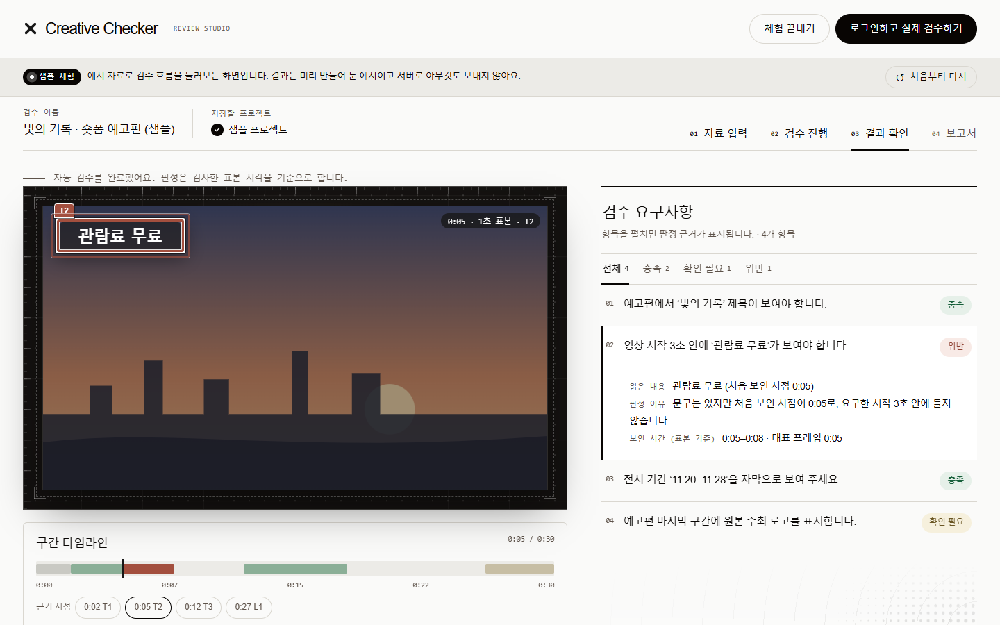
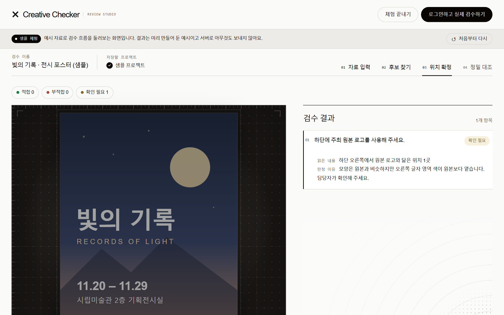
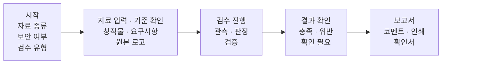
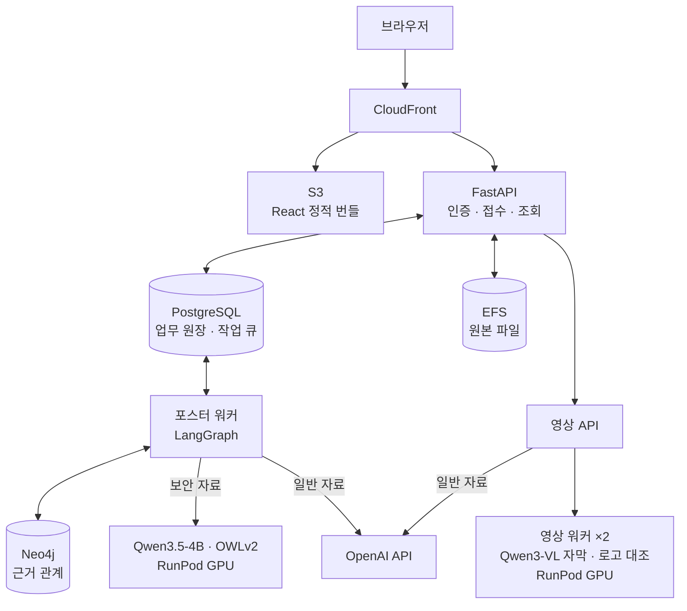

<div align="center">

# Creative Checker

### 좋은 디자인의 마지막 확인.

기준 문서의 요구사항과 포스터·동영상을 대조해<br>
항목별 판정과 그 이유를 근거 위치와 함께 보여 주는 창작물 검수 서비스입니다.

<br>

[**서비스 열기**](https://d2fu4nse4xovsn.cloudfront.net) &nbsp;·&nbsp;
[샘플 체험](#브라우저에서-바로-보기) &nbsp;·&nbsp;
[주요 기능](#주요-기능) &nbsp;·&nbsp;
[빠른 시작](#빠른-시작) &nbsp;·&nbsp;
[아키텍처](#아키텍처) &nbsp;·&nbsp;
[문서](#문서)

<br>

[](https://github.com/20260528-skn-family-ai-33/SKN33-Final-1Team/actions/workflows/review-app.yml)
[](https://github.com/20260528-skn-family-ai-33/SKN33-Final-1Team/actions/workflows/agent-framework.yml)
[](https://github.com/20260528-skn-family-ai-33/SKN33-Final-1Team/actions/workflows/aws-main-frontend.yml)
[](https://github.com/20260528-skn-family-ai-33/SKN33-Final-1Team/actions/workflows/aws-test-frontend.yml)


<br>



</div>

<br>

## 왜 만들었나요

포스터 한 장을 검수하려면 기획서와 가이드에서 요구사항을 찾아 이미지와 하나씩 맞춰 봐야 합니다. 행사 기간이 하루 다르거나 필수 안내 문구가 빠져도 눈으로는 놓치기 쉽고, 어떤 기준으로 통과시켰는지는 파일과 메신저에 흩어져 나중에 찾기 어렵습니다.

Creative Checker는 이 과정을 **기준 → 근거 → 결과** 하나의 흐름으로 묶습니다. 문서에서 기준을 뽑아 담당자가 확정하고, 확정한 기준 전체를 창작물과 대조하고, 판정마다 원문과 화면 속 위치를 붙입니다. 자동 판정은 담당자의 검토를 돕는 초안이고, 최종 판단은 사람이 합니다.

## 주요 기능

<table>
<tr>
<td width="50%" valign="top">

### 포스터 검수

요구사항 문서(PDF·DOCX 1개)를 올리거나 요구사항을 직접 적으면 검수 기준 초안이 만들어집니다. 기준마다 원문 출처가 남고, 문서에서 정해지지 않은 값은 임의로 채우지 않고 **미정**으로 둡니다. 자료 입력과 기준 확인이 한 화면이라, 항목을 빼거나 보완한 뒤 **검수 시작하기** 한 번으로 기준 승인부터 검수 접수까지 이어집니다.

</td>
<td width="50%" valign="top">

### 동영상 검수

180초·500MiB까지의 영상을 올리면 프레임마다 자막과 표시 문구를 읽고, 기준별 근거가 된 구간을 타임라인에서 바로 열어 봅니다. 요구사항은 영상 계약서 PDF·DOCX에서 추출하거나 직접 입력합니다.

</td>
</tr>
<tr>
<td width="50%" valign="top">

### 로고 검수

원본 로고를 함께 올리면 포스터 구역별·영상 프레임별로 로고 후보를 찾습니다. 담당자가 위치를 확정하면 원본과의 **정밀 대조**가 자동으로 이어지고, 모양·색의 차이를 문장으로 정리합니다. 로고만 따로 검수할 수도 있습니다.

</td>
<td width="50%" valign="top">

### 보안 자료 경로

검수를 시작할 때 **보안 자료**인지 고릅니다. 보안 자료는 팀이 운영하는 GPU 서버의 Qwen 모델로만 처리하고, 일반 자료는 OpenAI API로 처리합니다. 고른 경로는 실행마다 기록됩니다.

</td>
</tr>
<tr>
<td width="50%" valign="top">

### 근거 중심 결과

결과는 **충족 · 위반 · 확인 필요**로 나뉩니다. 기준 원문, 창작물에서 읽은 내용, 판정 이유를 나란히 보고, 항목을 누르면 포스터나 프레임 위에 위치 상자가 표시됩니다. 확신할 수 없는 항목은 통과시키지 않고 확인 필요로 남깁니다. 날짜와 파일 규격은 코드로 판정하며, 파일 크기·해상도·형식은 원본 파일을 직접 측정합니다.

</td>
<td width="50%" valign="top">

### 보고서와 검수 확인서

요구사항별 결과를 보고서로 정리합니다. 항목마다 **위치 보기**로 고칠 곳을 다시 띄우고, 확인 필요 항목에는 담당자 코멘트를 남깁니다. 브라우저 인쇄·PDF 저장과 함께, 공공기관 보고서 형식의 2쪽짜리 **검수 확인서**를 인쇄할 수 있습니다.

</td>
</tr>
<tr>
<td width="50%" valign="top">

### 포스터 문구 수정·지도 QR

위반 문구를 고친 포스터 시안을 만들고, 검수에서 읽은 장소명·주소로 네이버 지도 QR을 생성해 포스터에 넣습니다. 보안 자료 실행에서는 문구 수정이 막혀 있습니다.

</td>
<td width="50%" valign="top">

### 샘플 체험 · 사용 안내 · 내 작업

로그인 없이 예시 자료로 전체 흐름을 둘러보는 **샘플 체험**, 검토된 FAQ로 답하는 **사용 안내 챗봇**을 제공합니다. **내 작업**에서는 문서 분석과 검수 이력을 다시 열고, 대기 작업 취소와 이력 숨김·복원을 합니다.

</td>
</tr>
</table>

## 화면

<table>
<tr>
<td width="50%"></td>
<td width="50%"></td>
</tr>
<tr>
<td align="center"><sub><b>시작</b> · 보안 여부와 검수 유형을 고릅니다</sub></td>
<td align="center"><sub><b>자료 입력</b> · 포스터, 요구사항, 원본 로고를 한 화면에</sub></td>
</tr>
<tr>
<td width="50%"></td>
<td width="50%"></td>
</tr>
<tr>
<td align="center"><sub><b>포스터 결과</b> · 판정 이유와 읽은 위치</sub></td>
<td align="center"><sub><b>동영상 결과</b> · 근거 프레임과 구간 타임라인</sub></td>
</tr>
<tr>
<td width="50%"></td>
<td width="50%" valign="middle">

**로고 검수** · 후보 찾기 → 위치 확정 → 정밀 대조

모든 화면은 [샘플 체험](#브라우저에서-바로-보기)에서 캡처했습니다. 예시 자료이며 실제 검수 결과가 아닙니다.

</td>
</tr>
</table>

## 이용 흐름



| 단계 | 하는 일 |
| --- | --- |
| **시작** | 포스터·동영상, 보안 자료·일반 자료, 문구·로고·종합 검수를 고릅니다. 고른 유형에 필요한 입력 칸만 보입니다. |
| **자료 입력·기준 확인** | 창작물과 요구사항 문서를 올리거나 요구사항을 직접 적습니다. 추출된 기준은 같은 화면에 나타나며, 빼거나 보완할 수 있습니다. 값이 미정인 항목이 남으면 승인하지 않고 멈춥니다. |
| **검수 진행** | 확정한 기준 **전체**를 검사합니다. 진행률은 끝난 단계만 반영하고 남은 시간을 추정하지 않습니다. |
| **결과 확인** | 항목별 판정과 근거 위치를 확인합니다. |
| **보고서** | 확인 필요 항목에 코멘트를 남기고, 보고서나 검수 확인서로 인쇄합니다. |

판정 규칙은 단순합니다. 필수 조건에 확실한 위반이 있으면 **위반**, 불확실하거나 검사하지 못한 항목이 남으면 **확인 필요**, 모두 검사해 충족하면 **충족**입니다.

## 아키텍처



API는 요청을 검증하고 작업을 등록할 뿐 모델을 직접 실행하지 않습니다. 독립 워커가 PostgreSQL에서 작업을 가져가 처리하므로, 처리 중 서버가 재시작돼도 완료된 단계부터 이어집니다. PostgreSQL이 업무의 원본이고 Neo4j는 언제든 다시 만들 수 있는 관계 조회용 사본입니다. 벡터 DB는 쓰지 않습니다.

### 자료별 처리 경로

| 단계 | 보안 자료 | 일반 자료 |
| --- | --- | --- |
| 요구사항 추출 (A02) | Qwen3.5-4B | OpenAI |
| 포스터 검사 (A04·A05) | Qwen3.5-4B + OWLv2 객체 후보 | OpenAI |
| 영상 자막 판독 | Qwen3-VL | OpenAI |
| 로고 후보 찾기 | RunPod 워커 | OpenAI |
| 로고 정밀 대조 | RunPod 워커 | RunPod 워커 |

보안 자료는 외부 API로 보내지 않습니다. 보안 여부를 고르지 않은 이전 실행은 Qwen 추출이 실패하면 OpenAI로 한 번 다시 추출하며, 이 대체 결과도 같은 원문 대조 검증을 거칩니다.

### 검수 파이프라인

| 역할 | 책임 | 구현 |
| --- | --- | --- |
| **A01** 실행 조정 | 단계 연결, 대기·실패·재개 관리 | 코드 |
| **A02** 기준 추출 | PDF·DOCX·자유 입력에서 조건·기대값·원문 출처 구조화 | 모델 |
| **A04·A05** 통합 검사 | 포스터의 문구·시각 요소 관측, 조건별 판정 초안 | 모델 |
| **A06** 결과 검증 | 조건 누락·근거·모순 점검, 날짜·파일 규격 직접 판정 | 코드 |
| **A07** 보고 | 검증된 판정으로 설명과 수정 요청 초안 작성 | 코드 · 모델 |
| **A08** 재검수 연결 | 수정본을 새 실행으로 연결 | 코드 |

A02 다음에는 반드시 사람의 기준 승인을 거칩니다. 역할 사이의 입출력은 버전이 있는 JSON 계약(현재 3.0.0)으로 고정돼 있어, 담당자가 자기 역할의 어댑터만 바꿔 끼울 수 있습니다.

## 기술 스택

| 영역 | 사용 기술 |
| --- | --- |
| 프런트엔드 | React 19, React Router 7, Vite 7, TypeScript(타입 검사), Playwright |
| 백엔드 | Python 3.12, FastAPI, Pydantic 2, SQLAlchemy 2, Alembic |
| 에이전트 | LangGraph, MCP |
| 모델 | Qwen3.5-4B · Qwen3-VL(vLLM), OWLv2, OpenAI API |
| 데이터 | PostgreSQL 17, Neo4j |
| 영상 | FFmpeg, 프레임 표본 추출, OWLv2 · SigLIP2 · BiRefNet · PP-OCRv5 |
| 인프라 | AWS CloudFront · S3 · EC2 · RDS · EFS, RunPod GPU, Docker, GitHub Actions |

## 빠른 시작

### 브라우저에서 바로 보기

[서비스 첫 화면](https://d2fu4nse4xovsn.cloudfront.net)에서 **샘플로 체험하기**를 누르면 로그인 없이 포스터·동영상·로고 검수 흐름을 둘러볼 수 있습니다. 예시 자료만 쓰며 서버로 아무것도 보내지 않습니다.

### 로컬에서 화면만 띄우기

Node.js 20.19 이상이 필요합니다.

```bash
npm --prefix frontend ci
```

```bash
npm --prefix frontend run dev
```

`http://localhost:5173/sample`을 엽니다. 샘플 체험은 백엔드 없이 동작합니다.

### 검수 흐름 실행해 보기

모델과 DB 없이 메모리에서 기준 승인 → 검사 → 보고 → 재검수까지 한 바퀴 돕니다. Python 3.12와 [uv](https://docs.astral.sh/uv/)가 필요합니다.

```bash
uv sync --locked --group dev
```

```bash
uv run --locked --no-sync python -m backend.agent_framework demo
```

출력은 합성 데이터이며, 그 안의 승인도 스크립트가 넣은 테스트 값입니다.

### 전체 스택 실행

실제 검수에는 PostgreSQL, Qwen 엔드포인트 또는 OpenAI API 키, 환경 파일이 필요합니다. macOS와 Windows 모두 같은 실행기로 Docker 안의 Linux 런타임을 사용합니다.

```bash
python scripts/framework_desktop.py doctor
```

```bash
python scripts/framework_desktop.py build
```

이후 설정 생성, 마이그레이션, API·워커 실행 순서는 [Mac·Windows 공통 실행 가이드](docs/agent-framework/Mac_Windows_공통실행_가이드.md)를, 영상까지 함께 띄우려면 [포스터·영상 병행 실행](docs/agent-framework/영상_포스터_로컬_병행실행.md)을, 환경 파일은 [환경 설정](docs/environment.md)을 따릅니다. 실제 `.env`와 API 키는 저장소에 포함하지 않습니다.

### 테스트

```bash
uv run --locked --no-sync pytest -q
```

```bash
npm --prefix frontend test
```

DB·실모델이 필요한 통합 검사는 기본 실행에서 제외되며 마커로 따로 실행합니다.

## 저장소 구조

```text
├── frontend/                 React 앱
│   ├── src/pages/review/     포스터 검수 · 포스터 로고 · 내 작업 · 보고서
│   ├── src/pages/video/      동영상 검수 · 영상 로고
│   ├── src/pages/sample/     로그인 없는 샘플 체험
│   └── tests/e2e/            브라우저 회귀 검사
├── backend/
│   ├── agent_framework/      역할 계약 · LangGraph 실행 · API · 워커 · 모델 경로 · 마이그레이션(AF001–AF006)
│   ├── app/                  인증 · 영상 검수 · 포스터·영상 로고 API
│   └── a07_reporter/         보고서 생성
├── scripts/                  실행기 · 벤치마크 · 문서 빌드
├── deploy/ · docker/         배포 구성
├── tests/                    백엔드 테스트
├── experiments/              모델 비교 실험
└── docs/                     설계 · 운영 · 검증 기록
```

## 문서

전체 목록은 [문서 목차](docs/INDEX.md)에서 목적별로 찾을 수 있습니다.

| 문서 | 내용 |
| --- | --- |
| [에이전트 프레임워크 안내](docs/agent-framework/README.md) | 역할별 계약, 어댑터 연결 위치, 가이드 전체 목록 |
| [업무 흐름도](docs/agent-framework/flow.html) | 검수·재검수 시나리오를 탐색하는 단일 HTML |
| [A02 실행·사용 가이드](docs/agent-framework/A02_실행_사용가이드.md) | 요구사항 문서 기준 추출을 처음부터 실행하는 순서 |
| [포스터 로고 API](docs/poster-logo-flow-api.md) · [영상 로고 API](docs/video-logo-flow-api.md) | 로고 후보 찾기·위치 확정·정밀 대조와 워커 연결 |
| [영상 자막 엔진·기준 추출](docs/agent-framework/영상_자막_Qwen3VL_연결가이드.md) | Qwen3-VL 자막 판독과 영상 요구사항 추출 |
| [AWS 운영 현황](docs/agent-framework/AWS_인프라_운영현황_20261110.md) · [구축 설정](docs/agent-framework/AWS_구축_설정_인수인계_20261110.md) | 배포 구성, 서버 설정, 복구 절차 |
| [AWS_TEST 로컬 조치](docs/agent-framework/AWS_TEST_로컬_조치_20261111.md) | 테스트 환경 이슈별 조치와 수용 확인 |
| [환경 설정](docs/environment.md) · [코드 구조](docs/code-structure.md) | 환경 파일, 의존성, 파일 위치와 명명 규칙 |
| [논리 ERD](docs/ERD_논리.md) · [물리 ERD](docs/ERD_물리.md) | 데이터 모델 |
| [프로젝트 공통 맥락](docs/프로젝트_공통맥락.md) | 날짜별 결정과 검증 기록 |

초기 OCR 시제품의 비교 실험은 [Paddle 단독 비교](docs/ocr-paddle-only-2026-10-13.md)와 [OCR benchmark 안내](docs/ocr-benchmark.md)에, 당시 실행 방법은 [실행가이드](실행가이드.md)에 남아 있습니다.

## 현재 범위

팀 개발·발표용 환경에서 운영 중이며, 상시 가동과 장기 부하는 보장하지 않습니다.

| 지원 | 제외·제한 |
| --- | --- |
| 요구사항 문서 PDF·DOCX 1개, 자유 텍스트 입력 | HWPX 문서, 여러 문서 묶음 분석 |
| PNG·JPEG·WEBP 포스터 | 모바일·태블릿 화면 (데스크톱 기준) |
| 동영상 180초·500MiB 이하, 자막·표시 문구·로고 근거 | 음성, 미적 판단 |
| 회원가입·로그인, 프로젝트 권한 | 이메일 소유 확인, 비밀번호 재설정 |

- 로고는 일치 여부를 자동으로 단정하지 않고 대조 근거만 제공합니다.
- 일반 자료는 OpenAI API로 전송됩니다. 외부로 보내면 안 되는 자료는 **보안 자료**로 검수하세요.
- 보고서의 담당자 코멘트는 서버에 저장되지 않고 사용하는 브라우저에만 남습니다.
- 테스트 환경(AWS_TEST)에서는 사람의 다음 단계를 24시간 기다린 검수가 만료되어 기본 목록에서 숨겨집니다. 원본과 이력은 지워지지 않습니다.
- 업로드한 자료는 모델 학습에 쓰지 않습니다.

## 팀

SK네트웍스 Family AI 캠프 33기 최종 프로젝트 1팀

| 이름 | 담당 |
| --- | --- |
| 김일환 | 통합 · API · DB |
| 김성훈 | 문서 · 기준 추출 · 문구 검사 |
| 안정민 | 시각 모델 · 평가 |
| 주상현 | 동영상 검수 |
| 최지흠 | 화면 · 보고서 · 실행 프레임워크 |

## 기여

모든 변경은 Issue에서 시작해 `main` 대상 PR로 병합합니다. 브랜치·커밋·PR 규칙은 [CONTRIBUTING.md](CONTRIBUTING.md)를 따릅니다.
