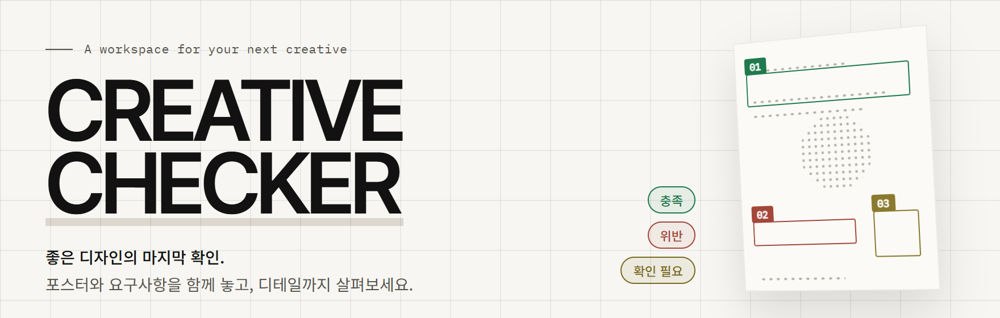
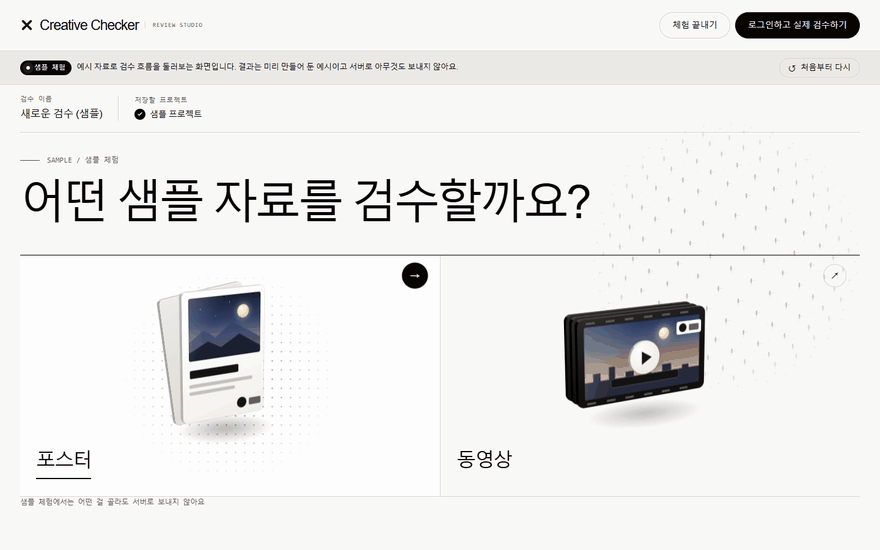
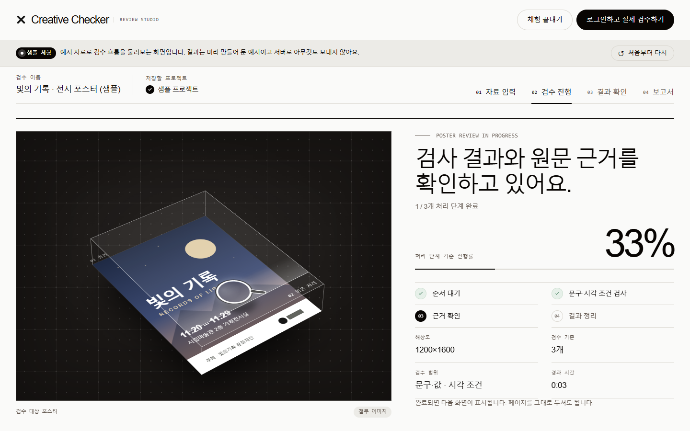
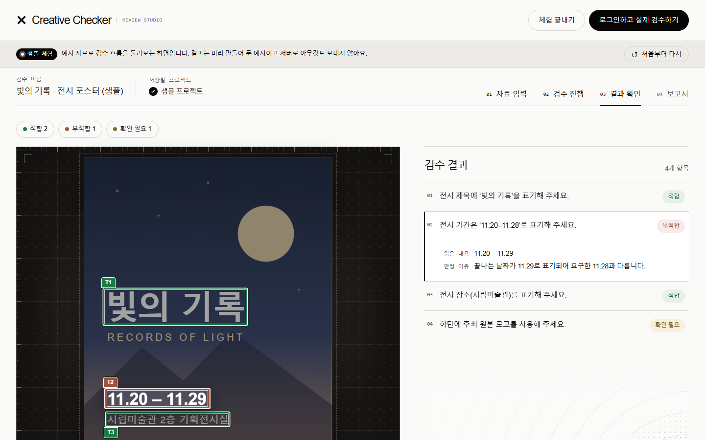
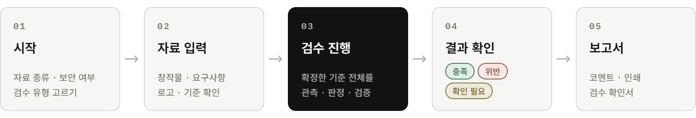
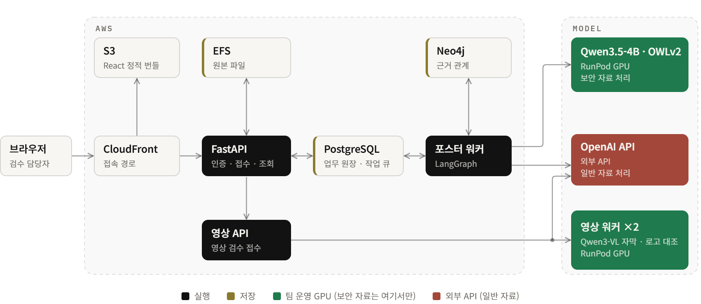

<a id="readme-top"></a>

<picture>
  <source media="(prefers-color-scheme: dark)" srcset="docs/assets/readme/banner-dark.png">
  
</picture>

<p align="center">
  <a href="https://d3navmtcjn23y2.cloudfront.net"></a>
  <a href="#샘플-체험"></a>
  <a href="#11--산출물"></a>
  <a href="#14--팀"></a>
</p>

<p align="center"><sub>SK네트웍스 Family AI 캠프 33기 · 최종 프로젝트 1팀 · 2026.09 – 2026.11</sub></p>

<p align="center">
  
  <br><sub>샘플 체험 · 자료 고르기 → 자료 입력 → 검수 진행 → 결과 확인</sub>
</p>

> [!NOTE]
> 배포 사이트의 API·GPU 모델 서버는 상시 가동하지 않으므로, 로그인 후 실제 검수는 동작하지 않을 수 있습니다. 첫 화면의 **샘플로 체험하기**는 서버 없이 동작하므로 검수 흐름 전체를 확인할 수 있습니다.

<br>

## 01 · 프로젝트 개요

기준 문서의 요구사항과 포스터·동영상을 대조해, 항목별 판정과 그 이유를 창작물 위의 위치와 함께 보여 주는 창작물 검수 서비스입니다.

| 항목 | 내용 |
| --- | --- |
| 과정 | SK네트웍스 Family AI 캠프 33기 최종 프로젝트 1팀 |
| 주제 | 다양한 창작물 포스터의 요구사항 검수 시스템 |
| 기간 | 2026.09.28 ~ 2026.11.20 (중간 발표 10.16, 최종 발표 11.20) |
| 대상 사용자 | 검수 담당자(광고대행·제작사, 지자체·축제 주최 기관 홍보 담당), 제작 담당자, 최종 승인자 |
| 검수 대상 | 포스터 이미지(PNG·JPEG·WEBP), 동영상(180초·500MiB 이하) |
| 요구사항 입력 | 요구사항 문서(PDF·DOCX 1개), 직접 입력한 자유 텍스트 |

<br>

## 02 · 왜 만들었나요

포스터 한 장을 검수하려면 기획서와 가이드에서 요구사항을 찾아 이미지와 하나씩 맞춰 봐야 합니다. 행사 기간이 하루 다르거나 필수 안내 문구가 빠져도 눈으로는 놓치기 쉽고, 어떤 기준으로 통과시켰는지는 파일과 메신저에 흩어져 나중에 찾기 어렵습니다.

Creative Checker는 이 과정을 **기준 → 근거 → 결과** 하나의 흐름으로 묶습니다.

<table>
<tr>
<td align="center" width="33%"><b>① 기준을 정하고</b><br><sub>문서·직접 입력에서 조건을 뽑아<br>담당자가 확정합니다</sub></td>
<td align="center" width="33%"><b>② 근거를 살피고</b><br><sub>확정한 조건 전체를 창작물과 대조해<br>읽은 위치를 표시합니다</sub></td>
<td align="center" width="33%"><b>③ 사람이 판단합니다</b><br><sub>자동 판정은 검토를 돕는 초안이고<br>최종 결정은 담당자가 합니다</sub></td>
</tr>
</table>

| 현장의 문제 | Creative Checker의 대응 |
| --- | --- |
| 기준이 여러 문서와 대화에 흩어져 조건을 빠뜨리기 쉬움 | 문서·직접 입력에서 조건을 추출하고, 담당자가 확정한 조건 **전체**를 검사 |
| 문구·일정·장소를 반복 확인하고 오류 위치를 다시 설명해야 함 | 판정마다 읽은 내용·판정 이유·창작물 위 위치 상자를 붙이고 보고서로 정리 |
| 기준 변경·수정본 제출 시 어떤 버전으로 검수했는지 추적하기 어려움 | 승인한 기준을 버전·해시로 고정하고, 수정본은 새 실행으로 전체 재검수 |
| 불명확한 조건이나 부족한 근거가 정상 판정과 섞여 승인될 수 있음 | 정해지지 않은 값은 **미정**으로 표시하고, 근거가 부족한 판정은 통과 대신 **확인 필요**로 남김 |

<br>

## 03 · 주요 기능

<table>
<tr>
<td width="50%" valign="top">

### 🖼️ 포스터 검수

요구사항 문서(PDF·DOCX 1개)를 올리거나 직접 적으면 검수 기준 초안이 만들어집니다. 기준마다 원문 출처가 남고, 정해지지 않은 값은 임의로 채우지 않고 **미정**으로 둡니다. 같은 화면에서 기준을 빼거나 보완한 뒤 **검수 시작하기** 한 번으로 승인과 접수가 이어집니다.

</td>
<td width="50%" valign="top">

### 🎬 동영상 검수

180초·500MiB까지의 영상을 올리면 프레임마다 자막과 표시 문구를 읽고, 기준별 근거가 된 구간을 타임라인에서 바로 열어 봅니다. 요구사항은 영상 계약서 PDF·DOCX에서 추출하거나 직접 입력합니다.

</td>
</tr>
<tr>
<td width="50%" valign="top">

### 🔍 로고 검수

원본 로고를 함께 올리면 포스터 구역별·영상 프레임별로 로고 후보를 찾고, 원본과 닮은 위치를 골라 **정밀 대조**를 자동으로 이어 갑니다. 모양·색의 차이를 문장으로 정리하며, 검수하려던 로고가 아니면 담당자가 위치를 직접 고쳐 다시 대조합니다.

</td>
<td width="50%" valign="top">

### 🔒 보안 자료 경로

검수를 시작할 때 **보안 자료**인지 고릅니다. 보안 자료는 팀이 운영하는 GPU 서버의 모델로만 처리하고, 일반 자료는 OpenAI API로 처리합니다. 고른 경로는 실행마다 기록됩니다.

</td>
</tr>
<tr>
<td width="50%" valign="top">

### 📍 근거 중심 결과

결과는 **충족 · 위반 · 확인 필요**로 나뉩니다. 기준 원문, 창작물에서 읽은 내용, 판정 이유를 나란히 보고, 항목을 누르면 포스터나 프레임 위에 위치 상자가 표시됩니다. 날짜와 파일 규격은 코드로 판정하며, 파일 크기·해상도·형식은 업로드 원본을 직접 측정합니다.

</td>
<td width="50%" valign="top">

### 📄 보고서와 검수 확인서

요구사항별 결과를 보고서로 정리합니다. 항목마다 **위치 보기**로 고칠 곳을 다시 띄우고, 확인 필요 항목에는 담당자 코멘트를 남깁니다. 브라우저 인쇄·PDF 저장과 함께, 공공기관 보고서 형식의 2쪽짜리 **검수 확인서**를 인쇄할 수 있습니다.

</td>
</tr>
<tr>
<td width="50%" valign="top">

### ✏️ 포스터 문구 수정·지도 QR

위반 문구를 고친 포스터 시안을 만들고, 검수에서 읽은 장소명·주소로 네이버 지도 QR을 생성해 포스터에 넣습니다. 보안 자료 실행에서는 문구 수정이 막혀 있습니다.

</td>
<td width="50%" valign="top">

### 🧭 샘플 체험 · 사용 안내 · 내 작업

로그인 없이 예시 자료로 전체 흐름을 둘러보는 **샘플 체험**, 검토된 FAQ로 답하는 **사용 안내 챗봇**을 제공합니다. **내 작업**에서는 문서 분석과 검수 이력을 다시 열고, 대기 작업 취소와 이력 숨김·복원을 합니다.

</td>
</tr>
</table>

<br>

## 04 · 화면

<table>
<tr>
<td width="50%"></td>
<td width="50%"></td>
</tr>
<tr>
<td align="center"><sub><b>① 시작</b> · 자료 종류, 보안 여부, 검수 유형</sub></td>
<td align="center"><sub><b>② 자료 입력</b> · 포스터, 요구사항, 원본 로고를 한 화면에</sub></td>
</tr>
<tr>
<td width="50%"></td>
<td width="50%"></td>
</tr>
<tr>
<td align="center"><sub><b>③ 검수 진행</b> · 끝난 처리 단계만 진행률에 반영</sub></td>
<td align="center"><sub><b>④ 포스터 결과</b> · 항목별 판정과 포스터 위 근거 상자</sub></td>
</tr>
<tr>
<td width="50%"></td>
<td width="50%"></td>
</tr>
<tr>
<td align="center"><sub><b>로고 검수</b> · 원본과 닮은 위치와 차이</sub></td>
<td align="center"><sub><b>동영상 결과</b> · 근거 프레임과 구간 타임라인</sub></td>
</tr>
</table>

<sub>모든 화면은 배포 사이트의 [샘플 체험](#샘플-체험)에서 캡처한 예시이며 실제 검수 결과가 아닙니다. 샘플 화면의 판정 표시(적합·부적합)는 실제 검수 화면에서 **충족·위반·확인 필요**로 나타납니다.</sub>

<br>

## 05 · 이용 흐름

<p>
<picture>
  <source media="(prefers-color-scheme: dark)" srcset="docs/assets/readme/flow-dark.png">
  
</picture>
</p>

| 단계 | 하는 일 |
| --- | --- |
| **시작** | 포스터·동영상, 보안 자료·일반 자료, 문구·로고·종합 검수를 고릅니다. 고른 유형에 필요한 입력 칸만 보입니다. |
| **자료 입력·기준 확인** | 창작물과 요구사항 문서를 올리거나 요구사항을 직접 적습니다. 추출된 기준은 같은 화면에 나타나며, 빼거나 보완할 수 있습니다. 값이 미정인 항목이 남으면 승인하지 않고 멈춥니다. |
| **검수 진행** | 확정한 기준 **전체**를 검사합니다. 진행률은 끝난 단계만 반영하고 남은 시간을 추정하지 않습니다. |
| **결과 확인** | 항목별 판정과 근거 위치를 확인합니다. |
| **보고서** | 확인 필요 항목에 코멘트를 남기고, 보고서나 검수 확인서로 인쇄합니다. |

판정 규칙은 단순합니다. 필수 조건에 확실한 위반이 있으면 **위반**, 불확실하거나 검사하지 못한 항목이 남으면 **확인 필요**, 모두 검사해 충족하면 **충족**입니다.

<br>

## 06 · 시스템 구성

<p>
<picture>
  <source media="(prefers-color-scheme: dark)" srcset="docs/assets/readme/architecture-dark.png">
  
</picture>
</p>

API는 요청을 검증하고 작업을 등록할 뿐 모델을 직접 실행하지 않습니다. 독립 워커가 PostgreSQL에서 작업을 가져가 처리하므로, 처리 중 서버가 재시작돼도 완료된 단계부터 이어집니다. PostgreSQL이 업무의 원본이고 Neo4j는 언제든 다시 만들 수 있는 관계 조회용 사본입니다. 벡터 DB와 독립 근거 검색 단계(A03)는 비교 실험 후 제외했습니다.

### 자료별 처리 경로

| 단계 | 🔒 보안 자료 | 🌐 일반 자료 |
| --- | --- | --- |
| 요구사항 추출 (A02) | Qwen3.5-4B | OpenAI |
| 포스터 검사 (A04·A05) | Qwen3.5-4B + OWLv2 객체 후보 | OpenAI |
| 영상 자막 판독 | Qwen3-VL | OpenAI |
| 로고 후보 찾기 | RunPod 워커 | OpenAI |
| 로고 정밀 대조 | RunPod 워커 | RunPod 워커 |

보안 자료는 외부 API로 보내지 않습니다. 보안 여부를 고르지 않은 이전 실행은 Qwen 추출이 실패하면 OpenAI로 한 번 다시 추출하며, 이 대체 결과도 같은 원문 대조 검증을 거칩니다.

### 검수 파이프라인

| 역할 | 책임 | 구현 |
| --- | --- | --- |
| **A01** 실행 조정 | 단계 연결, 대기·실패·재개 관리 | 코드 |
| **A02** 기준 추출 | PDF·DOCX·자유 입력에서 조건·기대값·원문 출처 구조화 | 모델 |
| **A04·A05** 통합 검사 | 포스터의 문구·시각 요소 관측, 조건별 판정 초안 | 모델 |
| **A06** 결과 검증 | 조건 누락·근거·모순 점검, 날짜·파일 규격 직접 판정 | 코드 |
| **A07** 보고 | 검증된 판정으로 설명과 수정 요청 초안 작성 | 코드 · 모델 |
| **A08** 재검수 연결 | 수정본을 새 실행으로 연결 | 코드 |

A02 다음에는 반드시 사람의 기준 승인을 거칩니다. 역할 사이의 입출력은 버전이 있는 JSON 계약(현재 3.0.0)으로 고정돼 있어, 담당자가 자기 역할의 어댑터만 바꿔 끼울 수 있습니다.

<br>

## 07 · 기술 스택

<p align="center">
  <picture>
    <source media="(prefers-color-scheme: dark)" srcset="https://skillicons.dev/icons?i=python,fastapi,react,vite,ts,postgres,docker,aws,githubactions&theme=dark">
    
  </picture>
</p>
<p align="center">
  
  
  
  
  
  
</p>

<details>
<summary><b>영역별 사용 기술</b></summary>

| 영역 | 사용 기술 |
| --- | --- |
| 프런트엔드 | React 19, React Router 7, Vite 7, TypeScript(타입 검사), Playwright |
| 백엔드 | Python 3.12, FastAPI, Pydantic 2, SQLAlchemy 2, Alembic |
| 에이전트 | LangGraph, MCP |
| 모델 | Qwen3.5-4B · Qwen3-VL(vLLM), OWLv2, OpenAI API |
| 데이터 | PostgreSQL 17, Neo4j 5.26 |
| 영상 | FFmpeg, 프레임 표본 추출, OWLv2 · SigLIP2 · BiRefNet · PP-OCRv5 |
| 인프라 | AWS CloudFront · S3 · EC2 · RDS · EFS, RunPod GPU(A40), Docker, GitHub Actions |

</details>

<br>

## 08 · 테스트 결과

[서비스 테스트 계획 및 결과 보고서 v04](<docs/산출물/05_서비스 배포 및 테스트/[모델배포] 서비스 테스트 계획 및 결과 보고서_33기_1팀_261118_v04.docx>)의 주요 결과입니다. 2026-11-05~11-18 테스트 사이트·격리 환경의 기록 시점 수치이며, 범위를 함께 적습니다.

<table>
<tr>
<td align="center" width="25%"><h3>0건</h3><sub>포스터 판정 오통과<br>(시범 위반 쌍, 두 경로)</sub></td>
<td align="center" width="25%"><h3>91.8 · 95.9%</h3><sub>요구사항 추출 정답 대응률<br>(Qwen · OpenAI, 시범 10건)</sub></td>
<td align="center" width="25%"><h3>약 114초</h3><sub>2쪽 PDF 요구사항 추출<br>(Qwen3.5-4B)</sub></td>
<td align="center" width="25%"><h3>93.0%</h3><sub>영상 자막 판독 재현율<br>(19편·1,267프레임)</sub></td>
</tr>
</table>

| 시험 | 범위 | 결과 |
| --- | --- | --- |
| 요구사항 추출 처리 시간 | 2쪽 PDF, Qwen3.5-4B, 같은 문서 5건 (11-11) | 113.6~115.3초, 조건 13개(미정 1), 오류 0 |
| 요구사항 추출 정답 대응률 | 계약서 v2 시범 10건, 필수 정답 행 73개 (11-18) | Qwen 91.8%(67/73), OpenAI 95.9%(70/73) |
| 포스터 판정 오통과 | 시범 위반 쌍, 위반 정답 행 Qwen 39·OpenAI 51 (11-18) | 두 경로 모두 **0건** |
| 위반 판정 일치율 | 같은 시범의 위반 행 중 판정된 행 | Qwen 91.7%(33/36), OpenAI 87.8%(36/41) |
| 확인 필요 비율 | 테스트 사이트 8쌍 승인 기준 47개 (11-17) | 19.1%(9/47), 모두 시각 요소 조건 |
| 영상 자막 판독 | 홍보 영상 19편·1,267프레임 (11-16·17) | 재현율 93.0%, 문자 오류율 5.32%, 판독 실패 0장 |
| 동시 처리 | 2쪽 PDF 3건 동시 추출 (11-11) | 3건 완료, 오류 0, GPU 최대 38,015 MiB |
| 회귀 시험 | 백엔드·격리 DB·프런트 (11-17) | pytest 1,684개, PostgreSQL·Neo4j 통합 170개, 프런트 단위 157개 통과 |

판정 품질은 계약서 v2 요구사항 행을 정답으로 한 시범 10쌍 규모까지 측정했으며 50·199쌍 확대는 진행 전입니다. 영상 자막의 정답은 사람 최종 확인 전 라벨입니다.

### 알려진 한계

| 구분 | 내용 |
| --- | --- |
| 긴 문서 처리 시간 | 보안 자료(Qwen) 경로에서 약 9,000자 계약서 추출이 평균 646.6초로 처리 한도 900초에 가깝고, 7쪽 계약서는 모델 출력 한도(16,384토큰)에 도달해 실패한 기록이 있습니다. 같은 문서의 OpenAI 경로는 평균 90.5초입니다. |
| 시각 요소 조건 | 문구 검수 안의 시각 요소 조건은 대부분 확인 필요로 남습니다. OWLv2 후보와의 교차 확인은 시험 단계입니다. |
| 표기 정규화 | 요일 축약(금·토)이나 시간 표기처럼 허용 표기가 다른 경우 정상 포스터를 위반으로 판정한 사례가 있습니다. |
| 화면 범위 | 데스크톱 화면 기준이며 모바일·태블릿은 지원하지 않습니다. |

<br>

## 09 · 빠른 시작

### 샘플 체험

[배포 사이트](https://d3navmtcjn23y2.cloudfront.net) 첫 화면에서 **샘플로 체험하기**를 누르면 로그인 없이 포스터·동영상·로고 검수 흐름을 둘러볼 수 있습니다. 예시 자료만 쓰며 서버로 아무것도 보내지 않습니다.

개발 환경에서 직접 실행하려면 아래 항목을 펼칩니다.

<details>
<summary><b>로컬에서 화면만 띄우기</b> · Node.js 20.19 이상</summary>

```bash
npm --prefix frontend ci
```

```bash
npm --prefix frontend run dev
```

`http://127.0.0.1:5173/sample`을 엽니다. 샘플 체험은 백엔드 없이 동작합니다.

</details>

<details>
<summary><b>검수 흐름 실행해 보기</b> · Python 3.12 · uv, 모델·DB 없이</summary>

모델과 DB 없이 메모리에서 기준 승인 → 검사 → 보고 → 재검수까지 한 바퀴 돕니다. [uv](https://docs.astral.sh/uv/)로 의존성을 설치합니다.

```bash
uv sync --locked --group dev
```

```bash
uv run --locked --no-sync python -m backend.agent_framework demo
```

출력은 합성 데이터이며, 그 안의 승인도 스크립트가 넣은 테스트 값입니다.

</details>

<details>
<summary><b>전체 스택 실행</b> · Docker · PostgreSQL · 모델 엔드포인트</summary>

실제 검수에는 PostgreSQL, Qwen 엔드포인트 또는 OpenAI API 키, 환경 파일이 필요합니다. macOS와 Windows 모두 같은 실행기로 Docker 안의 Linux 런타임을 사용합니다.

```bash
python scripts/framework_desktop.py doctor
```

```bash
python scripts/framework_desktop.py build
```

이후 설정 생성, 마이그레이션, API·워커 실행 순서는 [Mac·Windows 공통 실행 가이드](docs/agent-framework/Mac_Windows_공통실행_가이드.md)를, 영상까지 함께 띄우려면 [포스터·영상 병행 실행](docs/agent-framework/영상_포스터_로컬_병행실행.md)을, 환경 파일은 [환경 설정](docs/environment.md)을 따릅니다. 실제 `.env`와 API 키는 저장소에 포함하지 않습니다.

</details>

<details>
<summary><b>테스트</b> · pytest · 프런트 단위 테스트</summary>

```bash
uv run --locked --no-sync pytest -q
```

```bash
npm --prefix frontend test
```

DB·실모델이 필요한 통합 검사는 기본 실행에서 제외되며 마커로 따로 실행합니다.

</details>

<br>

## 10 · 저장소 구조

<details>
<summary><b>폴더 구성 펼치기</b></summary>

```text
├── frontend/                 React 앱
│   ├── src/pages/review/     포스터 검수 · 포스터 로고 · 내 작업 · 보고서
│   ├── src/pages/video/      동영상 검수 · 영상 로고
│   ├── src/pages/sample/     로그인 없는 샘플 체험
│   └── tests/e2e/            브라우저 회귀 검사
├── backend/
│   ├── agent_framework/      역할 계약 · LangGraph 실행 · API · 워커 · 모델 경로 · 마이그레이션(AF001–AF006)
│   ├── app/                  인증 · 영상 검수 · 포스터·영상 로고 API
│   └── a07_reporter/         보고서 생성
├── scripts/                  실행기 · 벤치마크 · 문서 빌드
├── deploy/ · docker/         배포 구성
├── tests/                    백엔드 테스트
├── experiments/              모델 비교 실험
└── docs/                     설계 · 운영 · 검증 기록 · 산출물
```

</details>

<br>

## 11 · 산출물

| 단계 | 산출물 |
| --- | --- |
| 📋 기획 | [요구사항 정의서](<docs/산출물/01_기획/[기획] 요구사항 정의서_33기_1팀_261118_v04.xlsx>) · [프로젝트 기획서](<docs/산출물/01_기획/[기획] 프로젝트 기획서_33기_1팀_261118_v05.docx>) · [화면설계서](<docs/산출물/01_기획/[기획] 화면설계서_33기_1팀_v05.pdf>) |
| 🗄️ 데이터 수집 및 저장 | [수집 데이터 보고서](<docs/산출물/02_데이터 수집 및 저장/[데이터 수집 및 저장] 수집 데이터 보고서_33기_1팀_261118_v06.docx>) · [데이터베이스·저장소 설계 보고서](<docs/산출물/02_데이터 수집 및 저장/[데이터 수집 및 저장] 데이터베이스·저장소 설계 보고서_33기_1팀_261118_v06.docx>) |
| 🧹 데이터 전처리 | [데이터 전처리 결과서](<docs/산출물/03_데이터 전처리/[데이터 전처리] 데이터 전처리 결과서_33기_1팀_261118_v05.docx>) |
| 🧠 모델링 및 평가 | [AI 시스템 아키텍처](<docs/산출물/04_모델링 및 평가/[모델링 및 평가] AI 시스템 아키텍처_33기_1팀_261116_v01.docx>) · [GraphDB 구축 결과서](<docs/산출물/04_모델링 및 평가/[모델링 및 평가] GraphDB 구축 결과서_33기_1팀_261118_v5.0.docx>) · [머신러닝·딥러닝 학습 결과서](<docs/산출물/04_모델링 및 평가/[모델링 및 평가] 머신러닝·딥러닝 학습 결과서_33기_1팀_261118_v1.3.docx>) · [학습한 ML·DL 모델](<docs/산출물/04_모델링 및 평가/[모델링 및 평가] 학습한 ML·DL 모델_33기_1팀_261118_v1.3.docx>) · [멀티 에이전트 테스트 계획 및 결과 보고서](<docs/산출물/04_모델링 및 평가/[모델링 및 평가] 멀티 에이전트 테스트 계획 및 결과 보고서_33기_1팀_261118_v01.docx>) |
| 🚀 서비스 배포 및 테스트 | [시스템 구성도](<docs/산출물/05_서비스 배포 및 테스트/[모델배포] 시스템 구성도_33기_1팀_261118_v01.docx>) · [개발된 LLM 연동 웹 애플리케이션](<docs/산출물/05_서비스 배포 및 테스트/[모델배포] 개발된 LLM 연동 웹 애플리케이션_33기_1팀_261118_v01.docx>) · [서비스 테스트 계획 및 결과 보고서](<docs/산출물/05_서비스 배포 및 테스트/[모델배포] 서비스 테스트 계획 및 결과 보고서_33기_1팀_261118_v04.docx>) |
| 🎤 발표 및 최종 제출 | 최종 발표 자료 (추가 예정) |

<br>

## 12 · 문서

전체 목록은 [문서 목차](docs/INDEX.md)에서 목적별로 찾을 수 있습니다.

| 문서 | 내용 |
| --- | --- |
| [에이전트 프레임워크 안내](docs/agent-framework/README.md) | 역할별 계약, 어댑터 연결 위치, 가이드 전체 목록 |
| [업무 흐름도](docs/agent-framework/flow.html) | 검수·재검수 시나리오를 탐색하는 단일 HTML |
| [A02 실행·사용 가이드](docs/agent-framework/A02_실행_사용가이드.md) | 요구사항 문서 기준 추출을 처음부터 실행하는 순서 |
| [포스터 로고 API](docs/poster-logo-flow-api.md) · [영상 로고 API](docs/video-logo-flow-api.md) | 로고 후보 찾기·위치 확정·정밀 대조와 워커 연결 |
| [영상 자막 엔진·기준 추출](docs/agent-framework/영상_자막_Qwen3VL_연결가이드.md) | Qwen3-VL 자막 판독과 영상 요구사항 추출 |
| [AWS 운영 현황](docs/agent-framework/AWS_인프라_운영현황_20261110.md) · [구축 설정](docs/agent-framework/AWS_구축_설정_인수인계_20261110.md) | 배포 구성, 서버 설정, 복구 절차 |
| [환경 설정](docs/environment.md) · [코드 구조](docs/code-structure.md) | 환경 파일, 의존성, 파일 위치와 명명 규칙 |
| [논리 ERD](docs/ERD_논리.md) · [물리 ERD](docs/ERD_물리.md) | 데이터 모델 |
| [프로젝트 공통 맥락](docs/프로젝트_공통맥락.md) | 날짜별 결정과 검증 기록 |

<br>

## 13 · 현재 범위

팀 개발·발표용 환경에서 운영했으며, 상시 가동과 장기 부하는 보장하지 않습니다.

| 지원 | 제외·제한 |
| --- | --- |
| 요구사항 문서 PDF·DOCX 1개, 자유 텍스트 입력 | HWPX 문서, 여러 문서 묶음 분석 |
| PNG·JPEG·WEBP 포스터 | 모바일·태블릿 화면 (데스크톱 기준) |
| 동영상 180초·500MiB 이하, 자막·표시 문구·로고 근거 | 음성, 미적 판단 |
| 회원가입·로그인, 프로젝트 권한 | 이메일 소유 확인, 비밀번호 재설정 |

- 로고는 일치 여부를 자동으로 단정하지 않고 대조 근거만 제공합니다.
- 일반 자료는 OpenAI API로 전송됩니다. 외부로 보내면 안 되는 자료는 **보안 자료**로 검수하세요.
- 보고서의 담당자 코멘트는 서버에 저장되지 않고 사용하는 브라우저에만 남습니다.
- 업로드한 자료는 모델 학습에 쓰지 않습니다.

<br>

## 14 · 팀

<table>
<tr>
<td align="center" valign="top" width="20%"><b>김일환</b><br><sub>PM</sub><br><sub>통합 · API · DB</sub><br><sub><code>TODO</code></sub></td>
<td align="center" valign="top" width="20%"><b>김성훈</b><br><sub>&nbsp;</sub><br><sub>문서 · 기준 추출 · 문구 검사</sub><br><sub><code>TODO</code></sub></td>
<td align="center" valign="top" width="20%"><b>안정민</b><br><sub>&nbsp;</sub><br><sub>시각 모델 · 평가</sub><br><sub><code>TODO</code></sub></td>
<td align="center" valign="top" width="20%"><b>주상현</b><br><sub>&nbsp;</sub><br><sub>동영상 검수</sub><br><sub><code>TODO</code></sub></td>
<td align="center" valign="top" width="20%"><b>최지흠</b><br><sub>APM</sub><br><sub>화면 · 보고서 · 실행 프레임워크</sub><br><sub><code>TODO</code></sub></td>
</tr>
</table>

<br>

## 15 · 한 줄 회고

| 이름 | 회고 |
| --- | --- |
| 김일환 | `TODO` |
| 김성훈 | `TODO` |
| 안정민 | `TODO` |
| 주상현 | `TODO` |
| 최지흠 | `TODO` |

<br>

## 16 · 기여

모든 변경은 Issue에서 시작해 `main` 대상 PR로 병합합니다. 브랜치·커밋·PR 규칙은 [CONTRIBUTING.md](CONTRIBUTING.md)를 따릅니다.

<br>

<p align="center"><a href="#readme-top">맨 위로 ↑</a></p>
