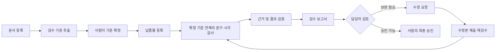
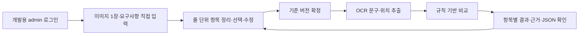
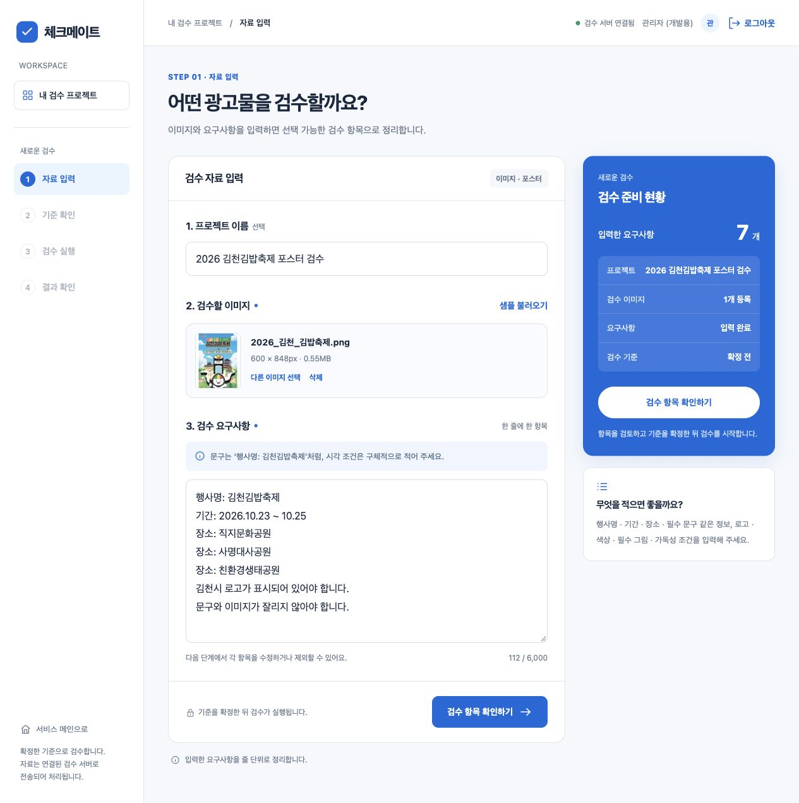
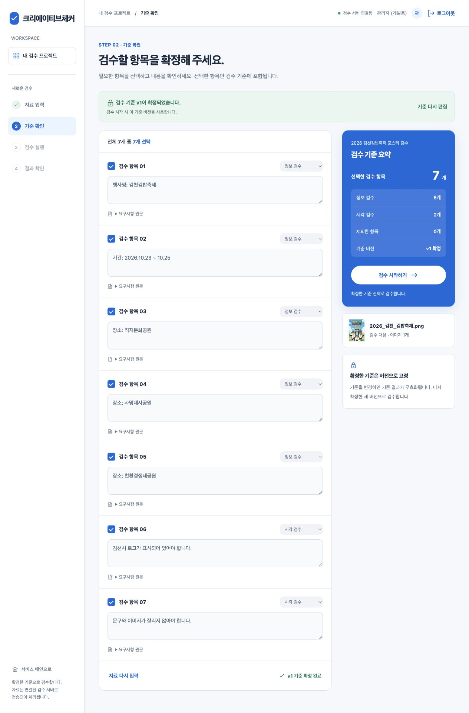
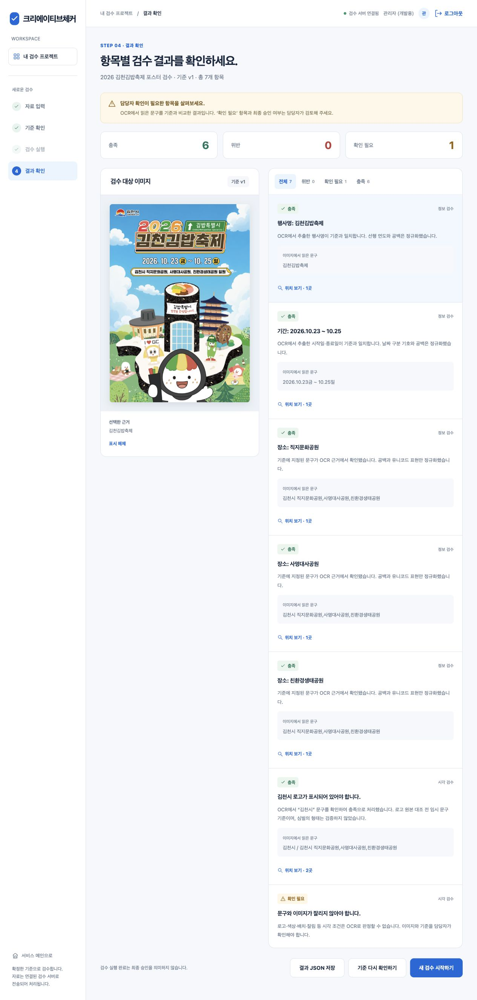
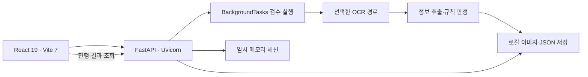
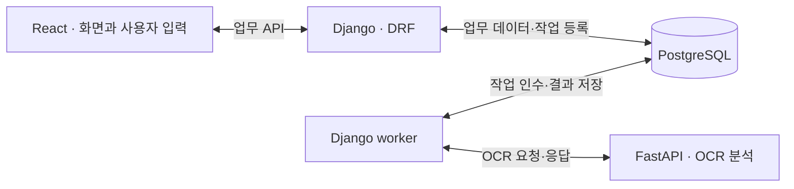

# 크리에이티브체커

**문서의 요구사항과 광고 납품물을 대조하고, 판단 근거를 바탕으로 수정 요청·재검수·최종 승인을 돕는 검수 업무 자동화 프로젝트입니다.**

현재 저장소에서는 이미지와 요구사항을 직접 입력해 검수 기준을 확정하고, OCR로 읽은 문구와 이미지 위치를 확인하는 시제품을 실행할 수 있습니다. 문서 자동 분석부터 최종 승인까지 이어지는 전체 업무 흐름은 단계적으로 구현합니다.

> **2026-10-14 기준:** React·FastAPI 시제품과 로컬 OCR이 구현되어 있습니다. 현재 화면의 서비스 표기는 **바로검수**이며, 프로젝트 소개명은 **크리에이티브체커**입니다. 설치·실행·문제 해결은 [실행가이드](실행가이드.md)를 참고하세요.

## 목차

- [최종 OCR 비교 결과](#최종-ocr-비교-결과)
- [기획 배경과 대상 사용자](#기획-배경과-대상-사용자)
- [전체 업무 흐름](#전체-업무-흐름)
- [현재 구현 기능과 실제 화면](#현재-구현-기능과-실제-화면)
- [시스템 구성](#시스템-구성)
- [역할 분담](#역할-분담)
- [OCR baseline 및 개선 결과](#ocr-baseline-및-개선-결과)
- [향후 계획](#향후-계획)
- [관련 문서와 작성 근거](#관련-문서와-작성-근거)

## 최종 OCR 비교 결과

**EasyOCR 기준선에서 PaddleOCR 단독 경로로 개선한 결과, 핵심 문자 오류율은 22.1%에서 3.5%로 낮아졌고 완전히 일치한 필드는 1개에서 12개로 늘었습니다.** 처리 시간과 메모리 사용량은 증가했습니다.

아래는 **2026-10-13 동일 CPU 조건**에서 비교한 최종 결과입니다. Mac M4 Pro에서 포스터 **5장**, 핵심 문자 **199자**, 가시 필드 **19개**, 검수 기준 **17개**를 평가했습니다. 입력은 RGB 2배이며 경로별 이미지당 1회 실행했습니다. 라벨은 사람이 승인하기 전의 초안입니다.

| 지표 | 개선 전 · EasyOCR 기준선 | 최종 개선 경로 · PaddleOCR 단독 | 기준선 대비 변화 |
| --- | ---: | ---: | --- |
| 핵심 문자 오류율(CER) | 22.1% (44/199) | **3.5% (7/199)** | 편집 오류 수 **37개 순감소 · 84.1% 감소** |
| 필드 완전 일치 | 1/19 (5.3%) | **12/19 (63.2%)** | **11개 증가 · 57.9%p 상승** |
| 정상 기준의 올바른 충족 | 1/14 | **11/14** | **10개 증가** |
| 확인 필요 | 13/17 | **6/17** | **7개 감소** |
| 전체 처리 시간 중앙값 | 3.63초 | 6.90초 | **3.27초 증가 · 약 1.90배** |
| 작업자 최대 RSS 중앙값 | 6.23GiB | 8.15GiB | **1.92GiB 증가 · 약 1.31배** |

문자 오류 순감소율은 `(44 − 7) / 44 × 100 = 84.1%`입니다. 이와 별도로, 기준선에서 틀렸던 필드 18개 중 11개를 바로잡아 **기존 오류 필드 수정률은 `11 / 18 × 100 = 61.1%`**입니다. 기존 정답 필드 1개도 유지했습니다. 두 비율은 전체 OCR 정확도를 뜻하지 않습니다.

이 비교에서는 PaddleOCR 단독이 세 경로 중 문자 오류율과 필드 완전 일치에서 가장 좋은 결과를 보였습니다. 정상 기준 충족에는 인식 모델과 판정 정책 변경의 효과가 함께 반영되어 있습니다. 위반 기준은 1개뿐이고 holdout 3장은 미평가이므로, 이 수치는 **조정용 포스터 5장에 대한 개발 실험 결과**로 해석합니다. 현재 기본 실행 설정은 EasyOCR이며, PaddleOCR 단독은 `OCR_PIPELINE=paddle-only`로 선택합니다.

**최신 실제 화면 검수(2026-10-14, 김천 포스터 1장)**에서는 충족 **6개**, 위반 **0개**, 확인 필요 **1개**를 확인했습니다. 이전 EasyOCR의 충족 2개에서 늘어난 결과이며, 이 중 로고 1개는 `김천시` 글자로 판단하는 임시 정책의 영향입니다. 이 화면 실행은 위 5장 benchmark에 합산하지 않았습니다. 아래 본문에 세 경로의 상세 지표와 김천 항목별 전후 결과를 함께 정리했습니다.

## 기획 배경과 대상 사용자

광고 납품물을 검수하려면 기획서·계약서·가이드에 적힌 요구사항을 찾아 이미지와 반복해서 비교해야 합니다. 필수 문구나 일정이 빠지면 수정 요청이 발생하고, 버전과 판단 이력이 파일·메신저·문서에 흩어져 있으면 어떤 기준으로 승인했는지 추적하기 어렵습니다.

크리에이티브체커는 **사람이 확정한 기준 전체를 검수하고, 결과마다 원문과 이미지 근거를 연결하는 것**을 목표로 합니다. 자동 결과는 담당자의 검토를 돕고, 최종 납품 승인은 사람이 결정합니다. 업무 시간 단축과 누락 감소는 검증할 목표이며, 현재 실측한 업무 효과는 아닙니다.

| 대상 사용자 | 사용 목적 |
| --- | --- |
| 발주자·광고주 | 요구사항 등록, 납품물 확인, 수정 요청과 승인 상태 확인 |
| 제작자·납품 담당자 | 납품물 제출, 수정 요청 확인, 수정본 재제출 |
| 검수 담당자 | 기준 확정, 자동 검수 근거 확인, 판단 보완 |
| 전문 검토자 | 필요한 경우 법무·권리 등 전문 항목 검토 |
| 최종 승인자 | 검수 결과와 미해결 사항을 확인하고 최종 승인 |
| 시스템 관리자·내부 개발자 | 계정·운영 관리, 데이터와 모델 평가 |

이 표는 서비스의 **목표 사용자 역할**입니다. 현재 임시 admin 로그인에 위 역할별 권한 체계가 구현된 것은 아닙니다.

## 전체 업무 흐름

### 기획상 목표 흐름

문서에서 추출해 사람이 확정한 기준 전체를 검사하고, RAG는 각 기준의 원문·예외·관련 근거를 찾는 데 사용합니다. 검색 결과는 판단을 보완하는 자료이며, 검색 순위에 따라 검수할 기준을 제외하지 않습니다.

### 현재 시제품 흐름

현재 기준 정리는 줄 분리와 키워드 분류 방식입니다. 문서 자동 추출, 다중 AI 에이전트 실행, 수정 요청 발송, 재검수 이력 연결, 최종 승인 기능은 후속 구현입니다. 현재 화면에서 다시 실행하면 새 검수 ID가 생성됩니다.

## 현재 구현 기능과 실제 화면

아래 세 화면은 **2026-10-14 실제 로컬 앱**에서 캡처했습니다. `admin / admin` 로그인 → 김천 샘플 불러오기 → 기준 7개 확정 → **PaddleOCR 단독 CPU 검수** → 근거 위치 확인 순서로 진행했습니다. 동일한 Chrome 데스크톱 뷰포트 **1755 × 952 CSS px**에서 전체 페이지를 캡처했으므로 페이지별 이미지 높이는 다릅니다. 이미지를 누르면 원본 크기로 확인할 수 있습니다.

### 이미지와 요구사항 입력

검수할 이미지 1장과 요구사항을 한 줄에 하나씩 입력합니다. 프로젝트 이름은 선택 사항이며, 샘플 불러오기로 김천 포스터와 요구사항 7개를 함께 불러올 수 있습니다. PNG·JPEG·WEBP를 지원하고 파일 크기, 실제 이미지 형식과 해상도를 검사합니다.

*입력 화면: 김천 샘플 이미지 600 × 848px와 요구사항 7개. 파일 제한은 20MiB, 1,000만 픽셀, 한 변 8,192px입니다.*

### 검수 기준 확인과 확정

요구사항을 항목별로 확인하고, 문구·검수 유형을 수정하거나 항목을 추가·제외할 수 있습니다. 선택한 기준을 확정하면 버전이 고정되고 검수 시작 버튼이 활성화됩니다. 다시 편집하면 재확정이 필요합니다.

*기준 화면: 총 7개를 선택해 v1로 확정한 상태. 확정은 프런트엔드 상태에 반영되며, 검수를 시작할 때 이미지와 기준 스냅샷을 서버에 함께 전송합니다.*

### OCR 실행과 결과·근거 확인

실행 화면은 서버의 실제 진행 상태를 조회합니다. 결과 화면에서는 **충족·위반·확인 필요**로 항목을 구분하고, 판독 문구와 판단 이유를 확인합니다. **위치 보기**를 누르면 해당 OCR 영역이 검수 이미지 위에 표시됩니다. 결과 필터와 JSON 저장도 제공합니다.

*결과 화면: 2026-10-14 10:45:10 KST 완료, 기준 v1, 충족 6개·위반 0개·확인 필요 1개. 제목의 ‘위치 보기’를 선택해 판독 문구와 이미지 근거 박스를 함께 표시했습니다.*

| 확인 항목 | 이번 실제 실행 결과 |
| --- | --- |
| 행사명 | 충족 — `김천김밥축제` |
| 기간 | 충족 — `2026.10.23금 ~ 10.25일`에서 날짜 비교 |
| 장소 3개 | 직지문화공원·사명대사공원·친환경생태공원 각각 충족 |
| 김천시 로고 | 충족 — OCR의 `김천시` 문구를 사용하는 임시 정책 |
| 문구와 이미지 잘림 | 확인 필요 — 담당자가 이미지 확인 |

로고 결과는 **심벌의 형태를 검증한 결과가 아닙니다.** 로고 원본 대조 전에는 ‘김천시’ 글자가 확인되면 충족으로 처리하는 정책입니다. 잘림은 현재 자동 판정하지 않으며, 후속 구현에서는 문구·필수 요소를 검사하고 의도적인 장식 잘림은 허용하는 방향입니다.

이번 실행 ID는 `0870311a-5f25-4e8e-be89-3c908e1e68be`이며, 엔진은 `paddleocr`, 경로는 `paddle_full_v1`, 실행 대상은 `local / cpu`입니다. **화면 확인용 실행을 아래 baseline 측정에 합산하지 않았습니다.** [실행 증거와 비교 보고서](docs/ocr-paddle-only-2026-10-13.md)를 참고하세요.

로그인은 localhost용 임시 계정과 메모리 세션을 사용합니다. 회원가입, 업무별 계정·권한, 검수 소유자 접근 제어는 운영용 인증 체계의 후속 과제입니다. **검수 실행 완료와 자동 충족 판정은 최종 승인을 뜻하지 않습니다.**

## 시스템 구성

**React와 Django는 API로 연결해 화면과 서버 업무를 나눌 수 있습니다.** React는 브라우저에서 이미지 업로드·기준 편집·결과와 근거 표시를 맡고, Django는 로그인·권한·프로젝트·검수 이력을 관리하는 서버로 도입할 계획입니다. 기존 React 화면과 컴포넌트를 재사용하면서 서버 연결을 확장합니다.

현재는 React가 FastAPI를 직접 호출합니다. 앞으로 Django·DRF를 업무 API로 도입하고, 기존 FastAPI는 OCR 분석 서비스로 분리하는 방향입니다.

### 현재 구현

| 구성 | 현재 동작 |
| --- | --- |
| 화면 | React·Vite, 소개 `/`, 로그인 `/login`, 검수 `/review/new` |
| 서버 | Python 3.12·FastAPI, 이미지 및 확정 기준 접수, 진행·결과 API |
| 실행 | FastAPI `BackgroundTasks`; 별도 영속 작업 큐는 없음 |
| OCR | 기본 `baseline`은 EasyOCR. `paddle`은 혼합 재인식, `paddle-only`는 Paddle 단독 |
| Paddle 단독 | `PP-OCRv5_server_det` 탐지 + `korean_PP-OCRv5_mobile_rec` 인식, 별도 Python 환경의 CPU 작업자 |
| 판정 | 문구·날짜·장소를 기준과 비교하고 OCR 위치를 근거로 제공. 불확실하거나 시각 판단이 필요한 경우 보류 |
| 저장 | `.runtime/reviews/<검수 ID>/`의 이미지·`snapshot.json`·`result.json` |
| 실행 준비 | `run.sh`·`run.cmd`가 환경·패키지·모델·빌드를 검사하고 누락 시 설치 명령 안내 |

기본 OCR은 EasyOCR의 `baseline`이며, 위 화면은 `OCR_PIPELINE=paddle-only`를 지정해 실행했습니다. 사용할 모델은 미리 준비해야 합니다. 실행 스크립트는 준비 상태를 검사하고 누락 항목의 설치 명령을 안내하며, 패키지나 모델을 자동 설치하지 않습니다. 프런트엔드 빌드가 준비되어 있으면 Node.js·npm 없이 실행할 수 있습니다.

서버 재시작 때 진행 중이던 작업은 실패로 정리되며 자동 재개하지 않습니다. 로컬 결과 파일 저장은 구현되어 있지만, 프로젝트별 이력 목록과 새로고침 후 작업 복원 화면은 아직 없습니다.

### 목표 구조

**React 프런트엔드 + Django 백엔드**를 중심으로 업무 기능을 확장합니다. Django REST framework(DRF)는 React에서 사용할 API를 만드는 데 활용하고, PostgreSQL에는 사용자·프로젝트·기준 버전·검수 이력을 저장합니다. 시간이 오래 걸리는 OCR은 별도 worker가 FastAPI에 요청하고, 처리 결과를 업무 기록에 반영하도록 설계합니다.

*목표 구성도: React는 Django를 통해 진행 상태와 결과를 조회합니다. worker는 FastAPI의 OCR 응답을 받아 정보 추출·기준별 판정·결과 저장을 수행합니다. Django·PostgreSQL·worker 연결은 후속 구현입니다.*

| 영역 | 목표 구성과 책임 | 구현 상태 |
| --- | --- | --- |
| 업무 서비스 | Django·DRF: 프로젝트, 계정·권한, 기준 버전, 결과·수정·승인 이력 | 후속 구현 |
| 업무 DB | **PostgreSQL**: 업무 상태와 이력의 기준 저장소 | 후속 구현 |
| 작업 실행 | Django worker·PostgreSQL 작업 기록: OCR 호출, 판정·결과 저장, 재시도·중단 복구 | 후속 구현 |
| 분석 서비스 | FastAPI: 전처리·OCR·모델 추론, 필요 시 RunPod 연계 | OCR 시제품 구현, 전체 서비스 분리 설계는 후속 |
| 문서와 근거 | 문서 파싱, 기준 구조화, RAG 원문·예외 검색 | 후속 구현 |
| 에이전트 연결 | LangChain·LangGraph 및 MCP를 이용한 도구 호출과 결과 통합 | 목표 설계 |
| 화면 | React: 검수뿐 아니라 이력·수정 요청·재검수·승인까지 연결 | 핵심 검수 화면 구현, 업무 화면 확장 예정 |

전환할 때는 현재의 로그인·입력·기준 확인·결과 화면을 바탕으로 서버 연결을 조정합니다. 예를 들어 로그인 화면은 재사용하고, 서버의 `admin / admin` 임시 인증 처리를 Django의 실제 사용자 인증으로 교체합니다. 이미지 업로드·서버 기준 확정·검수 생성 API를 나누고, React의 요청·응답 처리와 세션·CSRF 처리를 새 계약에 맞추는 작업이 필요합니다. 검수 결과와 근거 박스 표시도 이 계약에 맞춰 이어갑니다.

기획서의 Qwen3-8B, KLUE RoBERTa 요청 분류, BGE-M3·BM25·RRF 검색, Qdrant 등은 앞으로 검증할 후보입니다. 문서 분석 모델과 요청 분류기 학습은 후속 과제이며, 현재 저장소의 OCR 재인식 실험과 구분합니다. 상세한 책임 범위와 API 계약은 [프로젝트 구조 명세](docs/project-specification.md)에 정리했습니다. React와 API 구성에 관한 기술 배경은 [React 통합 안내](https://react.dev/learn/add-react-to-an-existing-project)와 [Django REST framework 공식 문서](https://www.django-rest-framework.org/)를 참고할 수 있습니다.

## 역할 분담

### 개발팀 A–E

최신 역할 정리를 기준으로 담당 영역을 표시합니다. 실명은 생략하며, 담당 범위가 곧 구현 완료 범위를 뜻하지는 않습니다.

| 역할 | 담당 영역 |
| --- | --- |
| 김일환| 서비스 API·DB·인증·권한·버전 및 이력·운영 |
| 김성훈 | 기준 구조화·OCR·정보 추출·규칙 검수 |
| 안정민 | 데이터·라벨·전처리·성능 평가·시각 검수 |
| 주상현 | 작업 실행·복구·에이전트 연결·결과 통합·후속 업무 |
| 최지흠 | React·입력·기준 확정·진행·결과·근거·이력 화면 |

React와 Django를 연결할 때는 A가 업무 API·인증·권한을, E가 화면과 API 연동을, D가 worker 실행과 복구 흐름을 맡습니다. 요청·응답 형식, 기준 버전, 진행 상태와 오류 처리 방식을 함께 맞춰 기존 검수 흐름을 확장합니다.

### 시스템 내부 AI 역할 A01–A08

아래는 기획상의 **목표 설계**입니다. 개발팀 A–E 또는 서비스 사용자 권한과는 별개이며, 현재 시제품이 8개 에이전트를 실행하는 것은 아닙니다.

| AI 역할 | 목표 책임 |
| --- | --- |
| A01 업무 총괄 | 요청과 실행 순서 관리, 작업 배분 |
| A02 문서·기준 분석 | 문서에서 요구사항과 검수 기준 구조화 |
| A03 근거 검색 | 원문·관련 기준·예외 근거 검색 |
| A04 문구 검수 | OCR 정보와 확정한 문구·일정·장소 기준 비교 |
| A05 시각 검수 | 로고·색상·배치·필수 이미지 등 시각 조건 확인 |
| A06 결과 검증 | 근거 누락·모순·과도한 판정을 점검하고 보류 결정 |
| A07 보고서 작성 | 항목별 결과와 근거를 보고서로 정리 |
| A08 수정·재검수 관리 | 수정 요청, 수정본과 이전 결과 연결, 재검수 관리 |

## OCR baseline 및 개선 결과

### 평가 조건과 지표 정의

대표 비교는 **2026-10-13 동일 CPU 조건**의 개발용 실험입니다. 아래에 평가 조건, 세 경로의 최종 수치, 오류 감소 계산식과 사례를 정리했습니다. 별도 보고서는 원 실행 기록을 확인할 때 참고할 수 있습니다.

| 조건 | 내용 |
| --- | --- |
| 평가 이미지 | 조정용 포스터 5장: 김천·춘천·구미·단양·안동 |
| 문자 평가 | 핵심 문구 총 199자 |
| 필드 평가 | 이미지에서 읽을 수 있는 제목·날짜·장소 등 19개 |
| 기준 평가 | 17개: 정상 기준 14개, 의도적으로 틀린 기준 1개, 시각 기준 2개 |
| 입력 | 동일 원본·라벨·입력 해시, RGB 2배 전처리 |
| 실행 환경 | Mac M4 Pro, macOS ARM64, Python 3.12.14, 세 경로 모두 CPU |
| 반복 수 | 경로별 이미지당 1회, 총 5회 결과의 중앙값 |
| 라벨 상태 | 모두 `human_verified=false`인 초안; 사람 승인 완료 라벨 0장 |

| 지표 | 정의와 해석 |
| --- | --- |
| 문자 오류율(CER) | 핵심 정답 문자열에 대한 치환·삭제·삽입 편집 수 ÷ 정답 문자 수 199. 낮을수록 좋음 |
| 필드 완전 일치 | 정규화 후 추출 필드가 라벨과 완전히 일치한 수 ÷ 가시 필드 19 |
| 필드 누락 | 가시 필드를 추출하지 못한 수 ÷ 19. 오인식 필드와 구분 |
| 정상 기준 충족 | 정상 기준을 올바르게 충족으로 판정한 수 ÷ 정상 기준 14 |
| 확인 필요 | 자동 판단을 보류한 기준 수 ÷ 전체 기준 17 |
| 오통과 | 의도적으로 틀린 기준을 충족으로 판정한 수 ÷ 위반 기준 1 |
| 오불충족 | 정상 기준을 미충족으로 판정한 수 ÷ 정상 기준 14 |
| 처리 중앙값 | 이미지별 전체 처리 시간의 중앙값. OCR 추론 시간만을 뜻하지 않음 |
| 최대 RSS 중앙값 | 작업자별 최대 상주 메모리의 중앙값. 시스템 전체·GPU 사용량이 아님 |

### 동일 CPU 조건의 대표 비교

| 경로 | 문자 오류율 | 필드 완전 일치 | 정상 기준 충족 | 처리 중앙값 | 최대 RSS 중앙값 |
| --- | ---: | ---: | ---: | ---: | ---: |
| EasyOCR 기준선 | 22.1% (44/199) | 1/19 | 1/14 | 3.63초 | 6.23GiB |
| EasyOCR + PaddleOCR | 6.0% (12/199) | 9/19 | 2/14 | 5.47초 | 6.23GiB |
| PaddleOCR 단독 | **3.5% (7/199)** | **12/19** | **11/14** | 6.90초 | 8.15GiB |

혼합 경로는 EasyOCR 탐지 후 선택 영역을 Paddle로 다시 읽습니다. 단독 경로는 Paddle이 위치 탐지와 인식을 모두 수행하므로 EasyOCR의 탐지 누락이나 혼합 경로의 재인식 영역 수 제한에 의존하지 않습니다. 이 실험에서는 인식 품질이 개선됐지만 처리 시간과 메모리 사용이 증가했습니다.

| 경로 | 필드 누락 | 확인 필요 | 오통과 | 오불충족 | 실행 완료 |
| --- | ---: | ---: | ---: | ---: | ---: |
| EasyOCR 기준선 | 14/19 | 13/17 | 1/1 | 2/14 | 5/5 |
| EasyOCR + PaddleOCR | 6/19 | 15/17 | 0/1 | 0/14 | 5/5 |
| PaddleOCR 단독 | 5/19 | 6/17 | 0/1 | 0/14 | 5/5 |

**확인 필요는 실행 실패와 다릅니다.** 혼합 경로에서는 문자를 더 잘 읽어도 재인식 근거에 대한 보류 정책 때문에 자동 충족이 적을 수 있습니다. 특히 위반 기준은 단 1개여서 오통과 0건으로 일반적인 위반 탐지 성능을 보장할 수 없습니다.

### 오류 감소와 기존 오류 필드 수정률

문자 오류 수의 **순감소율**과 기존에 틀린 필드를 **바로잡은 비율**은 분모가 다른 지표입니다.

| 지표 | EasyOCR + PaddleOCR | PaddleOCR 단독 |
| --- | ---: | ---: |
| 문자 오류 순감소율 | `(44 − 12) / 44 × 100 = 72.7%` | **`(44 − 7) / 44 × 100 = 84.1%`** |
| 기준선 오류 필드 수정률 | `8 / 18 × 100 = 44.4%` | **`11 / 18 × 100 = 61.1%`** |
| 기존 정답 필드 유지 | 1/1 | 1/1 |
| 기존 정답 필드의 회귀 | 0/1 | 0/1 |

기준선의 19개 필드 중 정답은 1개였고 오류 필드는 18개였습니다. 같은 필드를 대응시켜 비교한 결과, Paddle 단독은 기존 오류 18개 중 11개를 수정하고 기존 정답 1개를 유지하여 총 12/19가 됐습니다. **84.1%는 전체 OCR 정확도나 개별 문자 오류를 추적한 수정 성공률이 아니라, 편집 오류 수 44개가 7개로 줄어든 순감소율**입니다.

### 포스터별 필드 추출 결과

| 포스터 | EasyOCR 기준선 | 혼합 | Paddle 단독 | 남은 문제 |
| --- | ---: | ---: | ---: | --- |
| 김천 | 0/4 | 3/4 | 3/4 | 여러 영역의 전체 장소 필드 결합 |
| 춘천 | 0/3 | 2/3 | 2/3 | 제목 오인식·미추출 |
| 구미 | 1/4 | 1/4 | 3/4 | 제목 인식·추출 |
| 단양 | 0/4 | 2/4 | 3/4 | 전체 장소 필드 추출 |
| 안동 | 0/4 | 1/4 | 1/4 | 날짜 추출·전체 장소 결합 |
| 합계 | 1/19 | 9/19 | 12/19 | 정보 추출 규칙도 개선 필요 |

문구가 OCR 결과에 존재하는 것, 구조화된 필드를 완전히 추출하는 것, 기준을 충족하는 것은 서로 다른 단계입니다. 김천의 장소별 기준이 충족돼도 전체 장소 문자열을 하나의 필드로 묶지 못하면 필드 완전 일치에서는 오답이 됩니다.

### 개선 과정과 과거 MPS 실험

1. **전처리 비교:** RGB 배율과 회색조를 비교해 입력 확대가 항상 유리하지 않음을 확인했습니다.
2. **여러 줄 결합:** 제목·날짜의 후보를 위치와 내용에 따라 결합했습니다. 원시 OCR 문자 오류율과 별개로 필드 추출이 개선됐습니다.
3. **불확실 영역 재인식:** 어려운 영역을 다시 읽되, 낮은 점수·후보 충돌을 보류하도록 처리했습니다. 재인식만으로 모든 오류가 해결되지는 않았습니다.
4. **Paddle 혼합과 단독 비교:** 탐지부터 인식까지 Paddle이 담당하는 경로를 추가하고 같은 CPU 조건으로 다시 비교했습니다. 판정 정책 변경의 효과는 모델 변경과 구분합니다.

다음은 **과거 EasyOCR MPS 실험**이며 위 CPU 표에 합산하지 않습니다. 시간 열도 CPU 표의 전체 처리 시간과 달리 **추론 시간 중앙값**입니다.

| MPS 실험 | 문자 오류율 | 필드 완전 일치 | 필드 누락 | 추론 중앙값 |
| --- | ---: | ---: | ---: | ---: |
| 전처리 비교 · RGB 2배 | 22.1% (44/199) | 1/19 | 14/19 | 0.853초 |
| 전처리 비교 · RGB 1배 | 20.6% (41/199) | 1/19 | 13/19 | 0.446초 |
| 전처리 비교 · 회색조 2배 | 31.7% (63/199) | 1/19 | 13/19 | 0.732초 |
| 결합 실험 · 기준선 | 22.1% (44/199) | 1/19 | 14/19 | 0.543초 |
| 결합 실험 · 여러 줄 결합 | 22.1% (44/199) | 6/19 | 11/19 | 0.521초 |
| 결합 실험 · 결합 + 재인식 | 22.1% (44/199) | 6/19 | 10/19 | 1.320초 |

서로 다른 실행 묶음이라 같은 RGB 2배 기준선도 시간은 다릅니다. 결합 실험의 오류 필드 수정률은 `5/18 = 27.8%`였으며, 재인식은 누락을 1개 줄였지만 완전 일치 수를 늘리지는 못했습니다. 원 기록은 [전처리 baseline](docs/ocr-baseline-2026-10-13.md), [결합·재인식 비교](docs/ocr-improvement-2026-10-13.md), [모델 후보 비교](docs/ocr-model-comparison-2026-10-13.md)에 있습니다.

### 김천 검수 사례와 판정 정책의 영향

사용자 화면의 김천 기준 **7개**는 위 실험의 평가 기준 **17개**와 다른 목록입니다. 최종 열은 **2026-10-14 10:45:10 KST에 완료한 실제 화면 검수**이며, 이전 결과와 항목별로 비교하면 다음과 같습니다.

| 검수 항목 | 이전 EasyOCR | Paddle 단독 도입 당시 | 최종 화면 결과 · 로고 문구 정책 적용 후 |
| --- | --- | --- | --- |
| 행사명: 김천김밥축제 | 확인 필요 | 충족 | **충족** — `김천김밥축제` 판독 |
| 기간: 2026.10.23 ~ 10.25 | 확인 필요 | 충족 | **충족** — `2026.10.23금 ~ 10.25일`에서 날짜 비교 |
| 장소: 직지문화공원 | 충족 | 충족 | **충족 유지** |
| 장소: 사명대사공원 | 충족 | 충족 | **충족 유지** |
| 장소: 친환경생태공원 | 확인 필요 | 충족 | **충족** — 장소 문구 판독 |
| 김천시 로고 | 확인 필요 | 확인 필요 | **충족** — `김천시` 문구로 임시 판단, 심벌 검증 아님 |
| 문구와 이미지 잘림 | 확인 필요 | 확인 필요 | **확인 필요** — 시각 판단 미구현 |
| **합계** | **충족 2 / 위반 0 / 확인 필요 5** | **충족 5 / 위반 0 / 확인 필요 2** | **충족 6 / 위반 0 / 확인 필요 1** |

로고 문구 정책 적용 후 기존 저장 결과와 이번 실제 화면 실행 모두 충족 6개·확인 필요 1개였습니다. 화면 캡처용 실행은 5장 benchmark의 지표에 추가하지 않았습니다.

**2개 → 6개 변화 전체를 OCR 모델 성능 향상으로 해석하지 않습니다.** 마지막 1개 증가는 로고를 문구로 대체 판단하는 정책 변경의 영향입니다. 자동 충족 임계값과 보류 정책도 함께 바뀌었으므로, 모델의 인식 개선은 CER·필드 지표를 중심으로 읽어야 합니다.

### 해석의 한계와 후속 평가

- 라벨은 사람 미승인 초안입니다. 승인된 정답 기반의 최종 성능 평가가 아닙니다.
- 조정용 포스터는 5장이고, 최종 확인용 holdout `p06`–`p08` **3장은 미평가**입니다. 이 3장을 기존 수치의 분모에 포함하지 않습니다.
- 위반 사례가 1개뿐이므로 다양한 누락·오타·날짜 오류·잘림에 대한 평가가 더 필요합니다.
- 경로별 이미지당 1회 측정입니다. 반복 실험의 평균·분산·p95 및 장시간 운영 성능은 측정하지 않았습니다.
- 제목 장식체, 복수 장소, 날짜 추출과 시각 조건의 판단에는 한계가 남아 있습니다. Paddle 점수도 정답 확률을 보장하지 않습니다.
- 대표 CPU 표는 10월 13일 기록입니다. 이후 `김천시` 문구 정책 등 판정 코드가 변경됐으므로 현재 코드로 동일 benchmark 전체를 재현했다고 주장하지 않습니다.
- 기획서의 **가상 광고 18장**, 코드의 **자동 테스트 수**, 이번 **OCR 평가 포스터 5장**은 목적과 단위가 다릅니다. 서로 합산하거나 같은 성능 근거로 사용하지 않습니다.

## 향후 계획

| 순서 | 작업 | 완료 판단 기준 |
| --- | --- | --- |
| 1 | 라벨 사람 검수, 오류 유형별 데이터 보강, 미사용 holdout 평가 | 승인 라벨과 고정한 평가 집합으로 성능·오통과를 재측정 |
| 2 | 제목·날짜·복수 장소 정보 추출 개선, 반복 시간·메모리 측정 | 필드별 정확도와 실패 사유, 반복 측정 통계 확보 |
| 3 | Django·PostgreSQL 업무 모델, 실제 인증·권한, 버전·이력 연결 | 프로젝트·사용자별 접근 통제와 저장·조회 검증 |
| 4 | 문서 기준 추출·사람 확정·RAG 근거 검색 | 확정 기준 전체 검수와 원문 추적 가능 |
| 5 | 자연어 업무 요청 분류기 직접 학습, TF-IDF 기준 모델과 KLUE 계열 비교 | 독립 시험 데이터로 평가하고 업무 실행 분기와 연결 |
| 6 | worker·에이전트 연결, 실패 복구, 결과 통합 | 중단·재시도·중복 실행 처리 검증 |
| 7 | 로고 원본 대조와 문구·필수 요소 잘림 검사 | 승인된 시각 라벨로 평가; 장식 잘림 허용 정책 반영 |
| 8 | 보고서·수정 요청·재검수·최종 승인 화면 | 수정본·기준·결과·승인 이력이 연결된 업무 흐름 검증 |

영상 검수, 생성형 모델의 LoRA·QLoRA 추가 학습과 외부 업무 도구 연동은 이미지 검수의 데이터·평가·업무 흐름을 먼저 확보한 뒤 확장할 과제입니다.

## 관련 문서와 작성 근거

| 문서 | 내용 |
| --- | --- |
| [실행가이드](실행가이드.md) | 기존 README의 설치·실행·환경 변수·검증·문제 해결 안내 보존 |
| [프로젝트 구조 명세](docs/project-specification.md) | 현재 계약과 목표 Django·PostgreSQL 구조 |
| [데이터 파이프라인](docs/data-pipeline.md) | 원본·라벨·전처리·산출물 관리 |
| [OCR benchmark 안내](docs/ocr-benchmark.md) | 평가 지표·실행 방법·산출물 구조 |
| [최초 baseline](docs/ocr-baseline-2026-10-13.md) | 전처리별 비교와 초안 라벨의 한계 |
| [여러 줄 결합·재인식](docs/ocr-improvement-2026-10-13.md) | 추출·재인식 개선 실험 |
| [모델 비교](docs/ocr-model-comparison-2026-10-13.md) | OCR 재인식 후보 비교 |
| [Paddle 단독 비교와 실행 증거](docs/ocr-paddle-only-2026-10-13.md) | 동일 CPU 비교, 지표 검증, 김천 사례와 현재 캡처 실행 |
| [OCR 개선 작업 문서](docs/codex-ocr-improvement-task.md) | 개선 범위·순서·주의 사항 |

서비스 기획은 **2026-10-06 기준의 기획서·기능정의서·화면정의서·기술스펙정의서·사용자별 기능정의서**를 바탕으로 정리했습니다. 원본은 지정된 기획서 폴더의 HTML 문서 5개이며, 저장소에 포함되어 있지 않아 아래 표에 문서명과 반영 범위를 남겼습니다.

| 원본 문서 | README에 반영한 범위 |
| --- | --- |
| `01_기획서.html` | 문제 정의, 서비스 목적, 전체 업무 흐름 |
| `02_기능정의서.html` | 기준 추출·확정·검수·보고서·수정·재검수·승인 목표 |
| `03_화면정의서.html` | 사용자 흐름과 화면별 역할 |
| `04_기술스펙정의서.html` | 분석·검색·에이전트·실행 구조의 목표 후보 |
| `05_사용자별_기능정의서.html` | 서비스 사용자별 목적과 업무 책임 |

프로젝트명 **크리에이티브체커**, 목표 업무 DB **PostgreSQL**, 개발팀 **A–E**는 2026-10-14 작성 합의와 최신 역할 분담을 반영했습니다. 구현 현황은 저장소 코드와 실제 실행을, 성능 수치는 날짜별 OCR 보고서를 기준으로 작성했습니다.
