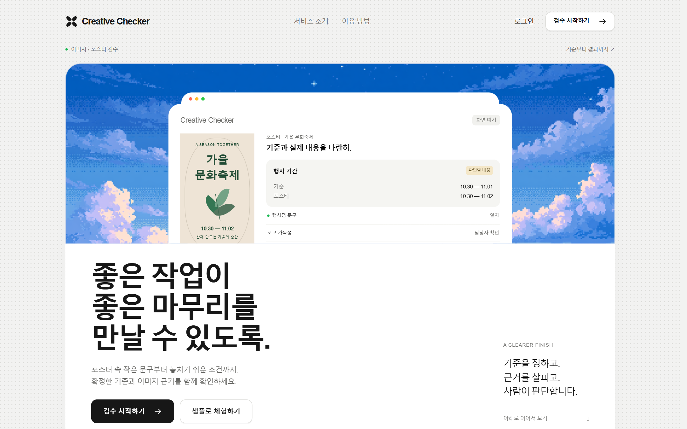
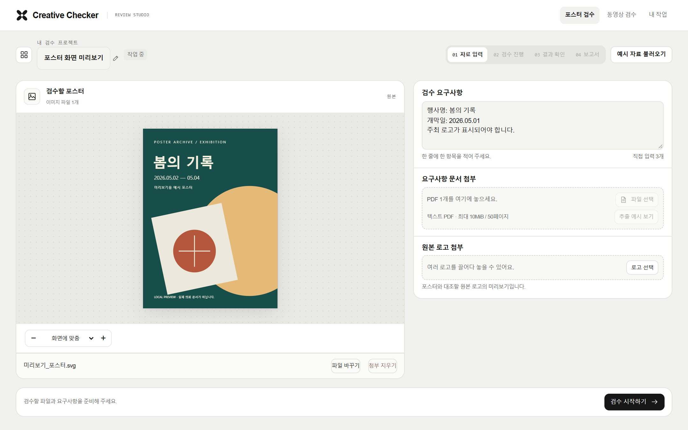
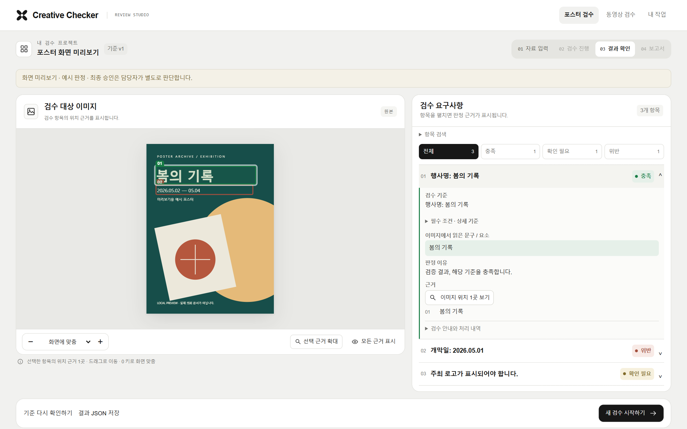
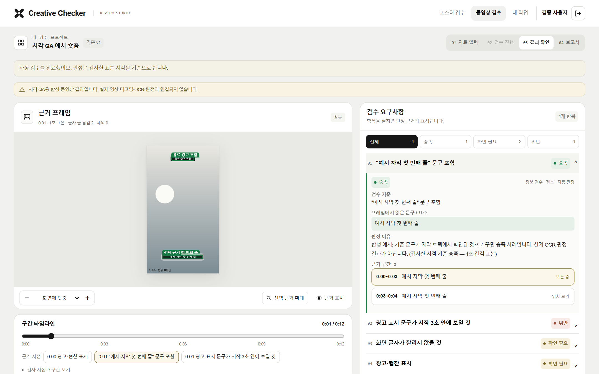
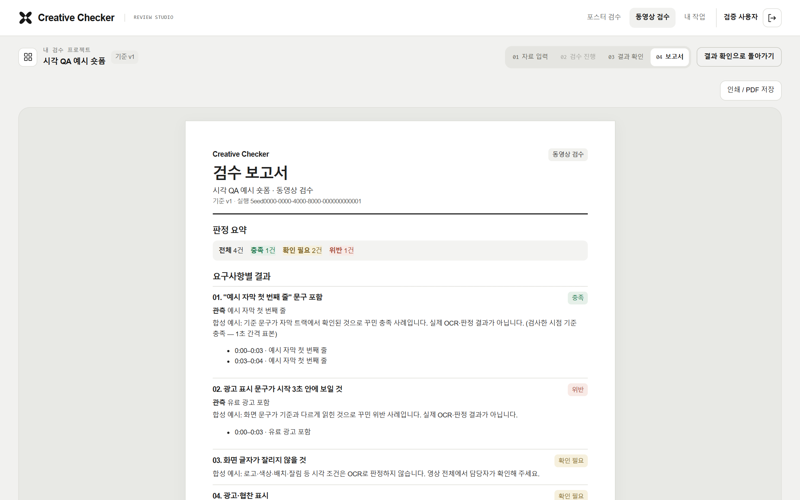
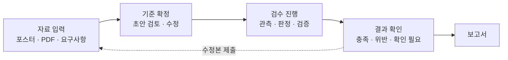
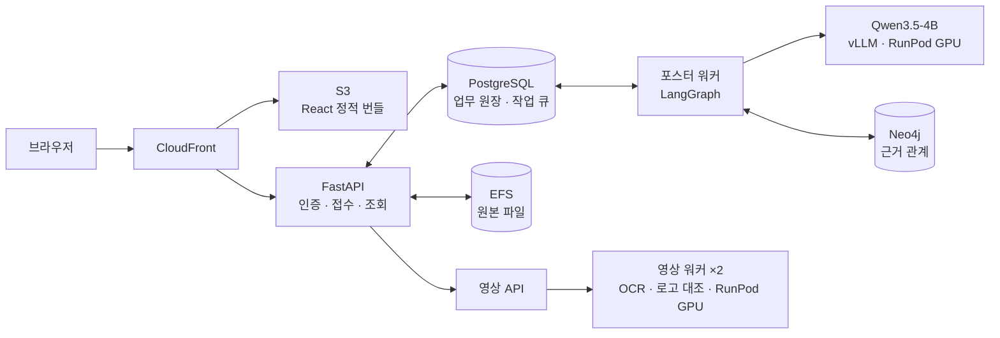

<div align="center">

# Creative Checker

### 기준을 정하고, 근거를 살피고, 사람이 판단합니다.

기준 문서의 요구사항과 포스터·동영상을 대조해<br>
항목별 판정과 그 근거를 한 화면에서 보여 주는 창작물 검수 서비스입니다.

<br>

[**서비스 열기**](https://d2fu4nse4xovsn.cloudfront.net) &nbsp;·&nbsp;
[주요 기능](#주요-기능) &nbsp;·&nbsp;
[빠른 시작](#빠른-시작) &nbsp;·&nbsp;
[아키텍처](#아키텍처) &nbsp;·&nbsp;
[문서](#문서)

<br>

[](https://github.com/20260528-skn-family-ai-33/SKN33-Final-1Team/actions/workflows/review-app.yml)
[](https://github.com/20260528-skn-family-ai-33/SKN33-Final-1Team/actions/workflows/agent-framework.yml)
[](https://github.com/20260528-skn-family-ai-33/SKN33-Final-1Team/actions/workflows/aws-main-frontend.yml)


<br>



</div>

<br>

## 왜 만들었나요

포스터 한 장을 검수하려면 기획서와 가이드에서 요구사항을 찾아 이미지와 하나씩 맞춰 봐야 합니다. 행사 기간이 하루 다르거나 필수 안내 문구가 빠져도 눈으로는 놓치기 쉽고, 어떤 기준으로 통과시켰는지는 파일과 메신저에 흩어져 나중에 찾기 어렵습니다.

Creative Checker는 이 과정을 **기준 → 근거 → 결과** 하나의 흐름으로 묶습니다. 문서에서 기준을 뽑아 담당자가 확정하고, 확정한 기준 전체를 창작물과 대조하고, 판정마다 원문과 화면의 근거를 붙입니다. 자동 판정은 담당자의 검토를 돕는 초안이고, 최종 승인은 사람이 합니다.

## 주요 기능

<table>
<tr>
<td width="50%" valign="top">

### 포스터 검수

PDF 기준 문서를 올리거나 요구사항을 직접 적으면 Qwen3.5-4B가 검수 기준 초안을 만듭니다. 기준마다 원문 출처가 남고, 문서에서 정해지지 않은 값은 임의로 채우지 않고 **미정**으로 표시합니다. 담당자가 기준을 확정하면 포스터 이미지와 항목별로 대조합니다.

</td>
<td width="50%" valign="top">

### 동영상 검수

영상에서 1초 간격으로 표본 프레임을 뽑아 자막과 표시 문구를 읽고, 기준별로 근거가 된 구간을 타임라인에서 바로 열어 볼 수 있습니다. 로고는 사용자가 영상 속 위치를 확정하면 원본과 정밀 대조한 근거를 제공합니다.

</td>
</tr>
<tr>
<td width="50%" valign="top">

### 근거 중심 결과

결과는 **충족 · 위반 · 확인 필요** 세 가지로 나뉩니다. 각 항목에서 기준 원문, 창작물에서 관측한 내용, 판정 이유를 나란히 확인합니다. 확신할 수 없는 항목은 통과시키지 않고 확인 필요로 남깁니다.

</td>
<td width="50%" valign="top">

### 검수 보고서

요구사항별 결과와 기대값·관측값, 검수 제한 사항, 담당자 승인 이력을 한 장의 보고서로 정리합니다. 브라우저 인쇄로 PDF 저장이 가능합니다.

</td>
</tr>
<tr>
<td width="50%" valign="top">

### 내 작업

문서 분석과 포스터·동영상 검수 이력을 다시 열 수 있습니다. 대기 중인 작업은 취소하고, 끝난 이력은 숨기거나 복원합니다. 숨겨도 원본과 결과, 승인 기록은 지워지지 않습니다.

</td>
<td width="50%" valign="top">

### 사람의 결정을 따로 기록

실행 상태, 기계 판정, 담당자 승인을 서로 다른 기록으로 관리합니다. 기준이나 창작물이 새 버전으로 바뀌면 이전 승인을 자동으로 이어받지 않습니다.

</td>
</tr>
</table>

## 화면

<table>
<tr>
<td width="50%"></td>
<td width="50%"></td>
</tr>
<tr>
<td align="center"><sub><b>자료 입력</b> · 포스터와 기준 문서를 올리고 기준을 확정합니다</sub></td>
<td align="center"><sub><b>결과 확인</b> · 기준과 관측 내용을 나란히 봅니다</sub></td>
</tr>
<tr>
<td width="50%"></td>
<td width="50%"></td>
</tr>
<tr>
<td align="center"><sub><b>동영상 검수</b> · 근거 프레임과 구간 타임라인</sub></td>
<td align="center"><sub><b>보고서</b> · 판정 요약과 요구사항별 결과, 인쇄·PDF 저장</sub></td>
</tr>
</table>

<sub>화면은 저장소에 포함된 예시 데이터로 캡처했습니다. 실제 검수 결과가 아닙니다.</sub>

## 이용 흐름



| 단계 | 하는 일 |
| --- | --- |
| **자료 입력** | 포스터 이미지(PNG·JPEG·WEBP)와 기준 문서 PDF를 올리거나 요구사항을 직접 입력합니다. 문서 분석 결과가 입력 카드 안에 항목별 문단으로 들어옵니다. |
| **기준 확정** | 추출된 기준을 검토하고 고치거나 제외합니다. 확정한 기준은 버전과 해시로 고정됩니다. |
| **검수 진행** | 확정한 기준 **전체**를 검사합니다. 진행률은 완료된 단계만 반영하고, 남은 시간을 추정해 보여 주지 않습니다. |
| **결과 확인** | 항목별 판정과 근거를 확인하고, 불확실한 항목은 담당자가 직접 보고 판단을 남깁니다. |
| **보고서** | 결과와 승인 이력을 정리해 공유합니다. |

판정 규칙은 단순합니다. 필수 조건에 확실한 위반이 있으면 **위반**, 불확실하거나 검사하지 못한 항목이 남으면 **확인 필요**, 모두 검사해 충족하면 **충족**입니다.

## 아키텍처



API는 요청을 검증하고 작업을 등록할 뿐 모델을 직접 실행하지 않습니다. 독립 워커가 PostgreSQL에서 작업을 가져가 처리하므로, 처리 중 서버가 재시작돼도 완료된 단계부터 이어집니다. PostgreSQL이 업무의 원본이고 Neo4j는 언제든 다시 만들 수 있는 관계 조회용 사본입니다. 벡터 DB는 쓰지 않습니다.

### 검수 파이프라인

| 역할 | 책임 | 구현 |
| --- | --- | --- |
| **A01** 실행 조정 | 단계 연결, 대기·실패·재개 관리 | 코드 |
| **A02** 기준 추출 | PDF·자유 입력에서 조건·기대값·원문 출처 구조화 | Qwen3.5-4B |
| **A04·A05** 통합 검사 | 포스터의 문구·시각 요소 관측, 조건별 판정 초안 | Qwen3.5-4B |
| **A06** 결과 검증 | 조건 누락·근거·모순·불확실성 점검 | 코드 |
| **A07** 보고 | 검증된 판정으로 설명과 수정 요청 초안 작성 | Qwen3.5-4B |
| **A08** 재검수 연결 | 수정본을 새 실행으로 연결 | 코드 |

A02 다음에는 반드시 사람의 기준 승인을 거칩니다. 역할 사이의 입출력은 버전이 있는 JSON 계약(현재 3.0.0)으로 고정돼 있어, 담당자가 자기 역할의 어댑터만 바꿔 끼울 수 있습니다.

## 기술 스택

| 영역 | 사용 기술 |
| --- | --- |
| 프런트엔드 | React 19, React Router 7, Vite 7, TypeScript(타입 검사), Playwright |
| 백엔드 | Python 3.12, FastAPI, Pydantic 2, SQLAlchemy 2, Alembic |
| 에이전트 | LangGraph, MCP, Qwen3.5-4B(vLLM) |
| 데이터 | PostgreSQL 17, Neo4j |
| 영상 | FFmpeg, PaddleOCR(자막), 로고 대조 모델 |
| 인프라 | AWS CloudFront · S3 · EC2 · RDS · EFS, RunPod GPU, Docker, GitHub Actions |

## 빠른 시작

### 화면만 둘러보기

백엔드와 모델 없이 예시 데이터로 전체 화면을 확인합니다. Node.js 20.19 이상이 필요합니다.

```bash
npm --prefix frontend ci
```

```bash
npm --prefix frontend run dev:ui
```

`http://localhost:5173`을 엽니다. 이 모드는 인증과 API 호출을 하지 않으며 실제 검수 기록을 만들지 않습니다.

### 검수 흐름 실행해 보기

모델과 DB 없이 메모리에서 기준 승인 → 검사 → 보고 → 재검수까지 한 바퀴 돕니다. Python 3.12와 [uv](https://docs.astral.sh/uv/)가 필요합니다.

```bash
uv sync --locked --group dev
```

```bash
uv run --locked --no-sync python -m backend.agent_framework demo
```

출력은 합성 데이터이며, 그 안의 승인도 스크립트가 넣은 테스트 값입니다.

### 전체 스택 실행

실제 검수에는 PostgreSQL, Qwen3.5-4B 엔드포인트, 환경 파일이 필요합니다. macOS와 Windows 모두 같은 실행기로 Docker 안의 Linux 런타임을 사용합니다.

```bash
python scripts/framework_desktop.py doctor
```

```bash
python scripts/framework_desktop.py build
```

이후 설정 생성, 마이그레이션, API·워커 실행 순서는 [Mac·Windows 공통 실행 가이드](docs/agent-framework/Mac_Windows_공통실행_가이드.md)를, 환경 파일은 [환경 설정](docs/environment.md)을 따릅니다. 실제 `.env`는 저장소에 포함하지 않습니다.

### 테스트

```bash
uv run --locked --no-sync pytest -q
```

```bash
npm --prefix frontend test
```

DB·실모델이 필요한 통합 검사는 기본 실행에서 제외되며 마커로 따로 실행합니다.

## 저장소 구조

```text
├── frontend/                 React 앱
│   ├── src/pages/review/     포스터 검수 · 내 작업 · 보고서
│   ├── src/pages/video/      동영상 검수 · 로고 확정
│   └── tests/e2e/            브라우저 회귀 검사
├── backend/
│   ├── agent_framework/      역할 계약 · LangGraph 실행 · API · 워커 · 마이그레이션(AF001–AF005)
│   ├── app/                  인증 · 영상 검수 API
│   └── a07_reporter/         보고서 생성
├── scripts/                  실행기 · 벤치마크 · 문서 빌드
├── deploy/ · docker/         배포 구성
├── tests/                    백엔드 테스트
├── experiments/              모델 비교 실험
└── docs/                     설계 · 운영 · 검증 기록
```

## 문서

| 문서 | 내용 |
| --- | --- |
| [에이전트 프레임워크 안내](docs/agent-framework/README.md) | 역할별 계약, 어댑터 연결 위치, 가이드 전체 목록 |
| [업무 흐름도](docs/agent-framework/flow.html) | 검수·재검수 시나리오를 탐색하는 단일 HTML |
| [A02 실행·사용 가이드](docs/agent-framework/A02_실행_사용가이드.md) | PDF 기준 추출을 처음부터 실행하는 순서 |
| [영상 로고 확정·대조 API](docs/video-logo-flow-api.md) | 동영상 검수의 로고 흐름과 워커 연결 |
| [AWS 운영 현황](docs/agent-framework/AWS_인프라_운영현황_20261110.md) | 배포 구성, 검증 범위, 복구 절차 |
| [AWS 구축 설정 인수인계](docs/agent-framework/AWS_구축_설정_인수인계_20261110.md) | 서버 설정과 확인 명령 |
| [환경 설정](docs/environment.md) · [코드 구조](docs/code-structure.md) | 환경 파일, 의존성, 파일 위치와 명명 규칙 |
| [논리 ERD](docs/ERD_논리.md) · [물리 ERD](docs/ERD_물리.md) | 데이터 모델 |
| [프로젝트 공통 맥락](docs/프로젝트_공통맥락.md) | 날짜별 결정과 검증 기록 |

초기 OCR 시제품의 비교 실험은 [Paddle 단독 비교](docs/ocr-paddle-only-2026-10-13.md)와 [OCR benchmark 안내](docs/ocr-benchmark.md)에, 당시 실행 방법은 [실행가이드](실행가이드.md)에 남아 있습니다.

## 현재 범위

팀 개발·발표용 환경에서 운영 중이며, 상시 가동과 장기 부하는 보장하지 않습니다.

| 지원 | 제외·제한 |
| --- | --- |
| 기준 문서 PDF, 자유 텍스트 입력 | DOCX·HWPX 기준 문서 |
| PNG·JPEG·WEBP 포스터 | 모바일·태블릿 화면 (데스크톱 기준) |
| 동영상 자막·표시 문구·로고 근거 | 음성, 미적 판단 |
| 회원가입·로그인, 프로젝트 권한 | 이메일 소유 확인, 비밀번호 재설정 |

로고는 일치 여부를 자동으로 단정하지 않고 대조 근거만 제공합니다. 업로드한 자료는 모델 학습에 쓰지 않습니다.

## 팀

SK네트웍스 Family AI 캠프 33기 최종 프로젝트 1팀

| 이름 | 담당 |
| --- | --- |
| 김일환 | 통합 · API · DB |
| 김성훈 | 문서 · 기준 추출 · 문구 검사 |
| 안정민 | 시각 모델 · 평가 |
| 주상현 | 동영상 검수 |
| 최지흠 | 화면 · 보고서 · 실행 프레임워크 |

## 기여

모든 변경은 Issue에서 시작해 `main` 대상 PR로 병합합니다. 브랜치·커밋·PR 규칙은 [CONTRIBUTING.md](CONTRIBUTING.md)를 따릅니다.
