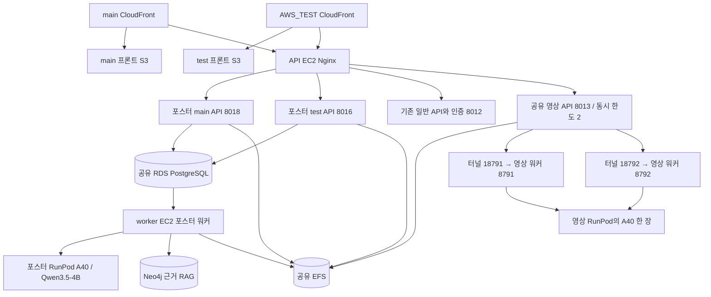

# Creative Checker AWS 인프라 운영 현황

문서 ID: `AWS-OPS-20261110` · 작성일: 2026-11-10 · 시간대: KST  
관련 이슈: [#75 AWS 구현](https://github.com/20260528-skn-family-ai-33/SKN33-Final-1Team/issues/75) · 병합 PR: [#77 AWS_TEST → main](https://github.com/20260528-skn-family-ai-33/SKN33-Final-1Team/pull/77)

설정·접속·복구 순서와 명령은 [AWS 구축 설정 인수인계](AWS_구축_설정_인수인계_20261110.md)를 따른다. 이 문서는 배포 상태와 검증 기록을 정리한다.

**포스터와 영상은 서로 다른 RunPod를 사용한다. 영상 워커 두 개는 영상용 A40 한 장에서 실행되며, main과 AWS_TEST가 영상 API의 동시 처리 한도 2를 공유한다.** 프론트는 브랜치별로 자동 배포되지만 API·워커·CloudFront Function은 별도 반영 대상이다.

이 문서는 11월 9일 원본 `AWS_인프라_구축현황_20261109.md`의 후속 운영 문서다. 원본은 수정하지 않았다. 서버 내부 구성은 **11월 9일 적용·검증 기록**, GitHub와 공개 HTTP 상태는 **11월 10일 08:58 재조회**로 구분한다. 이번 문서 작업에서는 서버 설정 변경이나 새 모델 검수를 실행하지 않았다.

## 1. 지금 확인된 상태

| 대상 | 확인 결과 | 근거·확인 시점 |
|---|---|---|
| 원격 main | `8f29d56`, PR #76 병합 상태 | 11/10 Git 조회 |
| 원격 AWS_TEST | `dc859fa`, main 병합 PR #77은 OPEN | 11/10 Git·PR 조회 |
| main 프론트 | `8f29d56`의 build·deploy 성공 | [Actions 42545426531](https://github.com/20260528-skn-family-ai-33/SKN33-Final-1Team/actions/runs/42545426531), 11/09 실행 |
| AWS_TEST 프론트 | `dc859fa`의 build·deploy 성공 | [Actions 42724118586](https://github.com/20260528-skn-family-ai-33/SKN33-Final-1Team/actions/runs/42724118586), 11/10 08:54 완료 |
| 포스터 API·워커, 공유 영상 API | `ca7f01c` 소스 반영 | [11/09 서버 적용 기록](AWS_main_머지전_반영_20261109.md). 이후 HEAD까지 backend 변경 없음은 11/10 Git diff로 확인 |
| 양 사이트 포스터 health | HTTP 200, `task_controls=true`, `poster_review_ready=true` | 11/10 공개 GET 재조회 |
| 양 사이트 화면 직접 접속 | `/`, `/login`, `/review/new?framework=…`, `/review/tasks`, `/video`, `/video/logo` 모두 HTTP 200 HTML | 11/10 공개 GET 재조회. 로그인·화면 렌더링·검수 성공을 대신하지 않음 |
| 양 사이트 영상·로고 status | 비로그인 요청에 HTTP 401 JSON | 11/10 공개 GET 재조회. GPU 준비 상태를 확인한 것은 아님 |
| 없는 정적 파일 | `/assets/aws-doc-check-not-found.js`가 HTTP 403 XML | 11/10 재조회. 모든 403을 HTML로 바꾸지 않음 |

11/10 조회는 배포 작업 성공과 공개 경로 응답을 확인한 것이다. 최신 브라우저 번들의 화면 검증과 파일별 배포 산출물 해시 대조는 다시 하지 않았다. health의 `production_ready=false`도 유지된다. 전체 운영 품질 검증 완료를 뜻하는 값으로 바꾸지 않는다.

## 2. 연결 구조와 저장소



| 리소스 | 주소·식별자 | 역할 |
|---|---|---|
| AWS | 계정 `357297649391`, `ap-northeast-2` | 팀 개발·발표 환경 |
| main CloudFront | `E1LYR5RFZBQOT8` · [메인 사이트](https://d2fu4nse4xovsn.cloudfront.net) | main 프론트·API 연결 |
| test CloudFront | `ESI2WHFLU88QT` · [테스트 사이트](https://d3navmtcjn23y2.cloudfront.net) | AWS_TEST 프론트·API 연결 |
| 프론트 S3 | main `creative-checker-frontend-20261106-jh`; test `creative-checker-frontend-test-20261108-jh` | 별도 정적 번들 |
| API EC2 | `i-00fc16b9aa2c5db6b`, `13.125.155.245`, 내부 `172.31.4.245`, t3.medium | Nginx·인증·포스터 API·영상 API 및 FFmpeg |
| worker EC2 | `i-0363417d6cbbd3fdd`, `43.201.194.165`, 내부 `172.31.21.11`, t3.large | 포스터 작업 실행·Qwen 터널 |
| Neo4j EC2 | `i-0e827f54bb4de92d8`, 내부 `172.31.1.222`, t3.medium | 기존 근거 그래프 |
| RDS | PostgreSQL 17, 기존 M008 및 AF001–AF005 | 사용자·프로젝트·포스터 작업·기준·승인·감사 원장 |
| EFS | `fs-0f05f47f8a4bd01db`, `/mnt/creative-checker-efs` | API·worker 공유 파일 저장소, TLS 마운트 |
| 포스터 RunPod | SSH `194.68.245.192:22045` → 내부 SSH 22 | 별도 A40, Qwen 내부 `127.0.0.1:8015` |
| 영상 RunPod | SSH `194.68.245.204:22152` → 내부 SSH 22 | 별도 A40, OCR·로고 워커 `127.0.0.1:8791`, `8792` |

EC2 크기·EFS·RunPod 정보는 11/09 기록이다. Pod 재생성 시 IP·외부 SSH 포트가 바뀔 수 있으므로 Connect 화면과 호스트 키를 다시 확인한다. `IP:외부포트:22` 전체를 HTTP 주소나 SSH 포트로 쓰지 않는다. 과거 11/06 채팅의 `69.30.85.39:22195`는 현재 연결값으로 복사하지 않는다.

포스터 파일은 EFS의 `service-storage` 아래 PDF·포스터 경로를 컨테이너 `/data`로 공유한다. 영상은 `video-aws-test` 경로를 계속 사용한다. **이름에 test가 있어도 현재 영상 API와 저장소는 main·test 공용**이다. 계정 접근 권한은 분리하지만 DB·EFS까지 독립된 시험 환경은 아니다.

## 3. 배포된 실행 단위

| 위치 | 실행 단위 | 연결·주의사항 |
|---|---|---|
| API EC2 | `creative-checker-framework-main-ca7f01c` | main 포스터 API, `127.0.0.1:8018`, 이미지 `creative-checker-framework-api:main-ca7f01c` |
| API EC2 | `creative-checker-framework-aws-test-tasks` | 테스트 포스터 API, `127.0.0.1:8016`, 이미지 태그 `aws-test-tasks-f7d78b6`는 최초 준비 시점 이름 |
| API EC2 | 기존 API `8012`, 이전 test API `8014` | 일반 `/api/` 인증 경로·이전 실행 호환을 위해 보존. 모든 API가 새 포트로 바뀐 것은 아님 |
| worker EC2 | `creative-checker-worker-worker-main-1` | 새 main용 이미지, 최신 runtime 처리 |
| worker EC2 | `creative-checker-worker-worker-aws-test-tasks-1` | 위 워커와 같은 최신 runtime으로 공유 큐 처리 |
| worker EC2 | `creative-checker-worker-qwen-tunnel-1` | `18015` → 포스터 RunPod `8015`, 워커가 터널 네트워크 사용 |
| API EC2 | `creative-checker-video-aws-test` | 공유 영상 API, `127.0.0.1:8013`, 이미지 `creative-checker-video:shared-ca7f01c` |
| API EC2 | `creative-checker-video-test-tunnel.service`, `creative-checker-video-test-tunnel-2.service` | 각각 `18791` → `8791`, `18792` → `8792`, 11/09 active·enabled 확인 |

최신 포스터 워커는 두 개지만 사이트별 전용 큐는 아니다. 이전 runtime 워커도 남아 있어 전체 컨테이너 수와 최신 워커 수를 혼동하면 안 된다. 작업은 접수 시 고정된 **runtime·설정 digest**가 맞는 워커가 가져간다. 새 배포에서 API와 워커를 함께 맞추고, 이전 실행이 남아 있는 동안 이전 워커를 제거하지 않는다.

11/09 최신 포스터 API·워커의 일치값:

- runtime SHA256: `98a47974fbcd25051ca93c52ac2de0128e10c14ad9a301bebd2fe272a7860e53`
- configuration SHA256: `8e95749c371a782d29a48d9e6a65483b9c63d34dd91a567f0d25c257c6a6b0f1`

이미지 태그·Git 브랜치 이름만으로 일치를 판정하지 않는다. `team.json` 원문 파일 해시와 실행기가 계산한 설정 digest도 같은 개념이 아니다. 워커 쪽 모델 주소만 임의로 바꿔 설정을 달리하면 큐가 멈출 수 있다.

영상 API는 **한 프로세스**를 유지한다. `VIDEO_MAX_ACTIVE=2`, 기본 워커 주소 `http://127.0.0.1:18791`, 보조 주소 `http://127.0.0.1:18792`로 연결한다. 영상마다 배정한 슬롯을 자막 OCR·로고 후보·정밀 대조에서 재사용한다. 각 워커는 한 번에 한 작업을 처리한다. 같은 EFS에 두 API를 띄워 한도를 늘리지 않는다. 저장소 잠금과 접수 한도가 충돌한다.

## 4. 완료한 시험과 남은 검증

아래는 **채팅·배포 기록에 남은 당시 시험**이다. 11/10에 재실행한 시험이 아니다.

| 날짜·대상 | 확인한 결과 | 경계·미확인 |
|---|---|---|
| 11/06 로컬 A02 | 기존 대기 실행 `818a6835-e627-5bcb-825c-a5310068d673`, 약 99.69초, 조건 13개, `waiting_criteria` | 로컬 연결 복구·실제 PDF 추출. AWS 전체 검수나 기준 승인 아님 |
| 11/09 EFS | API·worker 양쪽에서 같은 테스트 파일 읽기·쓰기, 짧은 동시 접근에서 잠금·저장 확인, PDF 해시 일치 | 장시간 부하·장애 복구 미검증. 포스터 파일의 양 서버 해시 대조는 당시 미완료 |
| 11/09 PDF 병렬 | `AWS EFS 동시검증 20261109 A`, `B` 프로젝트에서 약 65초 실행 중첩, 각각 13개 기준 추출 | 같은 계정 시험. 서로 다른 사용자 PDF 동시 사용의 증거는 아님 |
| 11/09 전시 포스터 | 지정한 `전시_포스터_제작의뢰서_v0.2.pdf`와 `전시_포스터.jpg` 사용. 사용자 허락으로 c013 제외, 12개 기준 승인 후 검수·보고서 생성 | 확인 필요 12·통과 0·불충족 0. 자동 초안이며 최종 담당자 승인 미실행. B 프로젝트는 기준 승인 전 |
| 11/09 영상 한 건 | 속초 29.9초·69.8MB 영상, GPU OCR 52프레임, 접수→결과 66초. “모든 날의 행복” 충족, 근거 재생·EFS 원본 해시 일치 | 한 영상의 자막 경로 시험이며 처리시간은 SLA가 아님 |
| 11/09 로고 | 속초 원본 로고 → 후보 탐색 → 심볼 포함 후보 확정 → 29초 영역 정밀 대조, 차이 근거 없음 1초 | 선택한 구간의 결과. 전체 영상·모든 로고 품질 보장 아님 |
| 11/09 영상 두 건 | 서울·속초 7초 1080p, video-1·video-2 배정. 자막 OCR 28·30프레임, 후보 탐색·선택 영역 정밀 대조 모두 완료. OCR 17.6초, 후보 탐색 44.6초 실행 중첩 | 같은 A40의 두 프로세스 검증. 장시간·고해상도·최대 업로드 부하 미검증 |
| 11/09 PDF 오류 수정 | 같은 해시의 축제 PDF를 새 테스트 프로젝트로 접수, 약 2분 17초 후 기준 19개 + 확인 필요 c020 1개 저장 | [실행 a9921a0c](https://d3navmtcjn23y2.cloudfront.net/review/new?framework=a9921a0c-4f56-5537-a394-6c252a053c37), 기준 확인 단계까지. 이전 실패 실행 보존 |
| 11/09 내 작업 | 격리 DB 통합 30개·관련 backend 49개·프론트 126개·UI 8개 등 통과. 실제 테스트 사이트 실패 이력 숨김→복원 | 실제 AWS 모델 작업의 취소 시험은 하지 않음. 선점/취소 경쟁은 격리 DB 검증 |
| 11/09 main 준비 반영 | 공개 경로·인증·포스터 health, 영상 WorkerPool 2/2 및 각 워커 ready 확인 | main 전환 뒤 새 파일 업로드→결과까지 실모델 재실행하지 않음 |

전시 PDF·포스터 원본 위치는 사용자가 지정한 `최종프로젝트/alpha_test`다. 영상은 사용자가 지정한 `OneDrive_2026-11-09` 자료를 사용했다. 테스트 프로젝트·승인·제외 사유·결과는 기존 데이터와 함께 보존했다.

11/09 main 준비 배포의 보존 비교에서는 영상 JSON **136개**의 해시가 같았고 PostgreSQL은 runs 48, jobs 48, steps 75, approvals 20, events 339로 전후 동일했다. 이는 **그 배포 시점의 스냅샷**이며 현재 전체 건수로 사용하지 않는다.

포스터와 영상이 별도 GPU라는 사실은 확인했지만, **포스터 한 건과 영상 한 건을 동시에 시작해 둘 다 끝나는 교차 시험의 완료 근거는 이번에 읽은 기록에서 확인하지 못했다.** 영상 두 건 병렬 시험으로 대신 완료 처리하지 않는다. API EC2의 업로드·FFmpeg·CPU·메모리·네트워크는 여전히 공유한다.

## 5. 장애별 확인 방법

### PDF가 약 2분대에 `A02_RESPONSE_INVALID`로 끝남

11/09 실패 원인은 Qwen이 미정 조건에 `target=poster_text`, `field=unspecified`를 반환해 기준 계약 검증이 거부된 것이었다. 당시 요청 제한은 600초였으므로 2분 20초라는 시간만으로 타임아웃을 단정하지 않는다.

[a02_semantic.py](../../backend/agent_framework/a02_semantic.py)는 기대값이 없고 미정인 `field=unspecified` 항목에 한해 `target=unspecified`, `kind=unsupported`로 보존한다. 원문 근거 검증을 유지하며 기대값을 생성하지 않는다. 이 수정의 관련 검사 176개와 위 축제 PDF 재실행을 확인했다. 이미지형 PDF 미지원·원문 근거 불일치는 별도 실패 원인이므로 이 보정으로 해결됐다고 묶지 않는다.

### `queued`가 계속되거나 `failed` 로그가 많음

- 먼저 실행 ID·시각·현재 상태·attempt를 구분한다. 워커의 `completed` 한 줄은 최종 승인 완료가 아니며, `framework_worker_ready`는 시작 준비 표시다.
- 대기 실행에 맞는 runtime·설정 digest의 워커가 있는지, EFS 마운트·Qwen 터널·모델 health가 각각 정상인지 확인한다.
- 11/09 15:58 조회에서 대기 0, 포스터 실행 중 1건이었다. 실패 12건은 모두 시도 1회·자동 재대기 0건이었다. 누적 실패 기록을 반복 검사하는 상황은 아니었다.
- 실패 분류는 응답 검증 9, 이미지형 PDF 미지원 2, 원문 근거 검증 1건이었다. 과거 로그를 지우거나 DB를 초기화해 해결할 문제가 아니다.
- `QWEN_OUTCOME_UNKNOWN`은 실제 호출 결과를 모르는 상태다. 자동 재호출하지 않고 요청·응답·서버 실행 흔적부터 확인한다.

worker EC2에서 앞으로 나오는 최신 워커 로그만 볼 때:

```bash
sudo docker ps --format 'table {{.Names}}\t{{.Image}}\t{{.Status}}'
sudo docker logs --follow --tail 0 --timestamps creative-checker-worker-worker-main-1
```

테스트 워커는 컨테이너 이름을 `creative-checker-worker-worker-aws-test-tasks-1`로 바꾼다. 예전 `docker compose logs worker`는 이전 서비스의 로그일 수 있다. `Ctrl+C`는 로그 조회만 끝내며 서버 작업을 취소하지 않는다.

### 영상 대기·OOM과 포스터 실행 중 영상 CPU 상승

초기 `VIDEO_MAX_ACTIVE=1`과 단일 실행 잠금은 영상 두 건 병렬 처리를 제한했다. 현재 구성은 두 슬롯 분배와 한도 2를 함께 적용한 것이다. 설정 숫자만 올리는 방식으로는 충분하지 않았다.

영상 Pod에서는 별도 Qwen3.5-9B vLLM 프로세스가 VRAM을 크게 점유한 기록도 있었다. 로고 후보 탐색의 OWLv2가 추가 1.16GiB를 요구할 때 여유 약 947MiB로 OOM이 났다. 따라서 **영상 Pod CPU 상승만으로 포스터가 잘못 연결됐다고 판단하지 않는다.** 요청 목적지·작업 ID·프로세스와 GPU 메모리를 대조한다. 다른 팀원의 모델을 임의로 종료하거나 기존 캐시 전체를 삭제하지 않는다.

RunPod 내부 Terminal에서 읽기 전용 점검:

```bash
nvidia-smi
ss -ltn
```

Mac의 `ssh` 접속 명령을 RunPod Jupyter Terminal 안에서 다시 실행하지 않는다. 영상 Python 설치 중 `/workspace`의 uv 캐시 권한 오류는 전용 `/opt` 캐시 경로로 해결했고, 0바이트 모델 설정 파일 문제는 정상 캐시를 지정해 복구했다. 두 문제 모두 모델 전체 재설치가 원인 확인의 첫 단계는 아니었다.

### 새로고침 시 S3 `AccessDenied` XML

main `main-spa-rewrite`, test `aws-test-spa-rewrite` Function을 기본 동작의 `viewer-request`에 연결했다. 정본은 [aws-test-spa-rewrite.js](../../deploy/agent-framework/aws-test-spa-rewrite.js)다. GET/HEAD의 허용된 화면 경로를 `/index.html`로 보내고 query를 유지한다. API·정적 파일·POST는 바꾸지 않는다.

11/09 적용 allowlist는 `/login`, `/review/new`, `/review/tasks`, `/video`, `/video/logo`, `/modeltest`다. 새 화면 경로는 프론트 배포만으로 Function에 추가되지 않는다. 최신 프론트에서는 모델 테스트 화면이 제거됐으므로 `/modeltest`의 HTML 200을 현재 기능 제공 증거로 해석하지 않는다.

재발하면 정확한 URL·메서드·HTTP 상태·응답 형식을 먼저 남긴다. 화면 경로 403인지, 존재하지 않는 파일 403인지, 애플리케이션 인증 401인지 구분한다. S3 전체 공개나 API까지 포함한 일괄 403→200 변경으로 처리하지 않는다.

## 6. 데이터 삭제 없이 작업 정리

[내 작업 관리](내_작업_관리.md)의 `/review/tasks`에서 **자기 문서·포스터 작업**을 관리한다. 영상 작업은 이 목록의 대상이 아니다.

- **대기 취소:** 워커 선점 전 자기 작업만 가능. 선점이 먼저면 409로 거절한다. 처리 중 작업을 강제 종료하지 않는다.
- **이력 숨기기/복원:** 종료된 자기 실행의 표시만 바꾼다. 원본·결과·기준·승인·감사 기록과 기존 링크는 보존한다.
- 기준 확인·포스터 등록·담당자 승인 등 사람이 해야 할 단계와 결과 불명 상태는 숨기지 않는다.
- 취소는 기존 DB 상태 `failed`와 오류 코드 `USER_CANCELLED`로 저장하고 UI에서 취소됨으로 표시한다. 운영 실패 집계에서 모델 오류와 분리한다.

새 스키마 마이그레이션이나 전체 clear 명령은 없다. 공유 DB·EFS를 초기화하거나 오래된 실행을 일괄 삭제하지 않는다.

## 7. push·PR·배포 순서

| 변경 | 자동 처리 | 별도 작업 |
|---|---|---|
| AWS_TEST push | 테스트 프론트 npm ci·test·build, S3 업로드, `/`·`/index.html` 무효화 요청 | build뿐 아니라 deploy 성공 확인, 실제 화면 확인 |
| main merge/push | main 프론트 같은 절차 | PR 병합 후 해당 SHA의 Actions와 메인 화면 확인 |
| 포스터 backend | 없음 | 동일 소스로 API·워커 이미지 준비, digest 일치 및 이전 실행 처리 확인 |
| 영상 backend·워커 | 없음 | API/RunPod 코드·터널·두 슬롯 준비 확인, 유휴 전환·보존 검증 |
| 새 화면 경로·API 원본 | 없음 | CloudFront Function/Behavior와 Nginx 변경·전파 확인 |

워크플로 정본은 [aws-test-frontend.yml](../../.github/workflows/aws-test-frontend.yml), [aws-main-frontend.yml](../../.github/workflows/aws-main-frontend.yml)이다. 빌드 시 `VITE_API_PROFILE=legacy`를 사용한다. 기존 S3 산출물을 자동 삭제하지 않는다.

GitHub OIDC 역할은 `CreativeCheckerAwsTestFrontendDeploy`, `CreativeCheckerMainFrontendDeploy`이며 Actions **Variables**의 `AWS_TEST_DEPLOY_ROLE_ARN`, `AWS_MAIN_DEPLOY_ROLE_ARN`을 사용한다. test는 변수가 없으면 deploy를 건너뛰고 main은 오류로 종료한다. 자세한 최초 설정은 [프론트 CI/CD](../AWS_TEST_프론트_CI_CD.md)를 따른다. OIDC 목록이 비었는데 생성 시 `EntityAlreadyExists`가 나면 계정·profile과 공급자 단건 조회부터 확인한다. 기존 공급자를 삭제하거나 다시 만들지 않는다. AttachedPolicies가 비어 있어도 inline 정책은 별도로 존재할 수 있다.

11/10 기준 PR #77은 미병합이다. PR #78은 영상 UI를 **AWS_TEST로** 병합한 PR이다. `ca7f01c` 이후 현재 `dc859fa`까지 backend는 같으므로 그 범위 그대로 main에 병합한다면 11/09 인프라 준비를 반복할 필요는 없다. 병합 전에 추가 backend 변경이 들어오면 다시 비교한다. 이 문서 작성으로 PR·브랜치 보호·배포 자동화 설정을 바꾸지는 않았다.

## 8. 복구 기준과 다음 확인

세부 백업 위치와 복구 순서는 [main 머지 전 반영 기록](AWS_main_머지전_반영_20261109.md)의 복구 절차를 따른다. root 전용 백업에는 비밀값이 있을 수 있으므로 내용을 Git·PR·채팅에 복사하지 않는다.

- 포스터: 새 API를 되돌리더라도 새 runtime에 고정된 작업이 남으면 해당 워커를 유지한다. DB 역마이그레이션·원본 삭제는 하지 않는다.
- 영상: 자막·후보·정밀 대조가 모두 유휴인지 확인하고 접수 전환 후 API 하나만 교체한다. 이전 API는 test Origin만 허용하므로 main 라우팅 복구도 함께 검토한다.
- CloudFront: 현재 ETag와 변경분을 새로 읽고 복구한다. 다른 팀의 후속 설정을 과거 전체 설정으로 덮어쓰지 않는다.
- EFS: 먼저 마운트를 확인한다. 기존 저장소에 초기화 스크립트나 디렉터리 삭제를 다시 실행하지 않는다. 마운트 실패 시 로컬 디스크에 대신 쓰지 않도록 부팅 복구 점검이 필요하다.

남은 확인 항목:

- [ ] PR #77 병합 후 해당 main SHA의 프론트 배포·로그인·내 작업·포스터·영상 UI 확인.
- [ ] 최신 main에서 PDF 업로드→기준 검토/승인→포스터→보고서까지 재검증. 최종 담당자 승인은 별도 사용자 판단으로 남김.
- [ ] 포스터 한 건과 영상 한 건의 동시 실행·각 RunPod 처리·양쪽 결과 완료 확인.
- [ ] 서로 다른 사용자의 PDF 동시 실행과 포스터 파일의 API/worker 양쪽 해시 대조.
- [ ] 긴 영상·큰 파일·두 작업 동시 처리에서 EC2 CPU/메모리·크레딧, GPU VRAM, 지연 계측. 필요 시 영상 API/FFmpeg EC2 분리 판단.
- [ ] EC2 재부팅·EFS 미마운트·터널 단절·RunPod 재시작/주소 변경 후 복구 시험. enabled/restart 정책만으로 검증 완료 처리하지 않음.

## 9. 근거와 문서 연결

| 근거 | 이번에 반영한 범위 |
|---|---|
| [현재 AWS 작업 채팅](thread://01a1b9f2-e400-7b43-8725-503362268ac6?hostId=local) | 11/09 EFS·포스터 전체 흐름, 영상 연결·병렬 OCR/로고, PDF 오류, 내 작업, main 준비 반영의 사용자 요청·결과 |
| [에이전트 : pdf read A02](thread://01a18ad6-9188-7763-8aef-d4cd95ec9342?hostId=local) | AWS 준비·OIDC·프론트 배포와 진행 화면의 최근 관련 턴. 과거 전체 턴을 이번에 다시 읽은 것은 아님 |
| [A02 PDF 내용 분석](thread://01a1ab3e-ae65-7eb1-b41d-c0fb48318467?hostId=local) | 로컬 Qwen 연결 복구, 실제 추출과 승인 경계, 대기·처리 표시·결과 불명 실행 보존 |
| 11/09 외부 원본 문서 | API/worker/Neo4j EC2 분리·EFS·RDS 및 당시 미검증 목록. 원본 경로: `최종프로젝트/AWS_인프라_구축현황_20261109.md` |
| [11/09 main 반영 기록](AWS_main_머지전_반영_20261109.md) | 배포 단위·digest·CloudFront·데이터 보존·백업/복구 정본 |
| [영상 연결 문서](../video-logo-flow-api.md) / [내 작업 관리](내_작업_관리.md) | 두 워커 분배·영상 결과 범위 / 취소·숨김 계약과 검증 |

11/05의 [AWS HTTPS 배포 준비](AWS_전체검수_HTTPS_배포준비.md)는 단일 EC2/EBS 설계 시점 문서다. 현재의 분리 EC2/EFS 운영 구성과 혼용하지 않는다. 기존 문서의 “미완료”는 위 날짜별 실제 검증 결과로 보완하되, 장기 부하·장애 복구·최종 사람 승인까지 확대해서 해석하지 않는다.
