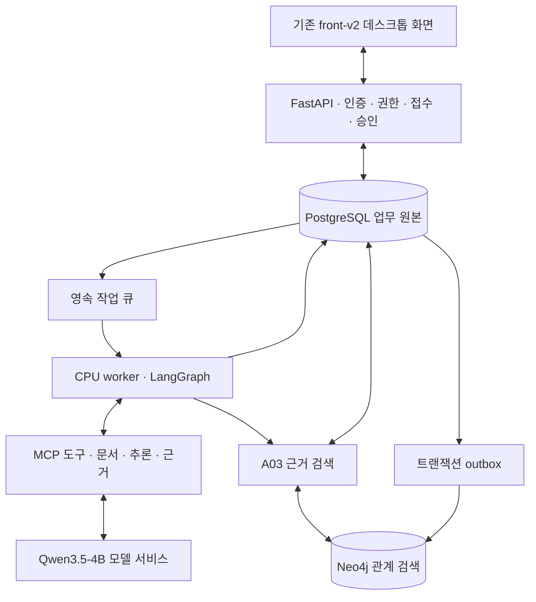
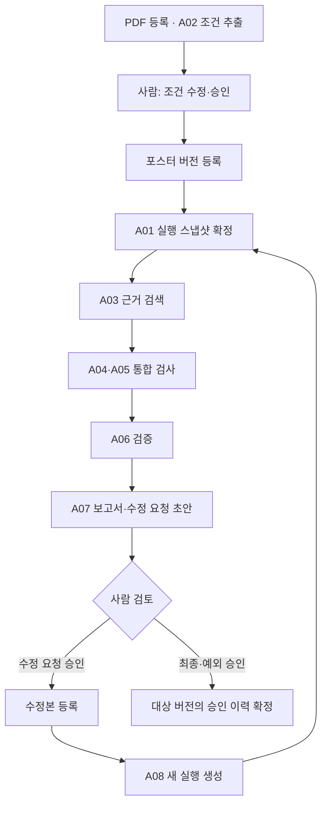

# Creative Checker — PDF·Qwen·PostgreSQL·Neo4j RAG 구현 계획

- 작성일: 2026-11-02 (Asia/Seoul)
- 상태: **계획 문서 — 실제 통합 구현·배포 완료를 의미하지 않음**
- 코드 조사 기준: `feat/29-front-v2`, `376946f`
- 1차 대상: **데스크톱 웹 / PDF 기준 문서 / 포스터 이미지**
- 최종 사용자 결정: **벡터DB 제외, PostgreSQL·Neo4j 기반 근거 검색과 RAG 유지**
- 모델 결정: **Qwen3.5-4B. PaddleOCR는 기본·보조·실패 시 대체 경로 모두 사용하지 않음.**

## 1. 목표와 범위

기존 front-v2의 디자인과 기존 PostgreSQL 데이터를 유지하면서 다음 업무를 실제 서비스 흐름으로 연결한다.

> PDF 등록 → 조건 추출 → 사람의 조건 승인 → 포스터 등록 → 근거 검색 → 검사 → 결과 검증 → 보고서 → 수정 요청 승인 → 수정본 전체 재검수 → 최종 승인

### 포함 범위

| 구분 | 1차 범위 |
|---|---|
| 문서 | PDF만 등록·읽기·조건 추출·원문 대조 |
| 산출물 | PNG·JPEG·WEBP 포스터 및 수정 버전 |
| 문서 이해·이미지 검사·보고 | Qwen3.5-4B |
| 업무 원본 | 기존 PostgreSQL의 사용자·프로젝트·파일·검수 이력 보존 및 필요한 구조 확장 |
| 관계 검색 | Neo4j에서 조건·원문·예외·수정·승인 관계 탐색 |
| RAG | 조회한 근거를 Qwen 입력에 제공하고 생성 결과의 출처·버전을 검증 |
| 실행 | LangGraph의 역할별 진행과 PostgreSQL의 영속 작업·단계 기록 |
| 도구 호출 | 실제 MCP 클라이언트·서버 연결. 단순 내부 함수 호출을 MCP 실행으로 표시하지 않음 |
| 사람의 결정 | 조건 승인, 수정 요청 승인, 최종·예외 승인 |
| 재검수 | 새 버전의 새 실행 생성, 승인 조건 전체 재검사, 이전 실행과 비교 |
| 화면 | 기존 front-v2 유지, 데스크톱에서 검수·비교·승인·이력 연결 |

### 이번 범위에서 제외

- DOCX·HWPX 등 PDF 이외 문서 형식.
- 영상·음성 검수, 모바일·태블릿 전용 화면.
- PaddleOCR, EasyOCR 등 추가 OCR 모델과 실패 시 자동 대체 경로.
- Qdrant·pgvector·Neo4j 벡터 인덱스, 임베딩 모델 및 벡터 검색.
- SigLIP·별도 로고 모델·추가 학습을 필수로 요구하는 경로.
- 자유로운 Text2SQL/Text2Cypher, 범용 챗봇, 자동 외부 메시지 발송.
- 클라우드 신규 자원 생성·운영 배포를 1차 연결의 선행 조건으로 삼는 작업.

기존 연구 코드·실험 결과·모델 캐시는 삭제하지 않는다. 제품 실행 경로와 역사 자료를 구분한다.

## 2. 현재 상태와 통합 방향

다음은 조사 당시 코드와 기존 검증 자료의 구분이다. 독립 경로의 구현을 현재 기본 웹의 동작으로 합쳐 표현하지 않는다.

| 구성 | 현재 확인한 내용 | 통합에서 할 일 |
|---|---|---|
| 기본 웹 | `backend.app.api`와 M008 PostgreSQL 저장·조회, BackgroundTasks 검수 실행 | 새 작업은 영속 worker로 연결 |
| M008 worker | 작업 선점, 실행 권한 만료, heartbeat, 중복 실행 방지·복구 코드 | PDF·Qwen 역할 실행을 수용하도록 확장 |
| 별도 rebuild | LangGraph, Qwen, MCP, 사람 승인, Neo4j outbox 코드 | 기존 사용자·프로젝트·인증·데이터 계약으로 이식 |
| Neo4j | 별도 경로의 관계·영향 조회 및 동기화 코드 | 제품의 실제 원본 데이터·버전·권한과 연결 |
| A03/RAG | 현재 제품 경로에 근거 검색부터 모델 입력까지의 통합이 필요 | 검색 도구, 근거 묶음, 인용 검증 신규 구성 |
| front-v2 | 기존 검수 UI와 이미지 확대·근거 표시 | 상태·비교·승인·재검수 API 연결 |

**기존 M008를 업무 데이터의 기준으로 유지한다.** 별도 rebuild의 `cc_*` 사용자·프로젝트·실행 테이블을 그대로 생성하여 같은 업무를 이중 저장하지 않는다. 기존 작업 선점·실행 권한 규칙을 확장하고, 하나의 worker 체계가 새 워크플로를 처리한다.

현재 `PRODUCT.md`의 `A03/RAG/VectorDB 제외`는 최신 사용자 결정과 다르다. 실제 구현 착수 시 이를 **벡터DB 제외 / A03 근거 검색 및 RAG 유지 / PDF·Qwen 전용**으로 수정한다. 이 계획 문서 작성만으로 기존 제품 문서나 코드가 수정된 것으로 간주하지 않는다.

## 3. 전체 구조



- PostgreSQL: 실제 업무 원본, 승인·버전·권한·실행 결과의 최종 기준.
- Neo4j: PostgreSQL에서 재구축할 수 있는 관계 표현. 모델이 만들어 낸 관계를 사람의 승인 관계로 취급하지 않는다.
- LangGraph: 단계 전환·분기·재진입을 담당하는 실행 구조. GraphDB와 다른 구성요소다.
- MCP: 작업별 입력·출력과 호출 기록을 남기는 도구 연결. 모든 DB 내부 함수를 반드시 MCP로 우회시킬 필요는 없다.
- Qwen: PDF 내용을 읽고 조건을 구조화하며, 현재 포스터를 관측하고 검증 결과를 설명한다.

초기 검증은 기존 로컬 환경을 기준으로 한다. 로컬 Qwen과 원격 Qwen은 동일한 모델 어댑터 계약으로 연결하되, 별도 모델 선택 UI를 제품 화면에 노출하지 않는다. 초기 GPU 추론 동시 실행은 1개를 기준으로 검증하고 실제 지연·메모리 측정 후 조정한다.

## 4. 에이전트 역할과 계약

기존 A01~A08 번호를 유지하고 A04·A05는 통합한다. 따라서 실제 역할은 7개다. 모든 역할이 별도의 LLM이나 GPU 프로세스일 필요는 없다.

| 역할 | 실행 방식 | 입력 | 출력·책임 |
|---|---|---|---|
| A01 조정 | 코드·LangGraph | 프로젝트, 문서·조건·산출물 버전, 사용자 요청 | 실행 스냅샷, 작업 배정, 상태 전환, 대기·실패·재개 |
| A02 조건 추출 | Qwen | 현재 PDF 전체 페이지·텍스트 | 조건 ID·유형·기대값·필수 여부·예외·원문 출처의 초안 |
| A03 근거 검색 | SQL·Cypher 도구 | 고정 버전, 대상 조건, 조회 목적 | 원문·관계·유효한 예외·과거 이력이 구분된 근거 묶음 |
| A04·A05 통합 검사 | Qwen + 파일 도구 | 승인 조건 전체, 현재 포스터, 허용된 검색 근거 | 현재 관측값, 조건별 판정 초안, 이미지 근거·불확실성 |
| A06 검증 | 코드 | 조건·관측·출처·검색 스냅샷 | 누락·모순·잘못된 인용 차단, 검증 결과·기계 판정 |
| A07 보고 | Qwen | A06 결과와 검증된 근거 | 항목별 설명, 보고서, 수정 요청 초안 |
| A08 재검수 연결 | 코드·LangGraph | 승인된 수정 요청, 새 산출물 버전 | 이전 실행과 연결된 새 실행, A03부터 전체 재검수 |

### 공통 경계

- 모델은 사람의 승인 상태를 만들거나 변경하지 않는다.
- A03는 승인된 검사 조건을 검색 결과 일부로 대체하지 않는다.
- A07은 A06의 판정을 다시 결정하지 않는다.
- A08의 변경 영향 조회는 설명과 우선순위에 사용한다. 1차 구현에서는 검사 생략에 사용하지 않는다.
- RAG는 현재 포스터 관측을 대신하지 않는다. 과거의 통과·개수·문구가 이번 이미지의 사실을 증명하지 않는다.

## 5. PDF·Qwen 처리

### PDF 읽기

1. 파일 내용이 PDF인지, 손상·암호화·크기·페이지 제한에 해당하는지 검사한다.
2. 페이지별 이미지와 사용 가능한 PDF 텍스트를 준비한다. 렌더링·텍스트 파싱 라이브러리는 파일 전처리 도구다.
3. Qwen이 페이지 내용을 읽고 페이지·블록 단위 기록을 만든다. 스캔 페이지도 별도 OCR 모델로 넘기지 않는다.
4. 전체 페이지의 처리·실패·누락 목록을 기록한다. 긴 PDF는 구간을 나누되 문서 전체 처리 여부를 보존한다.
5. Qwen이 조건을 구조화하고, 코드가 원문 인용·조건 ID·형식을 검사한다.
6. 사람이 PDF 원문과 추출 조건을 대조하고 수정·승인한다.

PDF 전체 읽기를 검색 top-k 결과로 대체하지 않는다. 읽을 수 없는 페이지나 구간 간 해석 충돌은 누락·확인 필요로 보여 준다. 처리 실패는 재시도 또는 확인 필요로 기록하며 PaddleOCR로 전환하지 않는다.

### 조건 데이터

조건에는 최소 다음 정보를 둔다.

```text
criterion_id
document_version_id / criteria_version_id
text / kind / expected / operator / unit
required / target_scope
source: page / block_id / quote / source_hash
exceptions / group_relation / supported / limitations
```

사람의 수정은 추출 초안과 구분하여 수정자·수정 내용·시각을 남긴다. 사람이 보충한 조건을 모델이 원문에서 그대로 추출한 조건으로 표시하지 않는다.

파일·페이지·해상도 제한은 기존 제품 제한과 Qwen 실측을 기준으로 구현 계약에서 확정한다. 제한을 초과한 PDF를 일부만 읽고 전체 처리 완료로 표시하지 않는다.

## 6. PostgreSQL·Neo4j 기반 RAG

### 조회 순서

1. 서버가 사용자·프로젝트 권한을 확인한다.
2. 실행에 고정된 승인 조건과 연결 원문을 PostgreSQL에서 직접 조회한다.
3. 관련 정의·상호참조가 필요하면 해당 프로젝트·문서 버전 내에서 키워드 검색한다.
4. Neo4j에서 근거 연결, 예외, 이전 수정·재검수, 변경 영향을 조회한다.
5. 반환된 원본 ID의 본문·권한·버전·승인 유효성을 PostgreSQL에서 다시 확인한다.
6. 근거 묶음을 저장하고 Qwen의 검사·보고 입력에 제공한다.
7. 생성한 설명의 인용 ID·원문·적용 범위를 검증한다.

초기에는 매개변수가 정해진 SQL·Cypher 템플릿을 사용한다. 사용자나 모델이 생성한 임의 쿼리를 실행하지 않는다. 벡터 인덱스·임베딩 모델은 추가하지 않는다.

### 초기 검색 도구

| 도구 | 목적 |
|---|---|
| 조건 원문 조회 | 조건을 만든 원문 조항·페이지·확정 버전 확인 |
| 적용 예외 조회 | 승인 여부·적용 대상·기간·철회 여부 확인 |
| 이전 검수 근거 조회 | 지정한 과거 실행의 판정·수정 사유 확인 |
| 변경 영향 조회 | 변경한 기준과 연결된 산출물·검수·승인 확인 |
| 문서 키워드 검색 | 해당 문서의 정의·관련 조항·추가 설명 탐색 |

자유로운 질문 응답 화면은 1차 필수 범위가 아니다. 우선 검수·보고에 필요한 업무 조회를 완성한다.

### 근거 묶음 계약

```text
retrieval_id / purpose / policy_version
project_id / run_id
document_version_id / criteria_version_id / asset_version_id
status / coverage / warnings
postgres_revision / graph_revision / source_backend
query_template / parameters / retrieved_at
evidence[]:
  evidence_id / kind / source_record_id / source_version
  page / block_id / quote / source_hash
  criterion_ids / approval_id / validity_scope
relationships[]
bundle_hash
```

근거 종류는 다음처럼 구분한다.

- `current_requirement`: 현재 승인 조건과 원문.
- `current_observation`: 이번 산출물에서 관측한 문구·객체·좌표. A03가 과거 이력에서 만들어 넣지 않는다.
- `approved_exception`: 명시적으로 승인되고 현재 대상에 적용되는 예외.
- `historical_context`: 과거 조건·검수·수정·승인 이력.

검사 모델에는 과거 판정을 기본 관측 근거로 제공하지 않는다. 보고서에는 과거 이력을 별도 맥락으로 사용할 수 있으나 현재 판정과 구분한다.

### 동기화·실패 처리

| 상황 | 처리 |
|---|---|
| 정상 조회 | 조회 버전과 근거를 고정하여 사용 |
| 검색 결과 없음 | 해당 범위에서 찾지 못했다고 표시. 충족·예외 부재의 증명으로 사용하지 않음 |
| 그래프 동기화 지연 | 요구 revision과 적용 revision을 기록하고 지연 상태 표시 |
| Neo4j 장애 | PostgreSQL에서 동일 의미를 재현할 수 있는 조회만 대체, 대체 여부 기록 |
| 필수 정의·적용 예외 확인 불가 | 영향받는 조건을 확인 필요로 처리 |
| 선택적인 과거 이력 조회 실패 | 현재 원문·이미지 검사 진행 가능, 이력 조회 한계 표시 |
| 다른 프로젝트·잘못된 버전·철회 근거 | 모델 입력에서 제외하고 검증 오류 기록 |

검색한 문서 안의 명령문은 자료로 취급한다. 시스템 지시·도구 권한·승인 규칙을 변경할 수 없다.

## 7. 승인·수정·재검수 흐름



### 세 승인 지점

1. **조건 승인:** 사람이 원문과 추출 초안을 확인하여 검사 기준 버전을 확정한다.
2. **수정 요청 승인:** 모델의 초안을 사람이 확정한다. 외부 발송은 별도 범위이며 자동으로 수행하지 않는다.
3. **최종·예외 승인:** 현재 실행·조건·포스터 버전에 대해 사람이 결정한다.

예외 승인에는 사유·대상 조건·승인자·시각·원래 판정을 남긴다. 과거 실행의 예외 승인을 새 버전에 자동 승계하지 않는다. 프로젝트 정책 예외가 있다면 적용 범위를 별도로 검증한다.

새 PDF나 수정 포스터는 기존 파일·조건·결과를 덮어쓰지 않는다. 새 버전과 새 실행을 만들고 이전 실행 ID·수정 요청 ID를 연결한다. 최종 승인 API는 대상 버전과 현재 상태를 다시 확인한다.

### 세 가지 상태를 분리

| 종류 | 의미 |
|---|---|
| 실행 상태 | 접수·대기·처리·대기 중단·완료·실패·취소·결과 확인 불가 |
| 기계 판정 | `pass / fail / review` |
| 사람 결정 | 미검토·수정 요청 승인·최종 승인·예외 승인 |

필수 조건의 확실한 위반이 있으면 전체 `fail`, 확실한 위반 없이 불확실·미지원·실패가 남으면 `review`, 모든 적용 필수 조건을 충분히 검사해 충족한 경우만 `pass`로 집계한다. 권장 조건과 조건 그룹은 별도 정책으로 처리한다.

## 8. 실행·저장·복구 설계

### 단일 실행 소유자

- API는 접수·조회·승인만 처리한다.
- 새 워크플로는 PostgreSQL 작업 큐를 통해 worker가 실행한다.
- 기존 BackgroundTasks와 rebuild worker가 같은 새 작업을 중복 실행하지 않도록 한다.
- 문서 추출처럼 아직 산출물·승인 조건이 없는 작업은 공통 작업 계약으로 수용한다.
- 실행 권한은 작업 선점·lease·heartbeat·token 확인으로 관리한다.

### 단계 저장과 재개

단계는 `execution_id + node + ordinal + input_hash`로 구분한다. 단계 결과, 업무 변경, 감사 이벤트, outbox 이벤트를 같은 업무 트랜잭션에서 확정한다.

LangGraph 체크포인트와 업무 DB 커밋이 자동으로 하나의 트랜잭션이 된다고 가정하지 않는다. 재진입 시 업무 DB의 완료 기록을 확인하고 완료된 결과를 재사용한다. 검색 단계도 당시 근거 스냅샷을 재사용하며 임의로 최신 자료를 섞지 않는다.

모델 호출에는 요청 식별자와 결과 기록을 남긴다. 호출 후 통신이 끊겨 실행 여부를 모르면 자동으로 다시 보내지 않는다. 확인 가능한 기존 작업 결과를 조회하거나 `outcome_unknown`으로 남기고 명시적 복구 절차를 제공한다.

승인 대기 중에는 GPU 작업이나 실행 lease를 유지하지 않는다. 승인 기록을 저장한 뒤 재개 작업을 등록한다. 실행 권한을 잃은 worker는 늦게 받은 결과를 확정하지 못하게 한다.

### 실행 재현 정보

- 원문 PDF·포스터 파일 해시와 버전.
- 승인 조건·그룹·적용 예외 스냅샷.
- 모델명, 실제 확인 가능한 모델 revision/가중치 식별자, 미확인 여부.
- 프롬프트·스키마·전처리·판정·검색 정책 버전.
- 근거 묶음 해시, Neo4j revision, 도구 요청·응답·오류 기록.
- 부모 실행, 수정 요청, 사람 승인 연결.

## 9. DB 확장과 데이터 보존

기존 사용자·프로젝트·멤버십·파일·산출물·조건·검수 이력을 재사용한다. 실제 마이그레이션 번호와 테이블명은 착수 시 현재 migration head를 확인하여 확정한다.

확장이 필요한 논리 항목:

1. PDF 원문 버전·페이지/블록·추출 초안·조건 출처 연결.
2. 사람의 조건 확정·수정 이력.
3. 공통 작업·단계 실행·시도·모델 호출 기록.
4. 검색 실행·근거 스냅샷·인용 연결.
5. 수정 요청·재검수 연결·최종/예외 승인.
6. PostgreSQL outbox·Neo4j 반영 revision·실패 재시도 기록.

변경은 명시적인 추가 마이그레이션으로 관리한다. 권한·스키마 inventory·백업/복원 검증도 함께 갱신한다. 앱 시작 시 임의 `create_all`이나 자동 마이그레이션으로 운영 DB를 바꾸지 않는다.

검증 순서는 격리 DB에 마이그레이션 적용 → 기존 데이터 복제본의 호환성·조회 확인 → 백업·복구 확인 → 대상 DB 적용 순서로 잡는다. 과거 기록에 존재하지 않았던 승인·근거·모델 실행 정보를 만들어 채우지 않는다.

## 10. API와 front-v2 연결

기존 인증·프로젝트 권한·CSRF 정책을 사용한다. 새 경로 이름은 기존 API와 충돌하지 않도록 구현 계약에서 확정하며, 아래는 필요한 기능 목록이다.

| API 기능 | 핵심 계약 |
|---|---|
| 프로젝트 조회·선택 | 현재 사용자가 접근 가능한 범위만 반환 |
| PDF 등록·상태 조회 | 파일 검증, 새 문서 버전, 비동기 작업 ID |
| 조건 초안 수정·승인 | 기대 revision, 원문 출처, 수정자, 불변 승인 버전 |
| 포스터·수정본 등록 | 새 버전, 부모 버전, 파일 해시 |
| 검수 실행·상태·취소·복구 | 고정 입력, 멱등키, 단계 상태, 명확한 오류 |
| 근거·원문·보고 조회 | 프로젝트 권한, 출처 위치, 조회 버전 |
| 수정 요청 작성·승인 | 대상 실행·조건, 사람의 확정 기록 |
| 재검수 접수 | 부모 실행·수정 요청·새 버전 연결 |
| 최종·예외 승인 | 현재 대상 확인, 원판정 보존, 사유·승인자 |
| 이력·관계·비교 조회 | 과거/현재 버전 구분, 동기화 상태 |

front-v2의 디자인 토큰·레이아웃·이미지 확대·근거 표시를 유지한다. 새로운 디자인 시안이나 랜딩 페이지 교체는 수행하지 않는다.

화면에 연결할 기능:

- **PDF·포스터 등록:** 파일 제한, 현재 기준과 산출물 버전 표시.
- **조건 승인:** PDF 원문과 조건을 대조하고 수정·승인.
- **검수 진행:** 실제 완료 단계·실패·재시도 상태 표시. 추정 진행률 생성 금지.
- **검수 결과:** 조건별 기대값·현재 관측·이미지 영역·원문 근거·한계 표시.
- **버전 비교:** 이전/수정 포스터, 수정 요청, 판정 변경 대조.
- **승인·재검수:** 수정 요청 승인, 수정본 전체 재검수, 최종·예외 승인.
- **이력·관계:** 어떤 원문·조건·버전·실행·사람 결정으로 이어졌는지 확인.

제품 화면에는 내부 모델 선택·개발용 도구 설명 대신 사용자가 업무 판단에 필요한 상태·근거·승인 범위를 표시한다. 기존 기록의 조회 접근도 보존한다.

## 11. 구현 단계와 완료 기준

| 단계 | 작업 | 완료 기준 |
|---|---|---|
| 1. 기준·계약 정리 | PDF/Qwen/RAG 최신 결정, 역할·입출력·상태·권한 확정 | 제품 문서·API·DB 계약의 모순 해소 |
| 2. 저장·실행 기반 | 기존 DB 확장, worker·LangGraph, 단계 기록·복구 | 중복 요청·재시작·권한 상실 시 중복 확정 차단 |
| 3. PDF·조건 승인 | PDF 처리, Qwen 추출, 원문 대조·수정·승인 | 전체 처리 범위와 조건 출처가 연결됨 |
| 4. A03·RAG | PostgreSQL 조회, Neo4j projection, 근거 묶음·인용 검증 | 실제 조회 근거가 모델 입력·결과까지 연결됨 |
| 5. 검사·보고 | Qwen 포스터 검사, A06, A07 | 조건 전체의 결과·관측·근거·한계 조회 가능 |
| 6. 승인·재검수·화면 | 수정 요청, 새 버전 전체 검사, 비교, 최종·예외 승인 | 기존 front-v2에서 업무 전체 수행 가능 |
| 7. 통합 검증 | 실제 모델 E2E, 권한·장애·복구·데이터 보존 | 실행 ID·로그·DB 기록으로 결과 재현 가능 |

처음 관통시킬 실행은 **PDF 1건 → 사람의 조건 승인 → 포스터 1건 → 실제 근거 검색 → Qwen 검사 → 근거가 표시된 보고서**다. 이 흐름에 수정 요청·수정본·전체 재검수·최종 승인을 연결한다.

계약 확정 후 PDF/Qwen 어댑터와 근거 검색 도구는 병렬 구현할 수 있다. 데이터 마이그레이션·실행기·공통 계약은 한 담당 경로에서 관리하여 충돌을 줄인다. 기간과 병렬 실행 수는 첫 관통 흐름의 실측 후 결정한다.

## 12. 검증 계획

### 기능·권한·버전

- PDF 이외 파일, 손상·암호화 PDF, 제한 초과 입력 처리.
- 조건 승인 전 검사 차단, 권한 없는 승인 차단.
- 다른 프로젝트의 파일·조건·근거·승인 접근 차단.
- 진행 중 기준 변경 시 기존 실행의 스냅샷 유지.
- 새 산출물/조건 버전에 과거 승인 자동 승계 금지.
- 수정 요청 승인 후 새 버전 전체 재검수·최종 승인.
- 예외 승인 후 원래 기계 판정·대상 조건·사유 보존.

### RAG·관계 정합성

- 조건 ID 기반 원문 조회와 문서 버전 일치.
- 검색 누락·빈 결과·장애·동기화 지연을 각각 구분.
- 만료·철회·대상 불일치 예외 차단.
- 존재하지 않는 근거 ID, 변조된 인용, 과거 판정의 현재 관측 오용 차단.
- PostgreSQL 대체 조회와 Neo4j의 동등 근거 집합 비교.
- outbox 중복·역순·재시도·전체 재구축 검증.
- 검색 결과가 필수 검사 조건을 줄이지 않는지 검증.

### 모델·판정

- 잘린 JSON, 조건 누락·중복, 근거 부족을 정상 통과로 처리하지 않음.
- 기대 수량과 관측 수량이 다른데 통과시키는 모순 차단.
- 객체별 위치·중복·가림·검사 범위를 기록하고 불확실성을 표시.
- 정확 문구·날짜·금액·수량 등 조건 유형별 결과를 분리 평가.
- 현재 조건의 확실한 위반과 불확실 조건이 함께 있어도 위반을 숨기지 않음.
- 보고서가 원래 판정·숫자·승인 사실을 임의 변경하지 않음.

기존 98조건 비교는 사람 검증이 완료된 정답셋이 아니다. 사람이 원문·이미지·기대값·판정을 확인하고, 원본 포스터 그룹이 겹치지 않는 별도 평가셋을 사용한다. 조건 추출 완전성, 검색 근거 적합성, 위반 탐지, 잘못 통과, 보류, 인용 정확도를 하나의 정확도로 합치지 않는다.

수량 비교 코드가 모델의 잘못된 시각 관측 자체를 보장해서 고칠 수는 없다. 근거 좌표가 존재한다는 사실과 그 관측이 정확하다는 사실도 구분한다.

### 실행 복구

- 중복 접수·승인 요청의 멱등성.
- worker 종료 후 단계 재개와 완료 단계 재사용.
- lease를 잃은 worker의 결과 반영 차단.
- 모델 호출 결과 불명 시 자동 중복 호출 차단.
- 검색·모델·DB 장애를 실제 실패로 표시.
- 승인 대기 중 재시작 후 기록·대상 버전 복원.

### 최종 E2E 완료 기준

실제 PDF·포스터와 실제 Qwen을 사용해 다음을 브라우저에서 수행하고 로그·DB 기록·원문/근거 ID를 남긴다.

1. PDF 등록과 Qwen 조건 추출.
2. 사람이 원문을 대조하고 조건 승인.
3. 포스터 등록과 PostgreSQL·Neo4j 근거 검색.
4. Qwen 검사, A06 검증, A07 보고서 생성.
5. 수정 요청 작성과 사람의 승인.
6. 수정 포스터 새 버전 등록과 조건 전체 재검수.
7. 이전/현재 결과 비교와 최종 승인.
8. 서버 재시작 후 동일 실행·버전·근거·승인 기록 조회.

DB/mock 테스트, 실제 모델 테스트, 브라우저 업무 테스트를 따로 기록한다. 실제 모델이 준비되지 않았을 때 합성 응답을 실모델 성공으로 표시하지 않는다.

## 13. 산출물과 완료 보고

실제 구현을 진행할 때 다음 산출물을 남긴다.

- 최신 제품 기준과 역할·API·데이터 계약.
- 기존 데이터 보존을 검증한 마이그레이션·스키마·권한 변경.
- PDF/Qwen 어댑터, A03 검색·근거 계약, A06 판정 검증.
- worker·LangGraph·MCP 실행 및 복구 경로.
- front-v2의 승인·비교·재검수 연결.
- Windows/macOS 실행 안내와 비밀정보 없는 설정 예시.
- 테스트 결과, 실제 실행 ID, 알려진 한계, 미검증 사항.

계획 문서와 설계 그림은 실행 완료 증거가 아니다. 구현·DB 적용·실모델 E2E·배포 상태는 각각 별도로 보고한다. 커밋·푸시는 별도 지시 범위에 따른다.

## 14. 근거와 후속 정합성 작업

참조한 채팅 (작성자의 로컬 Codex 기록이며 공유 파일에는 포함되지 않음):

- 벡터·Graph 보고서 — 기록 ID `01a15bde-c9b5-75f1-90be-047782ddca96`
- 최종 모델 비교 결과 정리 — 기록 ID `01a18a2d-9a65-76c1-acc9-7adde20686ea`
- 모델 최종 분석 — 기록 ID `01a17c65-83b7-7392-b71d-9a7147075eef`

현재 코드·문서와의 주요 대조 대상:

- `PRODUCT.md`: RAG 제외·문서 형식·모델 역할을 최신 합의로 갱신할 대상.
- `backend/app/api.py`, `backend/app/web_postgres.py`: 현재 기본 웹과 PostgreSQL 연결.
- `backend/app/worker.py`, `backend/app/execution/queue.py`: 기존 작업 선점·lease·복구 기반.
- `backend/creative_checker/orchestration.py`: 별도 LangGraph 흐름의 재사용 후보.
- `backend/creative_checker/tools.py`: 실제 MCP 도구 연결의 재사용 후보.
- `backend/creative_checker/graph.py`, `projection.py`: 관계 조회·outbox 재사용 후보.
- `docs/postgresql-web-integration-2026-10-30.md`, `docs/rebuild/status.md`: 검증 범위와 미완료 상태 구분.

기술 참고:

- [Neo4j GraphRAG: 검색기·모델 연결과 벡터 없는 조회](https://neo4j.com/docs/neo4j-graphrag-python/current/user_guide_rag.html)
- [LangGraph: 사람 입력을 기다리는 중단·재개](https://docs.langchain.com/oss/python/langgraph/interrupts)

이 문서는 최신 사용자 합의를 기준으로 한 계획이다. 과거 문서의 벡터 검색·PaddleOCR·DOCX/HWPX·영상 구성을 현재 구현 범위로 다시 포함하지 않는다.
