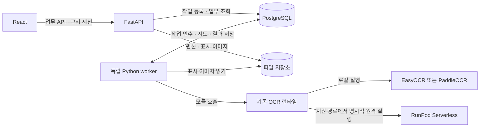

# 포스터 OCR·행사 정보 추출 및 검수 서비스 명세서

| 항목 | 내용 |
|---|---|
| 문서 버전 | v0.24 |
| 최초 작성일 / 개정일 | 2026-10-12 / 2026-10-19 |
| 대상 저장소 | SKN33-Final-1Team |
| 현재 코드 기준 | `ffa287b` 시제품 + 로컬 C01~C15: M008·이메일/개발 인증·검수 API/v1 React·독립 worker·수입/GC·복원·Linux 배포 리허설 |
| 문서 상태 | **현재 구현과 후속 확장 설계 — 팀 공유용** |
| 이번 산출물 | C15 Linux Compose·구형 쓰기 410/로컬 읽기 전용·최신 백업/복원 전환 검사·HTTPS/큐/새 Linux 볼륨 재가동 리허설·운영 절차. 실제 Linux OCR/외부 운영 공개는 후속 |

## 1. 목적과 결정 사항

포스터 이미지를 업로드하면 OCR로 글자를 읽고, 행사 정보를 추출하며, 사용자가 확정한 기준과 비교해 근거가 있는 검수 결과를 제공한다. 이미지·기준 버전·실행 결과를 보존하여 다른 팀원이 같은 검수 이력을 다시 확인할 수 있게 한다.

**2026-10-14 결정한 구조와 제약**

- 프런트엔드는 **React**, 공개 업무 API는 **FastAPI**를 유지한다. 기존 로그인·자료 입력 → 기준 확정 → 검수 실행 → 결과 확인 흐름을 확장한다.
- 업무 DB의 목표는 **PostgreSQL**이다. 현재 JSON 저장을 DB 기반 기록으로 확장한다. 후속 10단계에서 SQLAlchemy Core·psycopg·Alembic을 선택했고 C01 연결 계층과 C02~C07c의 Alembic/M001~M008을 구현·검증했다.
- 무거운 검수는 **독립 Python worker**가 기존 OCR 모듈을 직접 호출하고 추출·판정·결과 저장까지 수행하도록 분리한다. 별도 내부 OCR HTTP 서버는 필수 구성에 넣지 않는다.
- **Apple Vision을 사용하지 않는다.** 현재 EasyOCR 로컬 경로는 CUDA → MPS → CPU를 선택한다. Paddle 단독 경로는 별도 Python 환경의 CPU 작업자로 실행한다. 서로 다른 경로의 장치 지원을 동일하게 가정하지 않는다.
- RunPod 실행은 명시적으로 선택한 경우에만 사용한다. 로컬 실패를 이유로 유료 원격 실행으로 자동 전환하지 않는다. 선택한 OCR 경로의 원격 지원 여부도 실행 전에 확인한다.

이 결정은 v0.1의 Django·DRF 도입 계획을 대체한다. 기존 React와 FastAPI를 활용하면서 필요한 업무 기능을 추가한다. 기획 원본, [2026-10-13 OCR 작업 지시서](codex-ocr-improvement-task.md), 날짜별 실험 보고서는 당시 기록으로 보존하며 현재 아키텍처 판단에는 이 개정본을 우선한다.

**이 명세서의 구현 제안**

PostgreSQL에 저장하는 작업 큐, 독립 Python worker, 서버 저장 세션, 프로젝트별 접근 권한, 서버가 발급하는 불변 기준 버전을 도입한다. 서버 세션·프로젝트 권한·불변 기준과 파일 저장 API는 C08/C09의 별도 v1 앱에 구현했다. C10에서 별도 v1 검수 실행/결과도 구현했다. C11/C12의 화면 연결과 C13의 독립 worker도 별도 v1 프로필에서 구현·검증했다. 기존 시제품의 임시 로그인·JSON 저장·`BackgroundTasks`와 구분한다. 초기에는 Redis/Celery와 OCR 전용 HTTP 서버를 필수로 추가하지 않는다.

## 2. 현재 구현과 변경 범위

아래 현재 화면/검수 경로는 기존 시제품 기준이다. 별도 v1 백엔드는 C08 인증·C09 파일/기준·C10 검수 접수/실행/원자적 결과·이력 조회까지 구현·검증했다. C11은 별도 v1 React 화면과 계약 기반 합성 API 브라우저 검증까지 완료했다. C12에서 실제 DB/API/브라우저 직접·Vite, Linux Nginx HTTPS, 로컬 Paddle CPU 포스터 1장 경로도 확인했다. C10 백엔드 통합은 합성 OCR을 사용했다. C13에서는 독립 worker의 DB/프로세스 장애와 실제 로컬 Paddle CLI 경로도 확인했으며 운영 Linux OCR/공개 배포는 별도다.

| 구분 | 현재 구현 | 목표 구현 |
|---|---|---|
| 화면 | 기본 legacy 유지. C11 v1 프로필에 이메일/개발 로그인·프로젝트·초안·확정본·검수 이력·URL 재진입 구현/합성 API 검증 | C12 직접/Vite·Linux HTTPS·로컬 Paddle CPU 검증 완료. 운영 전환 후속 |
| 공개 API | FastAPI가 로그인·업로드·OCR 실행·판정·결과 조회 제공 | 같은 FastAPI에서 운영 인증·프로젝트·기준 버전·이력 API 확장 |
| 검수 기록 | `.runtime/reviews/<UUID>/`의 JSON·이미지 | PostgreSQL의 관계형 데이터 + 파일 저장소 |
| DB 연결 기반 | C01 Core Engine/UoW와 C02~C06 Alembic/M001~M006, 26개 테이블·81개 FK 및 C07a 인덱스 27개·C07b 가드 35개 트리거·C07c M008 최소 권한/최종 스키마 검증. 새 C08 main의 시작 점검 연결, 기존 API 저장 미연결 | C09/C10 서비스·업무 API 저장 연결 |
| 기준 확정 | 브라우저 스냅샷·정수 버전, 실행 요청 때 서버에 함께 저장 | 서버에 별도로 확정·저장하는 프로젝트별 불변 버전 |
| 실행 | FastAPI `BackgroundTasks`, 프로세스 내부 잠금 | PostgreSQL 작업 기록 + 독립 Python worker |
| OCR | 로컬 기본 Paddle 단독(`paddle-only`), EasyOCR 기준선·줄 결합·재인식 등 비교 경로. RunPod 기본은 `baseline` | 기존 OCR 모듈을 worker에서 호출하고 실행 설정·근거·시도 기록 보존 |
| 판정·행사 정보 추출 | `review_rules.py`, `extract_event.py`, `event_layout.py` | 기존 규칙·추출기를 worker에서 재사용 |
| 사용자·권한 | 기존 화면의 localhost `admin / admin` 유지. 별도 C08 main에 이메일/개발 DB 세션·서명 CSRF·권한 helper·계정 CLI 구현 | 기존 React와 실제 업무 API의 새 인증/접근 통제 연결 |
| 재실행 | 새 UUID 생성, 이전 실행과 관계 없음 | 새 실행에 `retry_of` 연결, 이전 결과 보존 |
| 재시작 | 남아 있는 queued/running JSON을 failed 처리 | DB 작업 상태와 시도 기록을 기준으로 복구·실패 판정 |

현재 API는 다음과 같다. `/api/v1/auth`는 이미 FastAPI에 있는 임시 인증 경로이며, 아래 6절의 업무 API 전체가 구현되었다는 뜻은 아니다.

| 구분 | 현재 경로·동작 |
|---|---|
| 임시 인증 | `GET /api/v1/auth/csrf`, `GET /api/v1/auth/me`, `POST /api/v1/auth/login`, `POST /api/v1/auth/logout` |
| 준비 상태·샘플 | `GET /api/health`, `GET /api/sample`, `GET /api/sample/image` |
| 검수 생성 | `POST /api/reviews` — 이미지·기준 배열·정수 버전·프로젝트명을 함께 보내는 multipart 요청 |
| 진행·결과·이미지 | `GET /api/reviews/{id}`, `GET /api/reviews/{id}/image` |

현재 임시 로그인은 8시간 메모리 세션이며 서버 재시작 때 사라진다. 검수 API에는 아직 사용자·프로젝트별 접근 검사가 연결되어 있지 않다. 이 문단은 기존 시제품의 설명이다. 별도 v1은 C08~C10 DB/API와 C11 이력·작업 복원 화면까지 구현했으며, 영속 worker는 C13·실제 종합 연계도 C12에서 격리 환경으로 검증했다.

현재 코드 근거: [검수 API](../backend/app/api.py), [임시 인증](../backend/app/local_auth.py), [OCR 런타임](../backend/app/ocr_runtime.py), [Paddle 단독 연결](../backend/app/paddle_ocr.py), [여러 줄 추출](../backend/app/event_layout.py), [React 경로 구성](../frontend/src/App.jsx), [화면 상태 전이](../frontend/src/workflow.js), [데이터 파이프라인](data-pipeline.md).

## 3. 서비스 구성과 책임

다음은 확장 구조다. C13의 별도 v1 프로필에서 로컬 Paddle worker까지 구현·검증했다. 아래 EasyOCR/RunPod 분기는 후속 adapter 범위다. 기존 시제품은 FastAPI의 `BackgroundTasks`·JSON 저장을 유지한다.



| 구성 | 소유하는 책임 |
|---|---|
| React | 자료 입력, 기준 편집·확정, 진행 상태 조회, 근거 박스, 결과·행사 정보·이력 표시 |
| FastAPI | 인증·권한, 프로젝트, 업로드, 기준 버전, 작업 생성, 이력·결과 API |
| 독립 Python worker | 영속 작업 인수, OCR 모듈 호출, 출력 검증, 행사 정보 추출, 기준별 판정, 결과 저장 |
| PostgreSQL | 사용자·세션·프로젝트·파일 메타데이터·기준·실행·시도·OCR 근거·판정·이벤트 |
| OCR 모듈 | OCR용 전처리·추론, 경로별 장치 선택, RunPod 어댑터, OCR 출력 |
| 파일 저장소 | 변경하지 않는 업로드 원본과 방향·배경을 정규화한 표시 이미지 |

React는 FastAPI만 호출한다. FastAPI와 worker는 공통 업무 로직·DB 접근 계층을 사용하되 별도 프로세스로 실행한다. OCR 모듈은 업무 DB를 직접 수정하지 않으며, 결과 검증·업무 기록 저장은 worker가 맡는다. 목표 구조의 웹 프로세스에는 OCR 모델을 로드하지 않는다. 이는 현재 `BackgroundTasks` 실행 방식에서 바꿀 부분이다.

Paddle 전용 Python 환경의 모델 작업자와 여기서 설계하는 영속 검수 worker는 역할이 다르다. 전자는 현재 모델 실행을 분리하는 하위 프로세스이고, 후자는 DB 작업 인수·복구·판정·저장을 담당하도록 새로 구현할 프로세스다.

## 4. 사용자 흐름과 기능 요구사항

아래는 목표 요구사항이며, 현재 구현 범위는 2절을 기준으로 확인한다.

| ID | 기능 | 요구사항 |
|---|---|---|
| FR-01 | 로그인·프로젝트 | 관리자에게 발급받은 계정으로 로그인하고 접근 가능한 프로젝트를 선택·생성한다. 프로젝트는 UUID로 식별한다. |
| FR-02 | 자료 입력 | 단일 포스터와 원문 요구사항을 입력한다. 이름은 신규 프로젝트 생성 시 입력하고 기존 프로젝트에서는 선택한 이름을 표시한다. 이름 변경은 owner의 별도 기능이다. 샘플 이미지도 일반 업로드와 같은 검증·저장 경로를 사용한다. |
| FR-03 | 기준 편집 | 현재처럼 항목 추가·수정·선택, 정보/시각 유형을 지원한다. 편집 중인 값은 미확정 초안이다. |
| FR-04 | 기준 확정 | 선택한 항목과 원문 요구사항을 FastAPI를 통해 DB에 저장한다. 서버가 `criteria_version_id`와 프로젝트별 증가 버전을 발급한다. 확정 버전은 직접 수정하지 않는다. |
| FR-05 | 검수 요청 | 저장된 이미지 ID와 확정 기준 버전 ID로 요청한다. DB 저장 후 `202`와 검수 ID를 반환한다. |
| FR-06 | 진행 조회 | queued/running/completed/failed를 표시한다. 화면을 닫아도 작업은 서버에 남으며 URL로 재진입할 수 있다. |
| FR-07 | 결과 | 충족/위반/확인 필요 필터, 판단 이유, OCR 텍스트, 이미지 근거 박스, JSON 내보내기를 유지한다. |
| FR-08 | 행사 정보 | 행사명·시작일·종료일·장소의 추출값, 출처 OCR ID, 확인 필요 사유를 표시한다. 알 수 없는 값은 `null`로 둔다. |
| FR-09 | 검수 이력 | 프로젝트별 최신순 목록, 상태 필터, 기준 버전, 요청자, 생성·완료 시각, 결과 요약, 상세 링크를 제공한다. |
| FR-10 | 재검수 | 사용자의 명시적 재검수는 새 실행과 `retry_of`를 생성한다. 통신 재전송은 같은 멱등키로 기존 실행을 반환한다. |
| FR-11 | 기록 보존 | 기준·이미지 변경은 편집 화면의 결과 연결만 해제한다. 이미 저장된 과거 기준과 검수 결과를 삭제하거나 덮어쓰지 않는다. |

검수 이력이 없으면 빈 목록과 새 검수 버튼을 표시한다. 임의의 성공 결과를 넣지 않는다. 상태 조회 통신 실패는 OCR 작업 실패와 구분하여 ‘진행 상태 다시 확인’을 제공한다. `progress`는 단계 진행 표시이며 남은 시간이나 OCR 정확도를 뜻하지 않는다.

이미지 업로드와 기준 확정이 성공해 서버의 이미지 UUID·기준 UUID·버전을 받은 뒤에만 실행 버튼을 활성화한다. 서버에 저장한 편집 초안은 draft UUID/revision으로 복원하고, 미저장 입력·업로드 전 File은 복원하지 않는다. 이미 확정된 버전과 실행 이력도 서버에서 재조회한다.

이번 단계에서 말하는 **검수 이력**은 기준 확정·실행·자동 판정·재실행 기록이다. 사람의 최종 승인·반려와 수정 라벨을 남기는 별도 검토 기능은 후속 범위로 둔다. 자동 처리 `completed`를 사람의 승인 완료로 표시하지 않는다.

## 5. PostgreSQL 데이터 모델

모든 업무 ID는 UUID를 기본으로 하고 시각은 timezone-aware UTC로 저장한다. 화면에서는 사용자 시간대에 맞춰 표시한다. 아래는 목표 논리 모델이며 실제 첫 테이블/컬럼은 상세 물리 설계를 따른다. DB 접근은 SQLAlchemy Core·동기 psycopg, 구조 이력은 Alembic으로 10단계에서 선택했다. C01에서 선택 DB 패키지와 독립 연결/UoW를 구현·검증했다. C02의 M001은 identity 4개 테이블·30개 컬럼·PK/UQ/CHECK와 기본 권한 회수까지 구현·격리 DB 검증했다. C03에서 파일 관련 5개 테이블·58개 컬럼을 M002로 추가해 누적 9개 테이블·88개 컬럼을 검증했다. C04에서 규격·인계·감사·OCR·추출·관찰·근거 9개 테이블·148개 컬럼을 M003으로 추가해 누적 18개 테이블·236개 컬럼을 검증했다. C05에서 검수 기준 4개 테이블·63개 컬럼을 M004로 추가해 누적 22개 테이블·299개 컬럼을 검증했다. C06에서 실행·결과 4개 테이블·96개 컬럼과 전체 FK를 M005/M006으로 추가해 26개 테이블·395개 컬럼·81개 FK를 검증했다. C07a에서 27개 인덱스 후보·조회 계획도 검증했다. C07b에서 봉인·전이·교차 행 가드를 완성해 정식 M007로 승격·검증했다. 일상 DB 적용·M008 최종 권한·기존 API 저장 연결은 후속이다.

| 모델 | 주요 필드·관계 | 주요 제약 |
|---|---|---|
| User (`users`) | account_kind, 이메일, 비밀번호 해시, 표시 이름, 활성 상태, 생성·수정 시각 | email 종류는 정규화 이메일·해시 필수·이메일 유일; developer 종류는 이메일/해시 NULL·DB당 최대 1행. Argon2id, 평문 저장 금지 |
| UserSession (`user_sessions`) | 세션 UUID, user, 토큰 해시, 발급·만료·폐기 시각 | 토큰 해시 유일; 임의 세션 토큰을 HttpOnly 쿠키로 제공; 서버에서 사용자 활성 여부·세션 만료·폐기 확인 |
| Project | 이름, owner, 생성일, archived_at | 동명 프로젝트를 이름으로 합치지 않음 |
| ProjectMembership | project, user, role | `(project, user)` 유일; owner/editor/viewer |
| ImageAsset | project, uploader, 원본/표시 파일 키·SHA256·크기, 실제 MIME, 각 이미지 치수, EXIF 처리 정보 | 실행에서 참조한 원본·표시 이미지 불변 |
| CriteriaVersion | project, version, 원문 요구사항, content_hash, confirmed_by/at | `(project, version)` 유일; 확정 후 불변 |
| CriterionItem | criteria_version, 항목 키, 순서, text, type, source | `(criteria_version, 항목 키)` 유일 |
| ReviewRun | project, image, criteria_version, requester, status/stage, progress, 실행 설정, pipeline/rule 버전, retry_of, 시각 | 한 실행의 이미지·기준·설정 고정 |
| ReviewAttempt | run, attempt_no, request_id, status, finished_at, lease_token/expiry, dispatch_state, 대상·실제 장치·모델, 원격 job ID, 오류·시각 | `(run, attempt_no)` 유일; status=active 시도는 실행당 하나 |
| OCRRecord | attempt, record_id, text, confidence, bbox/polygon, coordinate_space | `(attempt, record_id)` 유일 |
| CriterionResult | run, criterion_item, status, observed_text, reason | `(run, criterion_item)` 유일 |
| ResultEvidence | criterion_result, ocr_record | 같은 연결 중복 금지 |
| EventExtraction | run, 추출 필드 JSON, 경고, parser_version | 실행당 하나; 필드별 source_ocr_ids 포함 |
| ReviewEvent | run, 이벤트 유형, 이전/새 상태, actor, 발생 시각, 안전한 사유 | 서비스에서 추가만 허용, 수정·삭제 API 없음 |
| IdempotencyRecord | user, operation, key, request_hash, 생성된 리소스 ID | `(user, operation, key)` 유일 |

`IdempotencyRecord`는 논리적 책임이며 별도 물리 테이블을 첫 범위에 추가한다는 뜻은 아니다. [물리 설계 4단계](DB_Settings/DB_통합설계서.html#source-05)에서는 기준 확정 operation의 사용자·키·요청 해시를 `criteria_versions`에 함께 저장하고 `(confirmed_by, confirmation_key)`를 유일 키로 둔다. [물리 설계 5단계](DB_Settings/DB_통합설계서.html#source-06)에서는 검수 생성·재검수의 기록을 `review_runs`에 저장하고 `(requested_by, request_operation, idempotency_key)`를 유일 키로 둔다. 전체 키 범위는 물리 설계 6단계에서 대조한다.

[물리 설계 6단계](DB_Settings/DB_통합설계서.html#source-07)와 [제약 목록](DB_Settings/DB_통합설계서.html#source-08)에서 첫 26개 테이블의 키·상태·권한·조회 인덱스를 대조했다. 규격의 availability와 access_scope를 분리하고, OCR·추출본·기준 버전 및 실행의 로컬 sealed_at으로 봉인 후 자식 추가도 금지하도록 설계했다. 수입의 봉인은 로컬 구조 저장의 완료이며 과거 추론·사람 승인을 뜻하지 않는다. [추가 설계 7단계](DB_Settings/DB_통합설계서.html#source-09)의 account_kind까지 반영한 현재 범위는 26개 테이블·395개 컬럼이다. [추가 설계 8단계](DB_Settings/DB_통합설계서.html#source-10)에서 서버 초안·API·화면·JSON·해시 계약을 정했다. [추가 설계 9단계](DB_Settings/DB_통합설계서.html#source-11)에서 파일/DB 커밋·수입·백업/복원을 정했다. [추가 설계 10단계](DB_Settings/DB_통합설계서.html#source-12)에서 도구·모듈·8개 revision·17개 구현 단위와 PostgreSQL/E2E 검증 명세를 확정했다. 설계에 이어 [C01](DB_Settings/DB_통합설계서.html#source-13)의 설정·DB 연결·UoW 및 격리 접속/롤백 검증을 완료했다. 이후 [C02](DB_Settings/DB_통합설계서.html#source-14)의 Alembic/M001·identity 4개 테이블·30개 컬럼·기본 권한 회수도 구현·격리 DB 검증했다. [C03](DB_Settings/DB_통합설계서.html#source-15)의 파일 5개 테이블·58개 컬럼을 추가해 M002까지 구현·검증했다. [C04](DB_Settings/DB_통합설계서.html#source-16)의 9개 테이블·148개 컬럼·M003도 구현·검증했다. [C05](DB_Settings/DB_통합설계서.html#source-17)의 4개 테이블·63개 컬럼·M004도 구현·검증했다. [C06](DB_Settings/DB_통합설계서.html#source-18)의 실행·결과 4개 테이블·96개 컬럼과 전체 81개 FK를 M005/M006으로 구현·검증했다. [C07a](DB_Settings/DB_통합설계서.html#source-19)의 27개 인덱스 초안·predicate·조회 계획도 구현·검증했다. [C07b](DB_Settings/DB_통합설계서.html#source-20)의 봉인·전이·교차 행 가드와 정식 M007도 구현·검증했다. [C07c](DB_Settings/DB_통합설계서.html#source-21)의 M008 최소 권한·최종 inventory도 검증했다. [C08](DB_Settings/DB_통합설계서.html#source-22)의 이메일/개발 DB 인증·세션/CSRF·권한 검사·계정 CLI·별도 main도 구현·검증했다. [C09](DB_Settings/DB_통합설계서.html#source-23)의 전용 저장소·JCS·프로젝트/이미지/초안/기준 확정 API도 구현·격리 검증했다. [C10](DB_Settings/DB_통합설계서.html#source-24)의 검수 접수·명시적 재검수·BackgroundTasks·원자적 결과·조회/다운로드·중단 복구도 구현·검증했다. [C11](DB_Settings/DB_통합설계서.html#source-25)의 별도 v1 React 연결·이메일 UI·서버 상태/URL 복원·근거 조회도 구현·합성 API 브라우저 검증했다. 현재 head는 M008이며 [C12](DB_Settings/DB_통합설계서.html#source-26)의 실제 직접/Vite·Linux HTTPS·로컬 Paddle CPU 경로도 검증했다. [C13](DB_Settings/DB_통합설계서.html#source-27)의 독립 postgres_worker·인수/lease/회수·실제 CLI/Paddle 경로도 검증했다. [C14](DB_Settings/DB_통합설계서.html#source-28)의 수입/GC·실제 DB/파일 복원도 격리 환경에서 검증했다. [C15](DB_Settings/DB_통합설계서.html#source-29)의 Linux 배포 리허설·구형 쓰기 경계·전환 전 검사도 완료했다. 일상 DB 적용·실제 Linux OCR·운영 공개는 후속이다.

2026-10-16 이메일 기반 정식 로그인 요구사항에 따라 `users.password_hash`와 `user_sessions`를 [논리 ERD](ERD_논리.md)·[물리 ERD](ERD_물리.md)에 반영했다. 첫 구축 범위는 기존 검수용 25개에 사용자세션을 추가한 26개다. **기존 `admin/admin`은 개발용 계정으로 유지한다.** 현재의 localhost·`LOCAL_ADMIN_LOGIN` 경계를 유지하고 정식 이메일 계정과 구분한다. 이메일/개발 DB 로그인·세션과 프로젝트 권한 helper는 C08의 별도 main에 구현했다. C11/C12의 별도 v1 화면과 C09/C10의 업무 API로 연결했으며 기본 launcher의 운영 전환은 후속이다. 상세 컬럼·키는 [물리 설계 2단계](DB_Settings/DB_통합설계서.html#source-03)를 기준으로 확인한다.

7단계에서 developer의 이메일/해시 NULL 예외를 종류별 CHECK로 확정했다. ERD 가져오기용 SQL의 기존 NOT NULL과 account_kind 누락은 최종 마이그레이션에서 반영할 차이이며, 현재 상세 설계 문서를 우선한다. 해당 설계 당시에는 SQL을 생성·실행하지 않았다. 이후 C02~C06의 M001~M006는 별도 소스로 작성해 격리 DB에서 검증했다.

`ReviewRun` 상태·생성 시각, 프로젝트별 생성 시각, worker 대상 queued 작업, lease 만료 시각에 조회용 인덱스를 둔다. OCR 설정·추출 필드·안전한 오류 상세처럼 형태가 달라지는 작은 데이터에는 PostgreSQL JSONB를 사용하되 주요 관계와 상태를 통째로 JSON 파일처럼 저장하지 않는다.

확정 기준의 버전 번호는 프로젝트 행 잠금과 DB 유일 제약으로 발급한다. 실행이 참조하는 기준·이미지는 삭제를 제한하고 첫 버전의 프로젝트 삭제는 보관 처리로 제공한다. 프로젝트 생성 시 owner 멤버십을 함께 만들며, 이력의 요청자·확정자 참조도 계정 비활성화 이후 보존한다.

파일 바이트는 PostgreSQL에 넣지 않는다. [9단계 저장·복구 계약](DB_Settings/DB_통합설계서.html#source-11)에 따라 신규 v1은 단일 호스트의 별도 영속 STORAGE_ROOT와 UUID 파일 키를 사용한다. 같은 볼륨 staging→실제 바이트/해시·내구성 확인→파일 확정→짧은 DB 커밋 순서다. DB 커밋 결과 미확인은 파일을 보존하고 primary에서 실제 UUID/요청 지문을 확인한다. 작업 저널·OS gate/작업 잠금·트랜잭션 advisory lock으로 GC와 늦은 커밋의 경합을 막는다. GC는 기본 dry-run이며 모든 stored_files 행과 unresolved 작업을 보호한다. 업무 행·세션의 자동 물리 삭제는 첫 범위에 없다.

## 6. FastAPI 공개 API 계약 — 후속 구현

[추가 설계 8단계 — API·화면·JSON·해시 계약](DB_Settings/DB_통합설계서.html#source-10)이 상세 기준이다. 요청·응답·nullable 필드·오류·한도·페이지·해시 입력과 [합성 예제](DB_Settings/contracts/stage8-examples.json)를 함께 확인한다. 아래는 요약이며 아직 구현한 API 목록이 아니다.

기본 경로는 `/api/v1`이며 trailing slash 없이 통일한다. 첫 DB 쓰기는 **이미지 업로드 → 서버 초안 저장 → 기준 확정 → 검수 생성**으로 통일한다. 현재 multipart 검수 제출을 자동 DB 어댑터로 전환하지 않으며 React의 메모리 확정·버전 증가·제출을 새 경로로 교체한다.

| 메서드·경로 | 동작 |
|---|---|
| `GET /auth/csrf`, `POST /auth/login`, `GET /auth/me`, `POST /auth/logout` | 7단계 쿠키·DB 세션·서명 CSRF, 개발 로그인 허용 여부 |
| `GET/POST /projects`, `GET/PATCH /projects/{project_id}` | 소속 목록·생성과 owner의 이름·보관/복원 |
| `GET/POST /projects/{project_id}/images`, `GET /images/{image_id}`, `GET /images/{image_id}/content` | 이미지 버전 저장·메타·고정 표시 PNG |
| `GET/POST /projects/{project_id}/criteria-sets` | 기준 묶음 목록·생성 |
| `GET/POST /projects/{project_id}/criteria-drafts`, `GET/PUT /projects/{project_id}/criteria-drafts/{draft_id}` | 초안 저장·전체 조회·expected_revision으로 동시 수정 검사 |
| `GET/POST /projects/{project_id}/criteria-versions`, `GET /projects/{project_id}/criteria-versions/{criteria_version_id}` | 불변 기준 확정·목록·상세 |
| `POST /reviews`, `GET /projects/{project_id}/reviews`, `GET /reviews/{run_id}`, `POST /reviews/{run_id}/retry` | 접수·이력·현재 상태·명시적 재검수 |
| `GET /reviews/{run_id}/image`, `GET /reviews/{run_id}/ocr-records`, `GET /reviews/{run_id}/results/{result_id}/evidence` | 고정 이미지·채택 OCR·근거 페이지 |
| `GET /reviews/{run_id}/export` | 출처·검증 상태를 보존한 로컬 결과 JSON. 외부 인계 규격 파일과 구분 |
| `GET /sample`, `GET /sample/image`, `GET /health` | 인증 후 번들 예제, 공개 가능한 준비 상태·한도 |

표의 상대 경로 앞에 `/api/v1`을 붙인다. image_id는 `asset_versions.asset_version_id`이며 자료 asset_id와 구분한다. 초안 생성 때 대상 이미지와 기준 묶음을 고정한다. revision은 BIGINT의 십진 문자열이고, 기준 확정 본문은 `{draft_id,expected_revision}`뿐이다. 서버가 선택 항목을 복사·봉인하고 프로젝트별 version_no·UUID를 발급한다. 초안의 미선택 항목은 편집 이력에 남기며 is_required를 true로 추정하지 않는다.

검수 생성 본문은 `{project_id,image_id,criteria_version_id}`, 재검수는 종료된 원 실행 경로와 `{}`다. 세 리소스의 프로젝트·이미지 일치, 활성 권한·확정 상태·현재 초안 revision을 검사한다. 실행 장치·서버 주소·모델은 클라이언트가 주입하지 못하며 서버가 실제 설정·버전을 스냅샷으로 고정한다. 이미 접수한 실행은 이후 초안 편집 때문에 무효화되지 않는다.

확정·생성·재검수에는 UUID Idempotency-Key와 X-CSRFToken을 보낸다. 최초 확정은 201, 최초 실행 접수는 202, 같은 요청 재전송은 200과 동일 UUID·현재 실제 상태를 반환한다. 같은 사용자·operation·키에 다른 지문은 409다. 기존 키의 접근 권한·지문 검사를 현재 초안/서버 설정 검사보다 먼저 하므로 성공 후 편집·설정 변경에도 동일 요청을 복원할 수 있다. 연결 단절은 접수 실패로 단정하지 않으며 보낸 키·본문을 유지한다. 다른 POST의 영속 멱등성은 보장하지 않는다.

상세는 id/status/stage/progress/project_name/criteria_version/image/results/runtime/ocr 등의 표시 책임을 유지하고 UUID·출처·자동 요약·전체성 정보를 추가한다. results[].verdict는 실제 자동 판정/null, 표시 status는 pass/fail/review다. failed/unsupported/imported 항목의 표시 review가 로컬 verdict를 생성하지 않는다. 일반 상세의 근거 배열은 지연 조회하고 evidence_count/evidence_complete/evidence_url로 부재와 미조회 상태를 구분한다. 표시 bbox는 이미 복원한 표시 이미지 픽셀이다.

일반 응답은 `meta.contract_version=cc-api-v1`·request_id를 포함하고 오류는 `{error:{code,message,fields},meta}`다. fields는 JSON Pointer→메시지 배열이다. 현재 FastAPI detail·오류 문자열은 전환 어댑터에서 명시적으로 처리한다. 401은 인증 만료, 403은 CSRF/역할 거절, 404는 접근 불가, 409는 상태/동시 수정/멱등 충돌이다. 통신 실패를 서버 run 실패로 바꾸지 않는다.

JSON 요청은 256 KiB·depth 32, 초안 항목 최대 100개다. 목록·OCR·근거는 서명 cursor와 기본 20/최대 100개 페이지를 쓴다. 일반 응답 2 MiB·export 50 MiB 한도와 초과 처리, 정확한 문자/이미지 한도는 8단계를 따른다. source_draft_hash/criteria_hash, 요청 지문, 입력/결과 manifest는 목적을 분리하고 버전 있는 JCS+SHA256을 사용한다. JSONB의 텍스트 출력이나 예쁘게 출력한 파일을 대신 해시하지 않는다.

화면은 프로젝트·초안·확정·실행 UUID가 있는 URL로 복원한다. 미저장 파일은 재선택하고 저장한 이미지·초안·run은 서버에서 읽는다. sessionStorage에는 주체·operation·pending 키/본문만 저장하며 비밀번호·토큰·이미지 바이트는 넣지 않는다. health의 api/db/worker/ocr_runtime/model 점검과 실제 모델 준비·추론 성공을 구분하고 미확인은 unknown으로 표시한다.

기존 `/api/reviews`의 쓰기 종료·개발 전용 구형 읽기·운영 수입은 8·9단계의 고정 계획·보존·복구 순서를 따른다. 이번 문서 개정은 현재 경로·JSON 저장·인증 코드를 삭제하거나 변경한 것이 아니다.

## 7. 이미지 전처리와 worker·OCR 모듈 계약

### 7.1 입력과 좌표 소유권

1. **FastAPI**가 업로드 원본을 검증하고 원본 바이트·SHA256을 그대로 보존한다. 제한은 20 MiB, 1,000만 픽셀, 한 변 8,192px이다. 실제 파일 서명으로 JPEG/PNG/WEBP 정지 이미지만 허용한다.
2. **FastAPI**가 EXIF 방향 적용 → 투명 영역 흰색 합성 → RGB PNG 변환을 한 번 수행하여 표시 이미지를 저장한다. 원본·표시 이미지의 해시와 치수를 각각 기록한다.
3. **worker의 OCR 어댑터**가 표시 이미지를 Lanczos로 가로·세로 2배 확대하고 기존 OCR 모듈을 호출한다. EXIF 회전을 다시 적용하지 않는다.
4. **worker의 OCR 어댑터**가 OCR 입력 좌표의 bbox·polygon을 2로 나눠 표시 이미지 좌표로 복원한다. DB 저장·FastAPI 응답·React 표시에서는 다시 나누지 않는다.
5. 최종 좌표계는 `normalized_original_pixels`이고 원점은 표시 이미지 왼쪽 위이다. bbox 형식은 `[x_min,y_min,x_max,y_max]`, x는 오른쪽·y는 아래 방향, 유효 범위는 이미지 경계 안이다.

현재는 `api.py`의 검수 작업 함수가 2배 확대·OCR 호출·좌표 복원을 수행한다. 이를 worker로 옮길 때도 변환은 정확히 한 번만 수행한다. 기존 OCR 런타임의 2배 입력 제한 128 MiB·4,000만 픽셀과 RunPod의 **전처리된 전달 파일 7 MiB 이하** 제한을 유지한다. 초과하면 명확한 오류를 반환하고 원본을 몰래 축소하거나 외부 실행으로 바꾸지 않는다.

기존 데이터셋 CLI는 EXIF 역변환을 거친 **원본 저장 픽셀 좌표**를 쓴다. 서비스의 표시 이미지 좌표와 구분하며, 변환 없이 같은 라벨·근거로 취급하지 않는다. 현재 웹 OCR 레코드의 bbox·polygon 보존과 표시 이미지 기준 좌표를 새 worker 계약에서도 유지한다.

### 7.2 동기 모듈 입력·출력 — 후속 구현

worker는 서버가 관리하는 파일 저장소에서 표시 이미지를 읽고 기존 OCR 함수를 동기 호출한다. 아래는 작업 실행 어댑터의 목표 계약이며, 현재 함수 시그니처에 이미 모든 필드가 있다는 뜻은 아니다. 브라우저가 임의 서버 파일 경로나 외부 URL을 지정할 수 없게 한다.

| 입력 필드 | 의미 |
|---|---|
| `review_id`, `attempt_id`, `request_id` | 저장된 검수 UUID와 worker가 생성·검증하는 시도·호출 UUID |
| `source_sha256` | 원본 식별용 해시; 표시 이미지만 읽는 OCR 함수가 원본 바이트를 검증했다는 의미는 아님 |
| `display_sha256`, `display_image` | 서버가 저장한 표시 이미지의 해시와 파일 참조; worker가 실제 바이트의 해시·치수 확인 |
| `pipeline`, `pipeline_version` | 실행에 고정한 OCR 경로와 전처리·좌표 계약 버전 |
| `expected_execution_target` | 실행에 고정한 `local` 또는 `runpod`; worker 설정·경로 지원과 다르면 추론 전에 거절 |

기존 OCR 출력에 worker의 검증된 실행 문맥을 합쳐 저장할 정보:

```text
schema_version, review_id, attempt_id, request_id
source_sha256, display_sha256, pipeline, pipeline_version
engine, engine_version, model_version, execution_target, device, fallback_attempts
remote_job_id (로컬은 null)
display_dimensions, ocr_input_dimensions, scale=2
coordinate_space="normalized_original_pixels"
records[]: {id, text, confidence, bbox_xyxy, polygon}
timings
```

OCR 함수에는 픽셀·실행 설정을 전달하고, 기대 정답·라벨·원래 파일명으로 인식을 보정하지 않는다. 반환값에 없는 모델 버전·시간·원격 job ID를 추정하여 채우지 않는다. `model_version`에는 실제 재현 가능한 모델 식별자·체크섬을 기록하도록 확장한다.

모듈 오류는 안전한 `code/message/retryable/dispatch_state/remote_job_id`로 변환하여 시도에 기록한다. `retryable` 하나만으로 자동 재실행하지 않고 다음 절의 실행·제출 상태 정책을 함께 적용한다. 실행 대상·pipeline 버전이 맞지 않으면 추론·RunPod 제출 전에 `CONFIGURATION_MISMATCH`로 실패 처리한다. 동기 함수의 반환값이나 예외를 HTTP 상태 코드처럼 표현하지 않는다.

worker는 ID·해시·스키마 버전·치수·좌표계, 중복 OCR ID, NaN/Infinity, 좌표 범위, confidence의 `null` 또는 0~1 범위를 검증한 뒤 저장한다. 출력의 최대 항목 수는 최초 제안 10,000개이며 측정에 따라 설정한다. 초과 결과를 조용히 버리지 않고 명시적인 계약 오류로 처리한다.

**선택 확장:** 이후 OCR을 별도 서버로 분리할 때만 `/internal/v1/ocr` 같은 내부 HTTP 계약, 서버 간 토큰·네트워크 제한, 전달 ID·해시 검증, 요청·응답 크기 제한을 추가한다. 이전 설계의 정규화 이미지 64 MiB·1,000만 픽셀 및 응답 10 MiB 제한은 이 선택 확장의 제안값이며 현재 직접 모듈 호출의 HTTP 제한이 아니다. 이 내부 서버나 포트는 이번 목표의 필수 구성에 포함하지 않는다.

### 7.3 장치·실행 대상

- EasyOCR 로컬 경로는 CUDA → MPS → CPU를 선택하며 실제 장치·fallback 이력을 기록한다. 명확한 장치 미지원·GPU 메모리 부족에만 다음 장치를 시도하고 손상 이미지·모델 누락·다운로드 오류를 CPU 재시도로 숨기지 않는다.
- Paddle 단독은 현재 `.runtime/paddle-env`의 CPU 작업자를 사용한다. `PP-OCRv5_server_det`와 `korean_PP-OCRv5_mobile_rec`을 명시적으로 준비하며, CUDA·MPS·RunPod 지원을 이미 검증한 것처럼 표시하지 않는다.
- RunPod Serverless는 해당 실행 경로에서 지원하고 명시적으로 선택했을 때만 사용한다. RunPod Pod에서 기존 로컬 런타임을 실행한다면 호환 장비의 CUDA 지원을 별도로 검증한다.
- 로컬과 RunPod 사이의 자동 전환은 하지 않는다. 모델 준비 실패·지원하지 않는 경로·원격 요청 제한을 실행 전에 확인한다.
- 초기 검수 worker 수와 동시 추론 수는 각각 1로 제안한다. Paddle 하위 프로세스도 이 작업자의 실행 수명에 포함한다. Uvicorn 웹 worker 수를 늘리는 것을 OCR 병렬화로 취급하지 않는다.

## 8. 작업 상태·재시도·장애 처리

아래 로컬 영속 큐·lease/회수는 [C13](DB_Settings/DB_통합설계서.html#source-27)의 명시적 postgres_worker 프로필에 구현·검증했다. 기존 `BackgroundTasks`의 재시작 실패 처리와 구분한다. 원격 job 조회/복구 adapter는 후속이다.

### 8.1 영속 작업 큐

`ReviewRun`의 queued 행 자체를 PostgreSQL 작업 큐로 사용한다. FastAPI는 작업·첫 이벤트를 짧은 트랜잭션으로 저장한 뒤 반환한다. 별도 worker는 PostgreSQL의 `SELECT ... FOR UPDATE SKIP LOCKED`에 해당하는 동작으로 작업을 인수하고 시도 번호·lease를 기록한 후 커밋한다. C13은 동기 SQLAlchemy Core·psycopg와 M008의 기존 큐/lease 제약을 사용한다. **OCR 모듈 실행·RunPod 응답 대기 중에는 DB 행 잠금이나 트랜잭션을 계속 잡지 않는다.**

worker는 호출 중 별도 heartbeat로 lease를 갱신하고, 주기적으로 만료 작업을 회수한다. heartbeat·완료 커밋에는 현재 시도·lease token 일치뿐 아니라 `ReviewRun.status=running`, 시도 `status=active`, `lease_expiry > DB 현재 시각`을 조건으로 둔다. 만료 lease를 늦은 heartbeat로 되살리지 않는다. 유효한 응답의 OCR 근거·추출 정보·판정·완료 이벤트는 한 트랜잭션으로 저장하고 늦게 도착한 이전 worker의 결과는 받지 않는다. 이 설계에서는 별도 outbox가 초기 필수는 아니다. 나중에 메시지 브로커를 도입하면 DB 커밋과 메시지 전달 사이의 유실 방지를 별도로 설계한다.

이 선택은 PostgreSQL의 트랜잭션·행 잠금과 작업 인수용 `SKIP LOCKED`를 사용하는 설계다. 실제 DB에서 경쟁 조건을 검증해야 하며 프레임워크 변경만으로 동시성 보장이 생기지는 않는다. [PostgreSQL SELECT](https://www.postgresql.org/docs/17/sql-select.html).

### 8.2 상태 계약

| 구분 | 값·규칙 |
|---|---|
| 실행 상태 | `queued → running → completed/failed`; 안전한 자동 재시도 대기에서는 다시 queued 가능 |
| 화면 단계 | `queued/preprocessing/ocr/review/completed/failed`; 최종 결과 저장 전에는 completed 표시 금지 |
| 항목 판정 | `pass/fail/review`; 실행 상태와 별개 |
| 시도 수명 | `active → succeeded/failed/unknown`; 종료 시 finished_at 기록, 제출 상태와 별개 |
| 시도 실행·제출 상태 | `not_dispatched/dispatching/submitted/unknown`; OCR 호출 직전에 dispatching을 DB에 기록, 원격 제출의 submitted는 job ID 확인 후 기록 |
| 자동 재시도 | 같은 ReviewRun의 새 ReviewAttempt; 기본 총 3회 이내, 제한된 backoff |
| 사용자 재검수 | 새 ReviewRun + retry_of; 새 멱등키 사용 |
| 큐 과부하 | 환경별 최대 대기 건수 설정, 최초 제안 100건; 초과 요청은 429로 거절 |

시도 종료와 실행 상태 변경은 같은 트랜잭션에서 처리한다. 재시도 인수 시 이전 시도가 종료됐는지 확인하고 새 active 시도 생성과 실행 점유를 원자적으로 수행한다. unknown 시도는 자동 재시도 대상에 넣지 않는다.

최초 운영 제안값은 heartbeat 15초, lease 90초이며 RunPod 총 대기 기본값 300초를 기준으로 검증한다. 긴 동기 OCR 실행 중에도 별도 heartbeat가 동작하게 하고, 로컬 실행 제한·하위 프로세스 종료 확인을 별도로 설계한다. timeout만으로 로컬·원격 추론 종료를 단정하지 않는다. 선택 확장인 내부 HTTP 서버를 도입할 때는 연결 5초·응답 330초를 시작값으로 검토하고 외부 timeout이 내부 RunPod 대기보다 짧지 않게 한다. 모든 값은 설정 가능하게 하며 실제 측정에 따라 조정한다.

### 8.3 장애별 처리

| 상황 | 처리 |
|---|---|
| 웹 서버 재시작 | DB queued 작업은 유지, worker가 계속 처리 |
| worker 종료·lease 만료 | 실행 전임이 확인되면 재대기; dispatching 이후 하위 프로세스·원격 실행 결과가 불명확하면 자동 재실행하지 않음 |
| OCR 실행 전 자원 부족·원격 연결 거절 | 모델 실행·원격 제출 전에 거절됐음이 확인된 경우에만 제한 재시도 |
| 잘못된 이미지·모델 누락·인증·응답 계약 오류 | failed와 원인 저장, 자동 반복 금지 |
| OCR 하위 프로세스 통신 유실·원격 응답 유실·timeout | `OCR_OUTCOME_UNKNOWN`으로 실패 기록, 시도는 unknown; UI에 실행 결과 확인 불가 안내 |
| RunPod job ID를 아는 상태에서 조회 오류 | 같은 job ID 상태 조회를 제한 재시도; 새 `/run` 제출 금지 |
| RunPod 제출 후 ID조차 못 받은 경우 | 제출 결과 불명으로 기록, 자동 유료 재제출 금지 |
| 완료 결과 저장 시 DB 오류 | lease가 유효하면 이미 받은 결과의 저장만 재시도; 새 OCR 요청으로 대체하지 않음 |
| 상태 조회 통신 오류 | 프런트의 조회 재시도만 제공, 실행 상태를 임의로 failed로 변경하지 않음 |

초기에는 모든 로컬 하위 프로세스·원격 추론 결과를 재시작 후 복구하는 별도 레지스트리를 두지 않는다. 따라서 worker가 저장 전에 잃어버린 추론 결과를 반드시 복구하는 기능은 범위 밖이다. **DB 결과 중복 방지와 GPU 추론의 정확히 한 번 실행은 다르다.** 사용자가 불명 상태의 작업을 재검수할 때도 이전 실행이 계속 중일 수 있음을 표시한다. 알려진 원격 작업의 취소는 시도할 수 있지만 성공으로 단정하지 않는다.

FastAPI `BackgroundTasks`를 영속 작업 큐로 재사용하지 않는다. 무거운 처리를 별도 프로세스에서 수행하는 설계의 배경은 [FastAPI Background Tasks 안내](https://fastapi.tiangolo.com/tutorial/background-tasks/#caveat)를 참고한다.

## 9. 행사 정보 추출·판정·라벨 정책

독립 Python worker가 OCR 모듈의 검증된 출력으로 기존 [행사 정보 추출기](../backend/app/extract_event.py), [여러 줄 추출기](../backend/app/event_layout.py), [판정 규칙](../backend/app/review_rules.py)을 실행한다. 파일명·정답 라벨·샘플 설명으로 OCR 결과를 채우지 않는다.

- 핵심 필드: `event_name`, `start_date`, `end_date`, `location_raw`.
- 필드별로 `value`, `source_ocr_ids`, `status`, `normalization`, 필요 시 `reason`을 보존한다. 날짜는 검증 후 ISO `YYYY-MM-DD`로 기록한다.
- 현재 여러 줄 제목·날짜 결합과 불확실 영역 재인식 경로가 구현되어 있다. 선택한 pipeline에 따라 적용 여부가 다르며, 일반 행사 포스터 전체에 대한 정확도를 보장하지 않는다.
- 주최자·운영 시간·입장료·연락처·웹사이트는 현재 추출 범위에서 근거 부족이면 `null/needs_review`로 유지한다.
- `pass`는 구현된 기준을 뒷받침하는 근거가 있는 경우에만 사용한다. `fail`은 위반을 확인하는 규칙·근거가 있는 경우에만 사용한다.
- OCR 누락, 부재·금지 조건의 불확실성, 로고 형태·색상·잘림 등 시각 조건은 `review`로 보낸다. 현재 특정 김천시 로고 기준은 `김천시` 문구를 근거로 통과시키는 임시 정책이며 심벌의 동일성을 검증하지 않는다. 장식의 의도적 잘림은 허용하고 문구·필수 요소의 잘림을 확인한다는 후속 범위도 유지한다. OCR confidence를 사실 여부의 확률로 표시하지 않는다.
- JSON 라벨 초안은 계속 `human_verified=false`, `use_for_training=false`로 유지한다. 사람 검증 전 학습·평가 정답으로 승격하지 않는다.

OCR 성능은 [프로젝트 소개의 최종 비교](../README.md#최종-ocr-비교-결과)와 [날짜별 Paddle 단독 보고서](ocr-paddle-only-2026-10-13.md)를 기준으로 읽는다. 기존 실험의 수치·분모·측정 조건과 화면 확인용 재실행은 그대로 보존하며, 이번 문서 개정이나 업무 API 확장을 새 OCR 성능 측정으로 합산하지 않는다.

## 10. 인증·권한·운영 설정

현재 `local_auth.py`는 localhost용 임시 계정·8시간 메모리 세션·로그인/로그아웃 CSRF 검사를 제공한다. 운영 인증의 목표는 **FastAPI에서 검증하는 쿠키 세션 + CSRF**다. 실제 계정·비밀번호 해시 검증·DB 세션 저장·만료·폐기·권한 검사·관리자 계정 발급은 후속 구현이며 FastAPI 자체가 이 기능을 자동 제공한다고 가정하지 않는다.

React 개발 서버는 `/api`를 FastAPI에 프록시하고 운영에서는 같은 HTTPS origin으로 제공한다. [추가 설계 7단계 — 인증·권한](DB_Settings/DB_통합설계서.html#source-09)에서 email/password와 개발 username/password의 분기, 계정 발급·Argon2id, 절대 8시간 DB 세션과 폐기, 세션에 결합한 서명 CSRF를 확정했다. 로그인 자체를 포함한 모든 변경 요청에 Origin/CSRF 검사를 적용한다. 운영 세션 쿠키는 `__Host-baro_session`·Secure·HttpOnly·SameSite=Strict이며 localhost 개발 쿠키와 구분한다. 실제 구현·패키지·환경 설정 적용은 후속 단계다.

기존 `admin/admin`은 APP_ENV=development/test·LOCAL_ADMIN_LOGIN=1·검증한 loopback에서만 허용하고 모든 개발 세션 요청에 조건을 다시 검사한다. 명시적 초기화로 만든 developer UUID와 프로젝트 멤버십을 사용하며 업무 권한을 우회하지 않는다. 운영 DB에 남은 개발 주체는 비활성으로 보존하고 새로 시드하지 않는다.

| 역할 | 목표 권한 |
|---|---|
| viewer | 프로젝트·기준·이력·근거 이미지·결과 조회 |
| editor | viewer 권한 + 이미지 업로드·기준 확정·검수·재검수 |
| owner | editor 권한 + 프로젝트 이름·보관 상태 관리 |
| 운영 관리 경로 | 첫 범위는 별도 보호된 관리 명령으로 계정·멤버십 관리. 웹의 전역 admin 역할 없음 |

프로젝트 생성자는 owner가 된다. 공개 회원가입·이메일 소유 확인·셀프 비밀번호 재설정·SSO·프런트 멤버 관리 화면은 후속 범위다. 목록·상세뿐 아니라 이미지 다운로드·JSON 결과에도 같은 접근 검사를 적용한다. 비밀번호/이메일 변경·계정 비활성화는 세션 전체를 함께 폐기하고 마지막 활성 owner 제거를 거부한다. 관리 기능도 확정 기준·완료 결과·이벤트를 임의 수정하지 못하게 한다. 관리 명령별 입력·행위는 7단계를 따르고 실행 진입점·패키지·프로필 기준은 [10단계](DB_Settings/DB_통합설계서.html#source-12)를 따르고 실제 배포 환경은 코드 적용 때 검증한다.

비밀 설정은 환경변수로 분리한다. FastAPI에는 DB 연결·세션 관련 비밀 설정을, worker에는 DB 연결·OCR 대상·모델 경로·필요한 RunPod 키를 둔다. 별도 내부 OCR 서버를 추가할 경우에만 서버 간 주소·토큰 설정을 추가한다. 프런트에 DB·세션 비밀값·RunPod 키를 전달하지 않는다. 비밀키·업로드·모델·DB 볼륨은 Git에서 제외한다.

health는 웹 프로세스 응답, DB 접근, worker heartbeat, 모델 파일 준비, 모델 로딩 여부, 마지막 실제 OCR 성공을 구분한다. 모델 상태는 worker가 보고한 시각과 함께 제공하며 웹 프로세스에서 모델을 로드하지 않는다. 파일 존재나 RunPod endpoint 설정만으로 실제 추론 성공을 표시하지 않는다. health 조회가 모델 다운로드나 유료 추론을 실행하지 않게 한다. 로그는 review/attempt/request ID로 연결하고 비밀값·원본 이미지 바이트는 기록하지 않는다.

## 11. 개발 환경·폴더 구성 제안

현재 기술 기준은 Python 3.12, React 19/Vite 7, FastAPI·Uvicorn, 경로별 EasyOCR/PyTorch 및 PaddleOCR 런타임이다. PostgreSQL은 현재 Compose의 postgres:17.11-bookworm을 기준으로 한다. [10단계](DB_Settings/DB_통합설계서.html#source-12)에서 SQLAlchemy Core 2.1.5·psycopg[binary] 3.3.6·Alembic 1.20.0을 선택했으며 서비스 UoW가 같은 스레드에서 Connection을 열고 닫는다. ORM·asyncpg는 추가하지 않는다. C01에서 SQLAlchemy·psycopg를 실제 설치하고 macOS Python 3.12.14/PostgreSQL 17.11 접속·commit/rollback을 검증했다. C02에서 Alembic 1.20.0을 설치·검증했다. 인증/JSON/잠금 패키지는 후속 단위에 추가하며 Linux/Windows의 실제 플랫폼 검증은 남아 있다. 웹·검수 worker·Paddle 모델 환경의 의존성과 모델 로딩 책임을 구분한다.

### 현재 주요 구성

```text
frontend/
  src/                            # App, 페이지, 인증, API 클라이언트, 검수 상태
  dist/                           # 현재 FastAPI가 제공하는 React 빌드
backend/
  app/
    api.py                        # 공개 API, BackgroundTasks, 결과 저장
    local_auth.py                 # localhost 임시 계정·메모리 세션
    config.py                     # C01: 독립 DB 설정·검증, API 미연결
    persistence/                  # C01 Engine/UoW, C02~C06 전체 metadata·FK, C07b 인덱스/M007 가드, C07c 최종 스키마 점검, C08 인증 repository
    ocr_runtime.py                # EasyOCR·장치 선택·RunPod 연결
    paddle_ocr.py                 # Paddle 단독 실행 어댑터
    paddle_full_worker.py         # Paddle 모델 환경의 하위 작업자
    event_layout.py               # 여러 줄 제목·날짜 결합
    review_rules.py               # 근거 기반 기준 판정
  migrations/                     # 정식 M001~M008, sql/의 고정 가드 SQL, candidates/의 과거 인덱스 초안
  tests/
scripts/                          # 라벨링·전처리·비교 CLI
start.py                          # 실행 전 검사 및 FastAPI 시작
run.sh / run.cmd                  # 공통 실행 진입점
.runtime/reviews/                 # 현재 이미지·JSON 결과, Git 제외
docs/
```

### 후속 확장의 모듈 구성 제안

다음은 10단계에서 정한 목표 모듈이다. C01의 config.py·database.py/transaction.py, C02~C06의 전체 테이블/M001~M005와 관계/M006과 C07a 인덱스·C07b 가드와 C07c 최소 권한/읽기 전용 스키마 점검과 C08 security/services/routes/management/main을 생성·검증했으며 나머지는 후속이다. 기존 `backend/app` 안에서 책임을 나누고 현재 공개 API·OCR 모듈을 점진적으로 재사용한다.

```text
backend/app/
  config.py                       # 순수 설정·검증·비밀 마스킹
  main.py                         # 명시적 app factory·프로필·수명
  routes/v1/                      # FastAPI 업무 API
  services/                       # 계정·프로젝트·기준·검수 업무 로직
  persistence/                    # 동기 Core Connection/UoW·schema·repositories
  security/                       # 이메일/개발 인증·DB 세션·CSRF·접근 경계
  storage/                        # 파일 확정·잠금·저널·복구
  hashing/                        # 버전별 payload·rfc8785·SHA256
  management/                     # 명시적 계정/수입/백업/복원 CLI
  execution/                      # OCR/판정·BackgroundTasks·독립 DB 큐/고정 설정
  contracts/                      # API·worker 입력/출력 스키마
  worker.py                       # 별도 프로세스의 작업 인수·복구·OCR 호출
  ...                             # 기존 OCR·추출·판정 모듈 유지
backend/migrations/               # Alembic 수동 revision·제약·권한 이력
compose.yaml                      # PostgreSQL 기반. 업무 schema M008/worker 격리 검증 완료
```

| 프로세스 | 기본 주소·실행 방식 |
|---|---|
| React 개발 서버 | 현재 `127.0.0.1:5173`, API는 FastAPI에 프록시 |
| FastAPI 업무 API | 현재 기본 `127.0.0.1:8000`, 빌드된 React 제공 |
| 독립 Python worker | C13 `python -m backend.app.worker --env-file .env.worker`, HTTP 포트 없음. 별도 v1 접수 프로필과 같은 DB/파일 루트 |
| PostgreSQL | 기초 컨테이너/역할·접속·보존 검증 기록 있음. C01~C06 M001~M006와 C07a 인덱스·C07b 가드·C07c M008 최소 권한/최종 스키마 격리 DB 검증 완료. 정식 head M008, 일상 DB/API 저장 연결은 후속 |

현재 `run.sh`·`run.cmd`는 준비 상태를 검사하고 **FastAPI만 시작**한다. PostgreSQL이나 영속 worker를 자동 설치·실행하지 않는다. 현재 실행 옵션·포트는 [실행가이드](../실행가이드.md)를 따른다. worker 실행/설정은 [C13 가이드](DB_Settings/DB_통합설계서.html#source-27)를 따른다. [C15 Linux 배포 리허설/전환 가이드](DB_Settings/DB_통합설계서.html#source-29)까지 완료했다. 실제 운영 서버·모델·보관 정책을 정한 뒤 운영 전환을 별도로 진행한다.

Mac의 EasyOCR MPS는 호스트 Python 프로세스를 기준으로 한다. Linux Docker 안에서 macOS MPS를 사용하는 것으로 가정하지 않는다. Paddle 단독의 CPU 실행과 운영 CUDA 지원은 각각 구분하여 검증한다. DB는 먼저 PostgreSQL 컨테이너로 제공할 수 있으며 파일·DB 백업과 복원 절차도 추가한다.

## 12. 전환 순서와 팀 작업 분담

개발팀 A–E의 책임은 유지한다. 아래는 업무 분담이며 구현 완료 여부나 시스템 내부 AI 역할을 나타내지 않는다.

| 역할 | 담당 영역 |
|---|---|
| A | FastAPI 업무 API·DB·운영 인증·권한·기준 버전·이력·운영 |
| B | 기준 구조화·OCR 모듈·정보 추출·규칙 검수 |
| C | 데이터·라벨·전처리·성능 평가·시각 검수 |
| D | 독립 worker·작업 복구·에이전트 연결·결과 통합·후속 업무 |
| E | React·입력·기준 확정·진행·결과·근거·이력 화면 및 API 연결 |

| 단계 | 담당 영역 | 산출물·선행 조건 |
|---|---|---|
| 1 | A·B·D·E 공통 | DTO·오류·좌표·상태 계약 고정, DB 도구 선정, 설정 범위 정리 |
| 2 | A 업무 API·DB | 사용자·세션·프로젝트·이미지·기준·실행 테이블, 마이그레이션, 인증·권한 API |
| 3 | B·C OCR | 기존 런타임의 worker 호출 계약·좌표·장치·RunPod 검증; 단계 2와 병행 가능 |
| 4 | D 작업 처리 | PostgreSQL 작업 인수·lease·멱등성·출력 검증·추출·판정·원자적 결과 저장 |
| 5 | E React | 확장 FastAPI 연결, 프로젝트·이력·재진입, 기존 로그인·검수 흐름 회귀 확인 |
| 6 | 전체 통합·문서 | PostgreSQL 경쟁 조건·선택 OCR 경로 실행 확인, 데이터 이전 도구, 실행·장애·백업 안내 |

A와 D는 DB 트랜잭션·작업 상태 계약을 함께 맞추고, B의 OCR·판정 모듈을 worker에서 재사용한다. E는 새 API 계약과 인증·오류 처리를 연결한다. 기존 기능을 유지한 상태에서 새 경로를 검증한 후 이전 검수 API의 호환·정리 시점을 정한다. 문서 개정만으로 기존 `/api/reviews` 경로를 삭제하지 않는다. 데이터 파이프라인 CLI import 경로도 함께 보존·검증한다.

기존 JSON 이력은 자동 삭제하거나 시작 시 무조건 DB로 가져오지 않는다. 이전 도구는 기본 dry-run으로 목록·누락·형식·해시를 검증하고 대상 프로젝트·namespace·고정 변환/연결 결정을 받아 실행한다. 기존 UUID/문자열 ID는 외부 별칭으로 보존하고 cc-import-envelope-v1 지문과 package 유일 키로 반복 적용을 구분한다. imported_by와 과거 requester를 구분하며 미확인 과거 주체는 NULL이다. 같은 숫자 기준 버전에 서로 다른 내용이 있으면 별도 서버 버전으로 매핑하고 원래 값을 기록한다. 중단된 과거 실행은 재실행하지 않고 중단 이력으로 가져온다. 원본 이력은 검증 완료 전후에도 별도 보존한다.

[9단계](DB_Settings/DB_통합설계서.html#source-11)는 수입 기준/결과를 cc-import-projection-v1의 로컬 구조 봉인으로 구분한다. 원문 completed/pass/confirmed를 로컬 판정/확정으로 승격하지 않는다. 새 실행은 실제 사용자가 새 초안·정상 확정 API로 재확정한 기준을 사용한다. 첫 범위에 자동 복제·과거 사용자 가장·completed 수입 삭제/undo를 추가하지 않는다.

백업은 쓰기·worker·GC 중지와 정상 drain 후 DB custom dump·파일 inventory·schema/설정 버전을 한 세트로 보관한다. 별도 DB/파일 루트 복원·전체 봉인/참조/파일/권한 대조·세션 전체 폐기·worker 재개 판단 전에 공개하지 않는다. DB만의 dump나 화면 조회 성공을 전체 복구로 간주하지 않는다. 기존 상태는 보존하며 실제 RPO/RTO는 복원 훈련에서 측정한다. 새 v1 쓰기가 생긴 뒤의 구형 코드/이전 DB 복귀는 데이터 손실과 호환성을 별도로 판단한다.

## 13. 완료 기준과 검증 범위

| ID | 완료 조건 |
|---|---|
| AC-01 | PostgreSQL에 프로젝트·기준·검수·시도·근거·행사 정보·결과가 저장되고 재접속 후 조회된다. |
| AC-02 | React 기존 입력→확정→실행→결과 흐름, 샘플·직접 업로드, 필터·근거 박스·JSON 내보내기가 동작한다. |
| AC-03 | React는 FastAPI 업무 API만 호출한다. FastAPI·독립 worker만 업무 DB에 접근하고 OCR 모듈은 DB를 직접 수정하지 않는다. 웹 프로세스에서 OCR 모델을 로드하지 않는다. |
| AC-04 | 기준 v2를 확정·실행해도 v1의 항목·이미지·결과가 변경되지 않는다. |
| AC-05 | 같은 멱등키 동시 요청은 한 리소스로 연결되고 다른 내용 재사용은 409, 사용자 재검수는 새 이력이 된다. |
| AC-06 | 실제 PostgreSQL에서 기준 버전 경쟁·worker 경쟁·lease 만료·늦은 결과 거부·완료 트랜잭션 원자성을 검증한다. SQLite 결과로 대체하지 않는다. |
| AC-07 | 웹·worker·OCR 하위 프로세스 중단, 출력·원격 응답 유실, DB 저장 실패, RunPod 제출 불명 상태에서 무한 running·무조건 재실행·결과 중복이 발생하지 않는다. |
| AC-08 | EXIF 8방향·투명 배경·2배 좌표 복원·해시 일치·업로드 경계값·잘못된 OCR 응답을 검증한다. |
| AC-09 | 실제 계정·세션 발급·만료·폐기와 미로그인·비멤버의 이력·이미지 접근 차단을 검증한다. viewer는 조회·다운로드만 허용한다. 로그인·변경 요청의 CSRF와 401·403·404 계약도 검증한다. |
| AC-10 | 선택한 OCR 경로의 실제 장치·시간·성공 여부를 기록한다. EasyOCR MPS와 Paddle CPU를 구분하고 CUDA·RunPod는 모의 테스트와 실제 검증 여부를 구분한다. |
| AC-11 | 기존 OCR·판정·추출·데이터셋·React 테스트를 유지하고 변경한 API 계약과 이력 복원 시나리오를 추가 검증한다. |
| AC-12 | 초기 설치, DB migration, 각 프로세스 실행, 포트 변경, 장애 확인, DB+파일 백업·복원 절차가 문서화된다. |

이 완료 기준은 후속 구현의 검증 목록이다. 기존 [실행가이드](../실행가이드.md)의 테스트·실행 기록과 날짜별 OCR 보고서는 당시 코드에 대한 검증이며 **PostgreSQL·독립 worker·운영 인증 구현이 완료됐다는 근거가 아니다.** CUDA 실장비, 실제 RunPod 호출, RunPod Docker 빌드도 각각 별도 확인 대상으로 남는다. v0.17 개정에서는 [C08](DB_Settings/DB_통합설계서.html#source-22)의 이메일/개발 DB 인증·계정 CLI·세션/서명 CSRF·권한 검사·별도 main을 반영한다. 기본 Python 491개·하위 검사 7개, DB/API 총 1,158개를 통과했다(기존/신규 통합 1,157개와 실제 Uvicorn/HTTP·재시작 1개를 별도 실행). Argon2id·이메일 형식 검증 패키지를 설치하고 실제 해시 비용·reset/login/owner/권한 경합·PTY 비밀번호 입력·웹 재시작 세션을 확인했다. [AUTH-01~28 대응표](DB_Settings/DB_통합설계서.html#source-31)는 백엔드 검증 20개·부분 7개·새 UI 미실행 1개를 구분한다. 당시 실제 브라우저·외부 proxy·새 React 인증 화면·파일/worker/복원은 후속이었다. 이후 C09/C10의 백엔드와 C11의 새 화면을 순차 구현했다. M001~M008와 기존 연결/UoW·JSON API·개발 인증·React/OCR/launcher·일상 DB는 보존했다. 실제 계정/개발 프로젝트 발급이나 일상 DB 업그레이드를 하지 않았으며 합성 데이터를 쓴 무작위 격리 DB와 테스트 서버만 생성·검증·정리했다.

이번 v0.20은 C11 신규 단위 35개·합성 API Chrome 14개, 기존 프런트 단위 18개·Chrome 16개·기본/v1 빌드 성공과 Python 592개·하위 7개 회귀를 반영한다. [C11 대응표](DB_Settings/DB_통합설계서.html#source-34)와 [증거](DB_Settings/verification/reports/2026-10-18-implementation-C11.json)를 따른다. C10 DB/API 1,265개는 이번에 재실행하지 않았으며 실제 DB/API/OCR/프록시를 연결한 브라우저 E2E로 합산하지 않는다. 이후 v0.21의 C12에서 실제 연결까지 검증했고, C15의 로컬 Linux 배포 리허설까지 진행했다.

v0.21 C12에서는 기본 Python 619개·하위 7개, 기존 DB/API 1,265개와 신규 실제 연결 4개(총 1,269개), 프런트 단위 53개·기본/v1 빌드를 검증했다. 고정 Chromium 151.0.7922.34·실제 Nginx/Linux HTTPS·실제 로컬 Paddle CPU 포스터 1장(18 OCR/1 항목) 경로를 구분한다. [C12 대응표](DB_Settings/DB_통합설계서.html#source-35)·[증거](DB_Settings/verification/reports/2026-10-18-implementation-C12.json)를 따른다. CI job은 추가/문법 확인만 했으며 원격 실행은 하지 않았다. 일상 DB·기존 launcher·M008을 유지했고 독립 worker·복원·운영 공개는 후속이다.

v0.22 C13은독립 postgres_worker의 경쟁 인수·heartbeat/lease·중단 회수·늦은 결과 거부·커밋 미확인·정상 drain을 구현했다. 기본 Python 645개·하위 7개와 DB/API core 1,285개·실제 직접/Vite 브라우저 2개·실제 worker OCR 1개(통합 고유 1,288개)를 통과했다. 실제 배포용 worker CLI가 웹과 별도로 로컬 Paddle CPU 포스터 1장(18 OCR/1 항목/attempt 1회)을 완료했다. 실제 유료 원격 호출은 0회이며 원격 조회 adapter·Linux Paddle worker 배포·수입/GC/backup/restore·운영 공개는 후속이다. [C13 대응표](DB_Settings/DB_통합설계서.html#source-36)·[증거](DB_Settings/verification/reports/2026-10-19-implementation-C13.json)를 따른다. 이후 C14 수입/복원과 C15 로컬 Linux 리허설도 완료했다.

v0.23 C14는 원본 불변 dry-run·고정 계획의 멱등 수입·미확정/원문 판정 구분·미참조 payload 격리/7일 보존 삭제·파일 가용성/동일 바이트 복구를 구현했다. 실제 PostgreSQL 17 custom dump를 새 template0 DB/새 저장소에 복원하고 M008 전체 구조/권한·행 수/행 SHA·전체 FK/봉인/manifest·파일·세션 폐기/새 키·새 로그인/검수/재시작을 검증했다. DB 단위 ACL과 PostgreSQL CHECK의 알려진 재파싱 표기는 새 복원 대상에서만 검토 정책으로 적용하고 기존 byte-exact 검사를 유지한다. 검증 수치/실측은 [C14 기록](DB_Settings/DB_통합설계서.html#source-28)·[대응표](DB_Settings/DB_통합설계서.html#source-37)·[증거](DB_Settings/verification/reports/2026-10-19-implementation-C14.json)를 따른다. 기존 일상 DB/JSON 이력에 실제 수입·GC·복원을 적용하지 않았으며 운영 공개·암호화 원격 보관·RPO/RTO SLA 달성을 선언하지 않는다. 이후 C15 로컬 Linux 배포 리허설도 완료했다.

v0.24 C15는 사용자가 선택한 로컬 Linux 리허설과 전환 자료 범위다. Compose의 HTTPS 프록시·비공개 API·독립 worker·공유 영속 볼륨·UID10001/read-only 경계, 구형 변경 요청 410·구형 조회 404, 명시적 로컬 legacy 읽기 모드의 원문 불변/개발 로그인, 실제 복원 증거와 현재 DB/파일·웹/worker 설정을 대조하는 release-check를 구현했다. 실제 Linux 브라우저 검수→중지한 볼륨 고정 스냅샷→PostgreSQL custom dump/새 DB·루트 복원→새 Linux 볼륨 재가동→원 쿠키 거부·새 로그인/검수·재시작 조회를 통과했다. OCR worker는 명시적인 테스트 override의 합성이며 실제 Linux Paddle·모델 이미지 빌드·암호화 원격 보관·RPO/RTO SLA·이전 버전 이미지 롤백·외부 운영 공개는 미검증/미실행으로 남긴다. [C15 기록](DB_Settings/DB_통합설계서.html#source-29)·[대응표](DB_Settings/DB_통합설계서.html#source-38)·[증거](DB_Settings/verification/reports/2026-10-19-implementation-C15.json)를 따른다. 일상 DB/JSON·기존 launcher/admin 개발 기본값·M008은 유지했다. C01~C15 구현 단위를 마쳤으며 실제 대상 운영 검증은 별도 후속이다.

## 14. 후속 범위

사람의 최종 승인·반려 및 라벨 수정 이력, 다단계 검토, 대량·다중 페이지 입력, 로고·색상·배치 전용 모델, OCR 정확도 개선 실험, SSO·공개 가입, 알림, S3 저장소, Celery/Redis·다중 GPU 스케줄링, 별도 OCR HTTP 서비스·추론 결과 레지스트리·원격 결과 복구는 후속 작업으로 분리한다. 해당 기능이 필요해지면 데이터·API 계약을 추가하고 완료 기준도 별도로 정한다.

이 명세의 첫 구현 목표는 **React + FastAPI 검수 흐름을 유지하면서 PostgreSQL에 재조회 가능한 기록을 남기고, 무거운 OCR·판정 실행을 독립 Python worker로 옮기는 것**이다.
