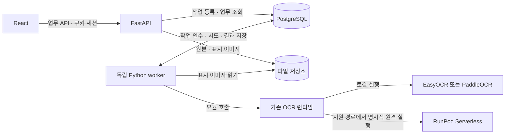

# 포스터 OCR·행사 정보 추출 및 검수 서비스 명세서

| 항목 | 내용 |
|---|---|
| 문서 버전 | v0.2 |
| 최초 작성일 / 개정일 | 2026-10-12 / 2026-10-14 |
| 대상 저장소 | SKN33-Final-1Team |
| 현재 코드 기준 | `ffa287b` — React·FastAPI 검수 시제품 |
| 문서 상태 | **현재 구현과 후속 확장 설계 — 팀 공유용** |
| 이번 산출물 | React + FastAPI 유지 결정 반영. PostgreSQL·영속 worker·운영 인증은 미구현 목표 |

## 1. 목적과 결정 사항

포스터 이미지를 업로드하면 OCR로 글자를 읽고, 행사 정보를 추출하며, 사용자가 확정한 기준과 비교해 근거가 있는 검수 결과를 제공한다. 이미지·기준 버전·실행 결과를 보존하여 다른 팀원이 같은 검수 이력을 다시 확인할 수 있게 한다.

**2026-10-14 결정한 구조와 제약**

- 프런트엔드는 **React**, 공개 업무 API는 **FastAPI**를 유지한다. 기존 로그인·자료 입력 → 기준 확정 → 검수 실행 → 결과 확인 흐름을 확장한다.
- 업무 DB의 목표는 **PostgreSQL**이다. 현재 JSON 저장을 DB 기반 기록으로 확장하되 DB 접근·마이그레이션 라이브러리는 아직 선정하지 않았다.
- 무거운 검수는 **독립 Python worker**가 기존 OCR 모듈을 직접 호출하고 추출·판정·결과 저장까지 수행하도록 분리한다. 별도 내부 OCR HTTP 서버는 필수 구성에 넣지 않는다.
- **Apple Vision을 사용하지 않는다.** 현재 EasyOCR 로컬 경로는 CUDA → MPS → CPU를 선택한다. Paddle 단독 경로는 별도 Python 환경의 CPU 작업자로 실행한다. 서로 다른 경로의 장치 지원을 동일하게 가정하지 않는다.
- RunPod 실행은 명시적으로 선택한 경우에만 사용한다. 로컬 실패를 이유로 유료 원격 실행으로 자동 전환하지 않는다. 선택한 OCR 경로의 원격 지원 여부도 실행 전에 확인한다.

이 결정은 v0.1의 Django·DRF 도입 계획을 대체한다. 기존 React와 FastAPI를 활용하면서 필요한 업무 기능을 추가한다. 기획 원본, [2026-10-13 OCR 작업 지시서](codex-ocr-improvement-task.md), 날짜별 실험 보고서는 당시 기록으로 보존하며 현재 아키텍처 판단에는 이 개정본을 우선한다.

**이 명세서의 구현 제안**

PostgreSQL에 저장하는 작업 큐, 독립 Python worker, 서버 저장 세션, 프로젝트별 접근 권한, 서버가 발급하는 불변 기준 버전을 도입한다. 모두 후속 구현이며 현재의 임시 로그인·JSON 저장·`BackgroundTasks`와 구분한다. 초기에는 Redis/Celery와 OCR 전용 HTTP 서버를 필수로 추가하지 않는다.

## 2. 현재 구현과 변경 범위

| 구분 | 현재 구현 | 목표 구현 |
|---|---|---|
| 화면 | React 19 + Vite 7, 소개·로그인·검수 화면 | 기존 화면 유지 + 프로젝트 목록·이력 상세·작업 재진입 |
| 공개 API | FastAPI가 로그인·업로드·OCR 실행·판정·결과 조회 제공 | 같은 FastAPI에서 운영 인증·프로젝트·기준 버전·이력 API 확장 |
| 검수 기록 | `.runtime/reviews/<UUID>/`의 JSON·이미지 | PostgreSQL의 관계형 데이터 + 파일 저장소 |
| 기준 확정 | 브라우저 스냅샷·정수 버전, 실행 요청 때 서버에 함께 저장 | 서버에 별도로 확정·저장하는 프로젝트별 불변 버전 |
| 실행 | FastAPI `BackgroundTasks`, 프로세스 내부 잠금 | PostgreSQL 작업 기록 + 독립 Python worker |
| OCR | 로컬 기본 Paddle 단독(`paddle-only`), EasyOCR 기준선·줄 결합·재인식 등 비교 경로. RunPod 기본은 `baseline` | 기존 OCR 모듈을 worker에서 호출하고 실행 설정·근거·시도 기록 보존 |
| 판정·행사 정보 추출 | `review_rules.py`, `extract_event.py`, `event_layout.py` | 기존 규칙·추출기를 worker에서 재사용 |
| 사용자·권한 | localhost용 `admin / admin`, 메모리 세션·로그인/로그아웃 CSRF | 실제 사용자·서버 저장 세션·프로젝트 멤버십·검수 접근 통제 |
| 재실행 | 새 UUID 생성, 이전 실행과 관계 없음 | 새 실행에 `retry_of` 연결, 이전 결과 보존 |
| 재시작 | 남아 있는 queued/running JSON을 failed 처리 | DB 작업 상태와 시도 기록을 기준으로 복구·실패 판정 |

현재 API는 다음과 같다. `/api/v1/auth`는 이미 FastAPI에 있는 임시 인증 경로이며, 아래 6절의 업무 API 전체가 구현되었다는 뜻은 아니다.

| 구분 | 현재 경로·동작 |
|---|---|
| 임시 인증 | `GET /api/v1/auth/csrf`, `GET /api/v1/auth/me`, `POST /api/v1/auth/login`, `POST /api/v1/auth/logout` |
| 준비 상태·샘플 | `GET /api/health`, `GET /api/sample`, `GET /api/sample/image` |
| 검수 생성 | `POST /api/reviews` — 이미지·기준 배열·정수 버전·프로젝트명을 함께 보내는 multipart 요청 |
| 진행·결과·이미지 | `GET /api/reviews/{id}`, `GET /api/reviews/{id}/image` |

현재 임시 로그인은 8시간 메모리 세션이며 서버 재시작 때 사라진다. 검수 API에는 아직 사용자·프로젝트별 접근 검사가 연결되어 있지 않다. 프로젝트 DB·이력 목록·영속 작업 큐·새로고침 후 작업 복원 화면도 후속 구현이다.

현재 코드 근거: [검수 API](../backend/app/api.py), [임시 인증](../backend/app/local_auth.py), [OCR 런타임](../backend/app/ocr_runtime.py), [Paddle 단독 연결](../backend/app/paddle_ocr.py), [여러 줄 추출](../backend/app/event_layout.py), [React 경로 구성](../frontend/src/App.jsx), [화면 상태 전이](../frontend/src/workflow.js), [데이터 파이프라인](data-pipeline.md).

## 3. 서비스 구성과 책임

다음은 **후속 확장 목표**다. 현재 시제품은 FastAPI 프로세스의 `BackgroundTasks`로 검수를 실행하며 로컬 JSON에 결과를 저장한다.



| 구성 | 소유하는 책임 |
|---|---|
| React | 자료 입력, 기준 편집·확정, 진행 상태 조회, 근거 박스, 결과·행사 정보·이력 표시 |
| FastAPI | 인증·권한, 프로젝트, 업로드, 기준 버전, 작업 생성, 이력·결과 API |
| 독립 Python worker | 영속 작업 인수, OCR 모듈 호출, 출력 검증, 행사 정보 추출, 기준별 판정, 결과 저장 |
| PostgreSQL | 사용자·세션·프로젝트·파일 메타데이터·기준·실행·시도·OCR 근거·판정·이벤트 |
| OCR 모듈 | OCR용 전처리·추론, 경로별 장치 선택, RunPod 어댑터, OCR 출력 |
| 파일 저장소 | 변경하지 않는 업로드 원본과 방향·배경을 정규화한 표시 이미지 |

React는 FastAPI만 호출한다. FastAPI와 worker는 공통 업무 로직·DB 접근 계층을 사용하되 별도 프로세스로 실행한다. OCR 모듈은 업무 DB를 직접 수정하지 않으며, 결과 검증·업무 기록 저장은 worker가 맡는다. 목표 구조의 웹 프로세스에는 OCR 모델을 로드하지 않는다. 이는 현재 `BackgroundTasks` 실행 방식에서 바꿀 부분이다.

Paddle 전용 Python 환경의 모델 작업자와 여기서 설계하는 영속 검수 worker는 역할이 다르다. 전자는 현재 모델 실행을 분리하는 하위 프로세스이고, 후자는 DB 작업 인수·복구·판정·저장을 담당하도록 새로 구현할 프로세스다.

## 4. 사용자 흐름과 기능 요구사항

아래는 목표 요구사항이며, 현재 구현 범위는 2절을 기준으로 확인한다.

| ID | 기능 | 요구사항 |
|---|---|---|
| FR-01 | 로그인·프로젝트 | 관리자에게 발급받은 계정으로 로그인하고 접근 가능한 프로젝트를 선택·생성한다. 프로젝트는 UUID로 식별한다. |
| FR-02 | 자료 입력 | 단일 포스터와 원문 요구사항을 입력한다. 이름은 신규 프로젝트 생성 시 입력하고 기존 프로젝트에서는 선택한 이름을 표시한다. 이름 변경은 owner의 별도 기능이다. 샘플 이미지도 일반 업로드와 같은 검증·저장 경로를 사용한다. |
| FR-03 | 기준 편집 | 현재처럼 항목 추가·수정·선택, 정보/시각 유형을 지원한다. 편집 중인 값은 미확정 초안이다. |
| FR-04 | 기준 확정 | 선택한 항목과 원문 요구사항을 FastAPI를 통해 DB에 저장한다. 서버가 `criteria_version_id`와 프로젝트별 증가 버전을 발급한다. 확정 버전은 직접 수정하지 않는다. |
| FR-05 | 검수 요청 | 저장된 이미지 ID와 확정 기준 버전 ID로 요청한다. DB 저장 후 `202`와 검수 ID를 반환한다. |
| FR-06 | 진행 조회 | queued/running/completed/failed를 표시한다. 화면을 닫아도 작업은 서버에 남으며 URL로 재진입할 수 있다. |
| FR-07 | 결과 | 충족/위반/확인 필요 필터, 판단 이유, OCR 텍스트, 이미지 근거 박스, JSON 내보내기를 유지한다. |
| FR-08 | 행사 정보 | 행사명·시작일·종료일·장소의 추출값, 출처 OCR ID, 확인 필요 사유를 표시한다. 알 수 없는 값은 `null`로 둔다. |
| FR-09 | 검수 이력 | 프로젝트별 최신순 목록, 상태 필터, 기준 버전, 요청자, 생성·완료 시각, 결과 요약, 상세 링크를 제공한다. |
| FR-10 | 재검수 | 사용자의 명시적 재검수는 새 실행과 `retry_of`를 생성한다. 통신 재전송은 같은 멱등키로 기존 실행을 반환한다. |
| FR-11 | 기록 보존 | 기준·이미지 변경은 편집 화면의 결과 연결만 해제한다. 이미 저장된 과거 기준과 검수 결과를 삭제하거나 덮어쓰지 않는다. |

검수 이력이 없으면 빈 목록과 새 검수 버튼을 표시한다. 임의의 성공 결과를 넣지 않는다. 상태 조회 통신 실패는 OCR 작업 실패와 구분하여 ‘진행 상태 다시 확인’을 제공한다. `progress`는 단계 진행 표시이며 남은 시간이나 OCR 정확도를 뜻하지 않는다.

이미지 업로드와 기준 확정이 성공해 서버의 이미지 UUID·기준 UUID·버전을 받은 뒤에만 실행 버튼을 활성화한다. 미확정 편집 초안의 새로고침 복원은 초기 범위에 포함하지 않는다. 이미 확정된 버전과 실행 이력은 서버에서 재조회한다.

이번 단계에서 말하는 **검수 이력**은 기준 확정·실행·자동 판정·재실행 기록이다. 사람의 최종 승인·반려와 수정 라벨을 남기는 별도 검토 기능은 후속 범위로 둔다. 자동 처리 `completed`를 사람의 승인 완료로 표시하지 않는다.

## 5. PostgreSQL 데이터 모델

모든 업무 ID는 UUID를 기본으로 하고 시각은 timezone-aware UTC로 저장한다. 화면에서는 사용자 시간대에 맞춰 표시한다. 아래는 목표 논리 모델이며 실제 테이블 이름과 DB 접근·마이그레이션 도구는 구현 단계에서 확정한다. 현재 PostgreSQL 연결이나 ORM을 채택·구현한 상태가 아니다.

| 모델 | 주요 필드·관계 | 주요 제약 |
|---|---|---|
| User | 로그인 식별자, 비밀번호 해시, 활성 상태, 생성일 | 평문 비밀번호 저장 금지; 해시·검증 라이브러리는 구현 시 선정 |
| UserSession | user, 세션 식별자 해시, 만료·폐기 시각 | 임의 세션 토큰을 HttpOnly 쿠키로 제공; 서버에서 만료·폐기 관리 |
| Project | 이름, owner, 생성일, archived_at | 동명 프로젝트를 이름으로 합치지 않음 |
| ProjectMembership | project, user, role | `(project, user)` 유일; owner/editor/viewer |
| ImageAsset | project, uploader, 원본/표시 파일 키·SHA256·크기, 실제 MIME, 각 이미지 치수, EXIF 처리 정보 | 실행에서 참조한 원본·표시 이미지 불변 |
| CriteriaVersion | project, version, 원문 요구사항, content_hash, confirmed_by/at | `(project, version)` 유일; 확정 후 불변 |
| CriterionItem | criteria_version, 항목 키, 순서, text, type, source | `(criteria_version, 항목 키)` 유일 |
| ReviewRun | project, image, criteria_version, requester, status/stage, progress, 실행 설정, pipeline/rule 버전, retry_of, 시각 | 한 실행의 이미지·기준·설정 고정 |
| ReviewAttempt | run, attempt_no, request_id, status, finished_at, lease_token/expiry, dispatch_state, 대상·실제 장치·모델, 원격 job ID, 오류·시각 | `(run, attempt_no)` 유일; status=active 시도는 실행당 하나 |
| OCRRecord | attempt, record_id, text, confidence, bbox/polygon, coordinate_space | `(attempt, record_id)` 유일 |
| CriterionResult | run, criterion_item, status, observed_text, reason | `(run, criterion_item)` 유일 |
| ResultEvidence | criterion_result, ocr_record | 같은 연결 중복 금지 |
| EventExtraction | run, 추출 필드 JSON, 경고, parser_version | 실행당 하나; 필드별 source_ocr_ids 포함 |
| ReviewEvent | run, 이벤트 유형, 이전/새 상태, actor, 발생 시각, 안전한 사유 | 서비스에서 추가만 허용, 수정·삭제 API 없음 |
| IdempotencyRecord | user, operation, key, request_hash, 생성된 리소스 ID | `(user, operation, key)` 유일 |

`ReviewRun` 상태·생성 시각, 프로젝트별 생성 시각, worker 대상 queued 작업, lease 만료 시각에 조회용 인덱스를 둔다. OCR 설정·추출 필드·안전한 오류 상세처럼 형태가 달라지는 작은 데이터에는 PostgreSQL JSONB를 사용하되 주요 관계와 상태를 통째로 JSON 파일처럼 저장하지 않는다.

확정 기준의 버전 번호는 프로젝트 행 잠금과 DB 유일 제약으로 발급한다. 실행이 참조하는 기준·이미지는 삭제를 제한하고 첫 버전의 프로젝트 삭제는 보관 처리로 제공한다. 프로젝트 생성 시 owner 멤버십을 함께 만들며, 이력의 요청자·확정자 참조도 계정 비활성화 이후 보존한다.

파일 바이트는 PostgreSQL에 넣지 않는다. 초기 파일 저장소는 영속 로컬 볼륨, 추후 object storage로 교체 가능한 인터페이스로 둔다. DB와 파일을 하나의 트랜잭션처럼 가정하지 않는다. 같은 볼륨의 임시 파일 → UUID 최종 경로로 atomic rename → DB 메타데이터 저장 순서로 처리한다. DB 저장 실패 시에는 해당 업로드가 만든 파일만 정리한다. 별도 미참조 파일 정리는 진행 중 업로드를 제외하고 유예기간 후 수행하여 파일 확정과 DB 커밋 사이의 삭제 경쟁을 막는다. 보관 중인 실행이 참조하는 파일은 정리 대상에서 제외한다.

## 6. FastAPI 공개 API 계약 — 후속 구현

새 API의 기본 경로는 `/api/v1`이며 trailing slash 없이 통일한다. 아래는 목표 계약이다. `/auth`의 경로는 현재 임시 인증과 겹치지만 운영 인증으로 확장해야 한다. 기존 multipart 검수 제출은 이미지 업로드·기준 확정·검수 생성으로 분리하므로 React 요청도 함께 수정한다. 프레임워크를 유지하더라도 이 API 변경은 자동으로 적용되지 않는다.

| 메서드·경로 | 동작 |
|---|---|
| `GET /api/v1/auth/csrf` | CSRF 쿠키·토큰 준비 |
| `POST /api/v1/auth/login`, `POST /api/v1/auth/logout` | 세션 로그인·로그아웃, 로그인도 CSRF 검증 |
| `GET /api/v1/auth/me` | 현재 사용자·로그인 상태 |
| `GET /api/v1/projects`, `POST /api/v1/projects` | 권한 있는 프로젝트 목록·생성 |
| `GET /api/v1/projects/{id}`, `PATCH /api/v1/projects/{id}` | 상세·이름 변경·보관 처리 |
| `POST /api/v1/projects/{id}/images` | 원본 업로드, `201`과 이미지 ID·표시 이미지 정보 반환 |
| `GET /api/v1/images/{id}`, `GET /api/v1/images/{id}/content` | 파일 메타데이터·권한 검사된 표시 이미지 |
| `GET /api/v1/projects/{id}/criteria-versions` | 확정 버전 목록·항목 조회 |
| `POST /api/v1/projects/{id}/criteria-versions` | 기준 확정, `201`과 UUID·서버 버전 반환; 멱등키 필수 |
| `POST /api/v1/reviews` | 검수 생성, `202 {id,status:"queued"}`; 멱등키 필수 |
| `GET /api/v1/projects/{id}/reviews` | 최신순 검수 이력; status 필터, cursor 페이지네이션 |
| `GET /api/v1/reviews/{id}` | 진행·기준 스냅샷·OCR·행사 정보·판정 상세 |
| `POST /api/v1/reviews/{id}/retry` | 같은 이미지·기준으로 새 실행 생성; 멱등키 필수 |
| `GET /api/v1/reviews/{id}/image` | 해당 실행과 연결된 표시 이미지 |
| `GET /api/v1/sample`, `GET /api/v1/sample/image` | 샘플 입력 정보·이미지 |
| `GET /api/v1/health` | 공개 가능한 서비스 준비 상태·입력 제한; 비밀 설정 제외 |

검수 생성 요청 예시:

```http
POST /api/v1/reviews
Content-Type: application/json
Idempotency-Key: <클라이언트가 생성한 UUID>
X-CSRFToken: <CSRF 토큰>

{
  "project_id": "<프로젝트 UUID>",
  "image_id": "<이미지 UUID>",
  "criteria_version_id": "<확정 기준 UUID>"
}
```

서버는 세 리소스가 같은 프로젝트에 속하는지와 요청자의 권한을 검증한다. 클라이언트가 임의 장치·서버 주소를 주입하지 못하도록 실행 대상은 서버 설정에서 결정하고 실행에 스냅샷으로 저장한다. 명시적 재검수는 기존 실행이 종료된 후 허용하며, 기준을 바꾸려면 일반 검수 생성 API를 사용한다.

동일 operation·멱등키·정규화한 요청 내용이면 기존 리소스를 반환하고, 같은 키에 다른 내용이면 `409`이다. 멱등 기록과 기준 버전 또는 검수 실행은 같은 atomic 트랜잭션에서 생성한다. 키의 유일 제약 충돌 시 해당 트랜잭션을 롤백하고 기존 요청 해시·리소스를 조회하며 새 리소스를 따로 생성하지 않는다. 재전송된 검수 생성은 작업이 이미 종료됐더라도 동일 ID와 **현재 실제 상태**를 반환한다. 멱등키는 연결된 리소스가 보존되는 동안 함께 보존한다.

상세 응답은 기존 React 결과 컴포넌트가 사용하는 `id/status/stage/progress/project_name/criteria_version/image/results/runtime/ocr/created_at/updated_at` 구조를 유지하고 프로젝트·기준 UUID, `retry_of`, `event_extraction`을 추가한다. `results[].status`는 `pass|fail|review`이며 작업 상태와 구분한다. `evidence[].bbox_xyxy`는 표시 이미지 좌표다.

목표 오류 형식은 `{ "error": { "code": "...", "message": "...", "fields": {} } }`로 통일하고 작업 상세의 오류는 같은 객체 또는 `null`로 한다. 미인증·세션 만료는 `401`, CSRF 실패·권한 거절은 `403`, 접근 불가 리소스는 `404`, 충돌은 `409`, 크기 초과는 `413`, 지원하지 않는 이미지 형식은 `415`, 요청 스키마 검증 실패는 `422`, 그 밖의 잘못된 요청은 `400`, 과부하는 `429/503`으로 구분한다. `auth/me`는 로그인 전에도 `200`과 `authenticated: false`로 상태를 알 수 있게 한다.

현재 FastAPI는 `detail` 기반 오류를 반환하고, 저장된 검수 실패 `error`는 문자열이다. 현재 로그인 자격 증명 오류는 `401`, 로그인·로그아웃 CSRF 오류는 `403`이다. 목표 오류 객체·운영 세션·보호 API의 인증 처리는 아직 완성된 공통 계약이 아니므로 React의 요청 처리와 서버 오류 변환을 함께 검증한다.

health 응답은 `status/checks/limits`로 구성하고 `limits.upload_bytes/image_pixels/image_side`는 유지한다. checks의 API·DB·worker·OCR 런타임·모델 준비 상태는 각각 `ready/not_ready/unknown`과 점검 시각을 제공한다. React의 기존 단일 `runtime.ready` 판독은 새 어댑터로 교체하고, 확인되지 않은 원격 상태는 unknown으로 표시한다. 모델 파일 준비·로딩 여부·마지막 실제 추론 성공은 별도 정보로 표시한다.

## 7. 이미지 전처리와 worker·OCR 모듈 계약

### 7.1 입력과 좌표 소유권

1. **FastAPI**가 업로드 원본을 검증하고 원본 바이트·SHA256을 그대로 보존한다. 제한은 20 MiB, 1,000만 픽셀, 한 변 8,192px이다. 실제 파일 서명으로 JPEG/PNG/WEBP 정지 이미지만 허용한다.
2. **FastAPI**가 EXIF 방향 적용 → 투명 영역 흰색 합성 → RGB PNG 변환을 한 번 수행하여 표시 이미지를 저장한다. 원본·표시 이미지의 해시와 치수를 각각 기록한다.
3. **worker의 OCR 어댑터**가 표시 이미지를 Lanczos로 가로·세로 2배 확대하고 기존 OCR 모듈을 호출한다. EXIF 회전을 다시 적용하지 않는다.
4. **worker의 OCR 어댑터**가 OCR 입력 좌표의 bbox·polygon을 2로 나눠 표시 이미지 좌표로 복원한다. DB 저장·FastAPI 응답·React 표시에서는 다시 나누지 않는다.
5. 최종 좌표계는 `normalized_original_pixels`이고 원점은 표시 이미지 왼쪽 위이다. bbox 형식은 `[x_min,y_min,x_max,y_max]`, x는 오른쪽·y는 아래 방향, 유효 범위는 이미지 경계 안이다.

현재는 `api.py`의 검수 작업 함수가 2배 확대·OCR 호출·좌표 복원을 수행한다. 이를 worker로 옮길 때도 변환은 정확히 한 번만 수행한다. 기존 OCR 런타임의 2배 입력 제한 128 MiB·4,000만 픽셀과 RunPod의 **전처리된 전달 파일 7 MiB 이하** 제한을 유지한다. 초과하면 명확한 오류를 반환하고 원본을 몰래 축소하거나 외부 실행으로 바꾸지 않는다.

기존 데이터셋 CLI는 EXIF 역변환을 거친 **원본 저장 픽셀 좌표**를 쓴다. 서비스의 표시 이미지 좌표와 구분하며, 변환 없이 같은 라벨·근거로 취급하지 않는다. 현재 웹 OCR 레코드의 bbox·polygon 보존과 표시 이미지 기준 좌표를 새 worker 계약에서도 유지한다.

### 7.2 동기 모듈 입력·출력 — 후속 구현

worker는 서버가 관리하는 파일 저장소에서 표시 이미지를 읽고 기존 OCR 함수를 동기 호출한다. 아래는 작업 실행 어댑터의 목표 계약이며, 현재 함수 시그니처에 이미 모든 필드가 있다는 뜻은 아니다. 브라우저가 임의 서버 파일 경로나 외부 URL을 지정할 수 없게 한다.

| 입력 필드 | 의미 |
|---|---|
| `review_id`, `attempt_id`, `request_id` | 저장된 검수 UUID와 worker가 생성·검증하는 시도·호출 UUID |
| `source_sha256` | 원본 식별용 해시; 표시 이미지만 읽는 OCR 함수가 원본 바이트를 검증했다는 의미는 아님 |
| `display_sha256`, `display_image` | 서버가 저장한 표시 이미지의 해시와 파일 참조; worker가 실제 바이트의 해시·치수 확인 |
| `pipeline`, `pipeline_version` | 실행에 고정한 OCR 경로와 전처리·좌표 계약 버전 |
| `expected_execution_target` | 실행에 고정한 `local` 또는 `runpod`; worker 설정·경로 지원과 다르면 추론 전에 거절 |

기존 OCR 출력에 worker의 검증된 실행 문맥을 합쳐 저장할 정보:

```text
schema_version, review_id, attempt_id, request_id
source_sha256, display_sha256, pipeline, pipeline_version
engine, engine_version, model_version, execution_target, device, fallback_attempts
remote_job_id (로컬은 null)
display_dimensions, ocr_input_dimensions, scale=2
coordinate_space="normalized_original_pixels"
records[]: {id, text, confidence, bbox_xyxy, polygon}
timings
```

OCR 함수에는 픽셀·실행 설정을 전달하고, 기대 정답·라벨·원래 파일명으로 인식을 보정하지 않는다. 반환값에 없는 모델 버전·시간·원격 job ID를 추정하여 채우지 않는다. `model_version`에는 실제 재현 가능한 모델 식별자·체크섬을 기록하도록 확장한다.

모듈 오류는 안전한 `code/message/retryable/dispatch_state/remote_job_id`로 변환하여 시도에 기록한다. `retryable` 하나만으로 자동 재실행하지 않고 다음 절의 실행·제출 상태 정책을 함께 적용한다. 실행 대상·pipeline 버전이 맞지 않으면 추론·RunPod 제출 전에 `CONFIGURATION_MISMATCH`로 실패 처리한다. 동기 함수의 반환값이나 예외를 HTTP 상태 코드처럼 표현하지 않는다.

worker는 ID·해시·스키마 버전·치수·좌표계, 중복 OCR ID, NaN/Infinity, 좌표 범위, confidence의 `null` 또는 0~1 범위를 검증한 뒤 저장한다. 출력의 최대 항목 수는 최초 제안 10,000개이며 측정에 따라 설정한다. 초과 결과를 조용히 버리지 않고 명시적인 계약 오류로 처리한다.

**선택 확장:** 이후 OCR을 별도 서버로 분리할 때만 `/internal/v1/ocr` 같은 내부 HTTP 계약, 서버 간 토큰·네트워크 제한, 전달 ID·해시 검증, 요청·응답 크기 제한을 추가한다. 이전 설계의 정규화 이미지 64 MiB·1,000만 픽셀 및 응답 10 MiB 제한은 이 선택 확장의 제안값이며 현재 직접 모듈 호출의 HTTP 제한이 아니다. 이 내부 서버나 포트는 이번 목표의 필수 구성에 포함하지 않는다.

### 7.3 장치·실행 대상

- EasyOCR 로컬 경로는 CUDA → MPS → CPU를 선택하며 실제 장치·fallback 이력을 기록한다. 명확한 장치 미지원·GPU 메모리 부족에만 다음 장치를 시도하고 손상 이미지·모델 누락·다운로드 오류를 CPU 재시도로 숨기지 않는다.
- Paddle 단독은 현재 `.runtime/paddle-env`의 CPU 작업자를 사용한다. `PP-OCRv5_server_det`와 `korean_PP-OCRv5_mobile_rec`을 명시적으로 준비하며, CUDA·MPS·RunPod 지원을 이미 검증한 것처럼 표시하지 않는다.
- RunPod Serverless는 해당 실행 경로에서 지원하고 명시적으로 선택했을 때만 사용한다. RunPod Pod에서 기존 로컬 런타임을 실행한다면 호환 장비의 CUDA 지원을 별도로 검증한다.
- 로컬과 RunPod 사이의 자동 전환은 하지 않는다. 모델 준비 실패·지원하지 않는 경로·원격 요청 제한을 실행 전에 확인한다.
- 초기 검수 worker 수와 동시 추론 수는 각각 1로 제안한다. Paddle 하위 프로세스도 이 작업자의 실행 수명에 포함한다. Uvicorn 웹 worker 수를 늘리는 것을 OCR 병렬화로 취급하지 않는다.

## 8. 작업 상태·재시도·장애 처리

아래는 아직 구현되지 않은 영속 worker의 목표다. 현재의 `BackgroundTasks`와 서버 재시작 시 실패 처리에 이 복구 기능이 있다는 뜻은 아니다.

### 8.1 영속 작업 큐

`ReviewRun`의 queued 행 자체를 PostgreSQL 작업 큐로 사용한다. FastAPI는 작업·첫 이벤트를 짧은 트랜잭션으로 저장한 뒤 반환한다. 별도 worker는 PostgreSQL의 `SELECT ... FOR UPDATE SKIP LOCKED`에 해당하는 동작으로 작업을 인수하고 시도 번호·lease를 기록한 후 커밋한다. 구체적인 DB 라이브러리 호출은 도구 선정 후 정한다. **OCR 모듈 실행·RunPod 응답 대기 중에는 DB 행 잠금이나 트랜잭션을 계속 잡지 않는다.**

worker는 호출 중 별도 heartbeat로 lease를 갱신하고, 주기적으로 만료 작업을 회수한다. heartbeat·완료 커밋에는 현재 시도·lease token 일치뿐 아니라 `ReviewRun.status=running`, 시도 `status=active`, `lease_expiry > DB 현재 시각`을 조건으로 둔다. 만료 lease를 늦은 heartbeat로 되살리지 않는다. 유효한 응답의 OCR 근거·추출 정보·판정·완료 이벤트는 한 트랜잭션으로 저장하고 늦게 도착한 이전 worker의 결과는 받지 않는다. 이 설계에서는 별도 outbox가 초기 필수는 아니다. 나중에 메시지 브로커를 도입하면 DB 커밋과 메시지 전달 사이의 유실 방지를 별도로 설계한다.

이 선택은 PostgreSQL의 트랜잭션·행 잠금과 작업 인수용 `SKIP LOCKED`를 사용하는 설계다. 실제 DB에서 경쟁 조건을 검증해야 하며 프레임워크 변경만으로 동시성 보장이 생기지는 않는다. [PostgreSQL SELECT](https://www.postgresql.org/docs/17/sql-select.html).

### 8.2 상태 계약

| 구분 | 값·규칙 |
|---|---|
| 실행 상태 | `queued → running → completed/failed`; 안전한 자동 재시도 대기에서는 다시 queued 가능 |
| 화면 단계 | `queued/preprocessing/ocr/review/completed/failed`; 최종 결과 저장 전에는 completed 표시 금지 |
| 항목 판정 | `pass/fail/review`; 실행 상태와 별개 |
| 시도 수명 | `active → succeeded/failed/unknown`; 종료 시 finished_at 기록, 제출 상태와 별개 |
| 시도 실행·제출 상태 | `not_dispatched/dispatching/submitted/unknown`; OCR 호출 직전에 dispatching을 DB에 기록, 원격 제출의 submitted는 job ID 확인 후 기록 |
| 자동 재시도 | 같은 ReviewRun의 새 ReviewAttempt; 기본 총 3회 이내, 제한된 backoff |
| 사용자 재검수 | 새 ReviewRun + retry_of; 새 멱등키 사용 |
| 큐 과부하 | 환경별 최대 대기 건수 설정, 최초 제안 100건; 초과 요청은 429로 거절 |

시도 종료와 실행 상태 변경은 같은 트랜잭션에서 처리한다. 재시도 인수 시 이전 시도가 종료됐는지 확인하고 새 active 시도 생성과 실행 점유를 원자적으로 수행한다. unknown 시도는 자동 재시도 대상에 넣지 않는다.

최초 운영 제안값은 heartbeat 15초, lease 90초이며 RunPod 총 대기 기본값 300초를 기준으로 검증한다. 긴 동기 OCR 실행 중에도 별도 heartbeat가 동작하게 하고, 로컬 실행 제한·하위 프로세스 종료 확인을 별도로 설계한다. timeout만으로 로컬·원격 추론 종료를 단정하지 않는다. 선택 확장인 내부 HTTP 서버를 도입할 때는 연결 5초·응답 330초를 시작값으로 검토하고 외부 timeout이 내부 RunPod 대기보다 짧지 않게 한다. 모든 값은 설정 가능하게 하며 실제 측정에 따라 조정한다.

### 8.3 장애별 처리

| 상황 | 처리 |
|---|---|
| 웹 서버 재시작 | DB queued 작업은 유지, worker가 계속 처리 |
| worker 종료·lease 만료 | 실행 전임이 확인되면 재대기; dispatching 이후 하위 프로세스·원격 실행 결과가 불명확하면 자동 재실행하지 않음 |
| OCR 실행 전 자원 부족·원격 연결 거절 | 모델 실행·원격 제출 전에 거절됐음이 확인된 경우에만 제한 재시도 |
| 잘못된 이미지·모델 누락·인증·응답 계약 오류 | failed와 원인 저장, 자동 반복 금지 |
| OCR 하위 프로세스 통신 유실·원격 응답 유실·timeout | `OCR_OUTCOME_UNKNOWN`으로 실패 기록, 시도는 unknown; UI에 실행 결과 확인 불가 안내 |
| RunPod job ID를 아는 상태에서 조회 오류 | 같은 job ID 상태 조회를 제한 재시도; 새 `/run` 제출 금지 |
| RunPod 제출 후 ID조차 못 받은 경우 | 제출 결과 불명으로 기록, 자동 유료 재제출 금지 |
| 완료 결과 저장 시 DB 오류 | lease가 유효하면 이미 받은 결과의 저장만 재시도; 새 OCR 요청으로 대체하지 않음 |
| 상태 조회 통신 오류 | 프런트의 조회 재시도만 제공, 실행 상태를 임의로 failed로 변경하지 않음 |

초기에는 모든 로컬 하위 프로세스·원격 추론 결과를 재시작 후 복구하는 별도 레지스트리를 두지 않는다. 따라서 worker가 저장 전에 잃어버린 추론 결과를 반드시 복구하는 기능은 범위 밖이다. **DB 결과 중복 방지와 GPU 추론의 정확히 한 번 실행은 다르다.** 사용자가 불명 상태의 작업을 재검수할 때도 이전 실행이 계속 중일 수 있음을 표시한다. 알려진 원격 작업의 취소는 시도할 수 있지만 성공으로 단정하지 않는다.

FastAPI `BackgroundTasks`를 영속 작업 큐로 재사용하지 않는다. 무거운 처리를 별도 프로세스에서 수행하는 설계의 배경은 [FastAPI Background Tasks 안내](https://fastapi.tiangolo.com/tutorial/background-tasks/#caveat)를 참고한다.

## 9. 행사 정보 추출·판정·라벨 정책

독립 Python worker가 OCR 모듈의 검증된 출력으로 기존 [행사 정보 추출기](../backend/app/extract_event.py), [여러 줄 추출기](../backend/app/event_layout.py), [판정 규칙](../backend/app/review_rules.py)을 실행한다. 파일명·정답 라벨·샘플 설명으로 OCR 결과를 채우지 않는다.

- 핵심 필드: `event_name`, `start_date`, `end_date`, `location_raw`.
- 필드별로 `value`, `source_ocr_ids`, `status`, `normalization`, 필요 시 `reason`을 보존한다. 날짜는 검증 후 ISO `YYYY-MM-DD`로 기록한다.
- 현재 여러 줄 제목·날짜 결합과 불확실 영역 재인식 경로가 구현되어 있다. 선택한 pipeline에 따라 적용 여부가 다르며, 일반 행사 포스터 전체에 대한 정확도를 보장하지 않는다.
- 주최자·운영 시간·입장료·연락처·웹사이트는 현재 추출 범위에서 근거 부족이면 `null/needs_review`로 유지한다.
- `pass`는 구현된 기준을 뒷받침하는 근거가 있는 경우에만 사용한다. `fail`은 위반을 확인하는 규칙·근거가 있는 경우에만 사용한다.
- OCR 누락, 부재·금지 조건의 불확실성, 로고 형태·색상·잘림 등 시각 조건은 `review`로 보낸다. 현재 특정 김천시 로고 기준은 `김천시` 문구를 근거로 통과시키는 임시 정책이며 심벌의 동일성을 검증하지 않는다. 장식의 의도적 잘림은 허용하고 문구·필수 요소의 잘림을 확인한다는 후속 범위도 유지한다. OCR confidence를 사실 여부의 확률로 표시하지 않는다.
- JSON 라벨 초안은 계속 `human_verified=false`, `use_for_training=false`로 유지한다. 사람 검증 전 학습·평가 정답으로 승격하지 않는다.

OCR 성능은 [프로젝트 소개의 최종 비교](../README.md#최종-ocr-비교-결과)와 [날짜별 Paddle 단독 보고서](ocr-paddle-only-2026-10-13.md)를 기준으로 읽는다. 기존 실험의 수치·분모·측정 조건과 화면 확인용 재실행은 그대로 보존하며, 이번 문서 개정이나 업무 API 확장을 새 OCR 성능 측정으로 합산하지 않는다.

## 10. 인증·권한·운영 설정

현재 `local_auth.py`는 localhost용 임시 계정·8시간 메모리 세션·로그인/로그아웃 CSRF 검사를 제공한다. 운영 인증의 목표는 **FastAPI에서 검증하는 쿠키 세션 + CSRF**다. 실제 계정·비밀번호 해시 검증·DB 세션 저장·만료·폐기·권한 검사·관리자 계정 발급은 후속 구현이며 FastAPI 자체가 이 기능을 자동 제공한다고 가정하지 않는다.

React 개발 서버는 `/api`를 FastAPI에 프록시하고 운영에서는 같은 사이트로 제공하는 구성을 유지한다. 로그인 자체를 포함한 변경 요청에 CSRF를 적용한다. 운영 세션 쿠키는 HTTPS에서 `Secure`·`HttpOnly`와 적절한 `SameSite` 정책을 적용하고, 로컬 개발 쿠키 설정과 구분한다. 기존 `admin / admin`은 운영 계정으로 사용하지 않는다.

| 역할 | 목표 권한 |
|---|---|
| viewer | 프로젝트·기준·이력·근거 이미지·결과 조회 |
| editor | viewer 권한 + 이미지 업로드·기준 확정·검수·재검수 |
| owner | editor 권한 + 프로젝트 이름·보관 상태 관리 |
| 운영 관리자 | 별도 보호된 관리 명령 또는 관리 API로 계정·멤버십 관리 |

프로젝트 생성자는 owner가 된다. 공개 회원가입·SSO·프런트 멤버 관리 화면은 후속 범위다. 목록·상세뿐 아니라 이미지 다운로드·JSON 결과에도 같은 접근 검사를 적용한다. 관리 기능도 확정 기준·완료 결과·이벤트를 임의 수정하지 못하게 한다. 관리 명령·API의 구체적 인터페이스는 구현 시 정한다.

비밀 설정은 환경변수로 분리한다. FastAPI에는 DB 연결·세션 관련 비밀 설정을, worker에는 DB 연결·OCR 대상·모델 경로·필요한 RunPod 키를 둔다. 별도 내부 OCR 서버를 추가할 경우에만 서버 간 주소·토큰 설정을 추가한다. 프런트에 DB·세션 비밀값·RunPod 키를 전달하지 않는다. 비밀키·업로드·모델·DB 볼륨은 Git에서 제외한다.

health는 웹 프로세스 응답, DB 접근, worker heartbeat, 모델 파일 준비, 모델 로딩 여부, 마지막 실제 OCR 성공을 구분한다. 모델 상태는 worker가 보고한 시각과 함께 제공하며 웹 프로세스에서 모델을 로드하지 않는다. 파일 존재나 RunPod endpoint 설정만으로 실제 추론 성공을 표시하지 않는다. health 조회가 모델 다운로드나 유료 추론을 실행하지 않게 한다. 로그는 review/attempt/request ID로 연결하고 비밀값·원본 이미지 바이트는 기록하지 않는다.

## 11. 개발 환경·폴더 구성 제안

현재 기술 기준은 Python 3.12, React 19/Vite 7, FastAPI·Uvicorn, 경로별 EasyOCR/PyTorch 및 PaddleOCR 런타임이다. PostgreSQL은 목표 업무 DB로 유지하며 이전 제안의 17 버전을 기준으로 구현 시 호환성·운영 버전을 확인한다. DB 접근·마이그레이션 라이브러리는 미선정이며, 특정 도구가 FastAPI에 필수라고 가정하지 않는다. [FastAPI DB 안내](https://fastapi.tiangolo.com/tutorial/sql-databases/)를 참고하여 구현 시 선정한다. 웹·검수 worker·Paddle 모델 환경의 의존성과 모델 로딩 책임을 구분한다.

### 현재 주요 구성

```text
frontend/
  src/                            # App, 페이지, 인증, API 클라이언트, 검수 상태
  dist/                           # 현재 FastAPI가 제공하는 React 빌드
backend/
  app/
    api.py                        # 공개 API, BackgroundTasks, 결과 저장
    local_auth.py                 # localhost 임시 계정·메모리 세션
    ocr_runtime.py                # EasyOCR·장치 선택·RunPod 연결
    paddle_ocr.py                 # Paddle 단독 실행 어댑터
    paddle_full_worker.py         # Paddle 모델 환경의 하위 작업자
    event_layout.py               # 여러 줄 제목·날짜 결합
    review_rules.py               # 근거 기반 기준 판정
  tests/
scripts/                          # 라벨링·전처리·비교 CLI
start.py                          # 실행 전 검사 및 FastAPI 시작
run.sh / run.cmd                  # 공통 실행 진입점
.runtime/reviews/                 # 현재 이미지·JSON 결과, Git 제외
docs/
```

### 후속 확장의 모듈 구성 제안

다음 경로·이름은 구현 시 확정할 제안이며 아직 생성되지 않았다. 기존 `backend/app` 안에서 책임을 나누고 현재 공개 API·OCR 모듈을 점진적으로 재사용한다.

```text
backend/app/
  routes/                         # FastAPI 업무 API
  services/                       # 계정·프로젝트·기준·검수 업무 로직
  persistence/                    # PostgreSQL 접근·트랜잭션
  contracts/                      # API·worker 입력/출력 스키마
  worker.py                       # 별도 프로세스의 작업 인수·복구·OCR 호출
  ...                             # 기존 OCR·추출·판정 모듈 유지
backend/migrations/               # 도구 선정 후 DB 변경 이력
compose.yaml                      # PostgreSQL 등 로컬 기반 서비스, 구현 예정
```

| 프로세스 | 기본 주소·실행 방식 |
|---|---|
| React 개발 서버 | 현재 `127.0.0.1:5173`, API는 FastAPI에 프록시 |
| FastAPI 업무 API | 현재 기본 `127.0.0.1:8000`, 빌드된 React 제공 |
| 독립 Python worker | 후속 구현, 별도 Python 실행 진입점, HTTP 포트 없음 |
| PostgreSQL | 후속 구현, `127.0.0.1:5432`와 영속 볼륨 제안 |

현재 `run.sh`·`run.cmd`는 준비 상태를 검사하고 **FastAPI만 시작**한다. PostgreSQL이나 영속 worker를 자동 설치·실행하지 않는다. 현재 실행 옵션·포트는 [실행가이드](../실행가이드.md)를 따른다. 새 worker 명령·DB 준비·마이그레이션·포트 설정은 실제 구현 후 안내에 추가한다.

Mac의 EasyOCR MPS는 호스트 Python 프로세스를 기준으로 한다. Linux Docker 안에서 macOS MPS를 사용하는 것으로 가정하지 않는다. Paddle 단독의 CPU 실행과 운영 CUDA 지원은 각각 구분하여 검증한다. DB는 먼저 PostgreSQL 컨테이너로 제공할 수 있으며 파일·DB 백업과 복원 절차도 추가한다.

## 12. 전환 순서와 팀 작업 분담

개발팀 A–E의 책임은 유지한다. 아래는 업무 분담이며 구현 완료 여부나 시스템 내부 AI 역할을 나타내지 않는다.

| 역할 | 담당 영역 |
|---|---|
| A | FastAPI 업무 API·DB·운영 인증·권한·기준 버전·이력·운영 |
| B | 기준 구조화·OCR 모듈·정보 추출·규칙 검수 |
| C | 데이터·라벨·전처리·성능 평가·시각 검수 |
| D | 독립 worker·작업 복구·에이전트 연결·결과 통합·후속 업무 |
| E | React·입력·기준 확정·진행·결과·근거·이력 화면 및 API 연결 |

| 단계 | 담당 영역 | 산출물·선행 조건 |
|---|---|---|
| 1 | A·B·D·E 공통 | DTO·오류·좌표·상태 계약 고정, DB 도구 선정, 설정 범위 정리 |
| 2 | A 업무 API·DB | 사용자·세션·프로젝트·이미지·기준·실행 테이블, 마이그레이션, 인증·권한 API |
| 3 | B·C OCR | 기존 런타임의 worker 호출 계약·좌표·장치·RunPod 검증; 단계 2와 병행 가능 |
| 4 | D 작업 처리 | PostgreSQL 작업 인수·lease·멱등성·출력 검증·추출·판정·원자적 결과 저장 |
| 5 | E React | 확장 FastAPI 연결, 프로젝트·이력·재진입, 기존 로그인·검수 흐름 회귀 확인 |
| 6 | 전체 통합·문서 | PostgreSQL 경쟁 조건·선택 OCR 경로 실행 확인, 데이터 이전 도구, 실행·장애·백업 안내 |

A와 D는 DB 트랜잭션·작업 상태 계약을 함께 맞추고, B의 OCR·판정 모듈을 worker에서 재사용한다. E는 새 API 계약과 인증·오류 처리를 연결한다. 기존 기능을 유지한 상태에서 새 경로를 검증한 후 이전 검수 API의 호환·정리 시점을 정한다. 문서 개정만으로 기존 `/api/reviews` 경로를 삭제하지 않는다. 데이터 파이프라인 CLI import 경로도 함께 보존·검증한다.

기존 JSON 이력은 자동 삭제하거나 시작 시 무조건 DB로 가져오지 않는다. 이전 도구는 기본 dry-run으로 목록·누락·형식·해시를 검증하고 대상 프로젝트·귀속 사용자를 명시적으로 받아 실행한다. 기존 UUID를 이전 식별자로 보존하여 반복 실행 시 중복을 막는다. 같은 숫자 기준 버전에 서로 다른 내용이 있으면 별도 서버 버전으로 매핑하고 원래 값을 기록한다. 중단된 과거 실행은 재실행하지 않고 중단 이력으로 가져온다. 원본 이력은 검증 완료 전후에도 별도 보존한다.

## 13. 완료 기준과 검증 범위

| ID | 완료 조건 |
|---|---|
| AC-01 | PostgreSQL에 프로젝트·기준·검수·시도·근거·행사 정보·결과가 저장되고 재접속 후 조회된다. |
| AC-02 | React 기존 입력→확정→실행→결과 흐름, 샘플·직접 업로드, 필터·근거 박스·JSON 내보내기가 동작한다. |
| AC-03 | React는 FastAPI 업무 API만 호출한다. FastAPI·독립 worker만 업무 DB에 접근하고 OCR 모듈은 DB를 직접 수정하지 않는다. 웹 프로세스에서 OCR 모델을 로드하지 않는다. |
| AC-04 | 기준 v2를 확정·실행해도 v1의 항목·이미지·결과가 변경되지 않는다. |
| AC-05 | 같은 멱등키 동시 요청은 한 리소스로 연결되고 다른 내용 재사용은 409, 사용자 재검수는 새 이력이 된다. |
| AC-06 | 실제 PostgreSQL에서 기준 버전 경쟁·worker 경쟁·lease 만료·늦은 결과 거부·완료 트랜잭션 원자성을 검증한다. SQLite 결과로 대체하지 않는다. |
| AC-07 | 웹·worker·OCR 하위 프로세스 중단, 출력·원격 응답 유실, DB 저장 실패, RunPod 제출 불명 상태에서 무한 running·무조건 재실행·결과 중복이 발생하지 않는다. |
| AC-08 | EXIF 8방향·투명 배경·2배 좌표 복원·해시 일치·업로드 경계값·잘못된 OCR 응답을 검증한다. |
| AC-09 | 실제 계정·세션 발급·만료·폐기와 미로그인·비멤버의 이력·이미지 접근 차단을 검증한다. viewer는 조회·다운로드만 허용한다. 로그인·변경 요청의 CSRF와 401·403·404 계약도 검증한다. |
| AC-10 | 선택한 OCR 경로의 실제 장치·시간·성공 여부를 기록한다. EasyOCR MPS와 Paddle CPU를 구분하고 CUDA·RunPod는 모의 테스트와 실제 검증 여부를 구분한다. |
| AC-11 | 기존 OCR·판정·추출·데이터셋·React 테스트를 유지하고 변경한 API 계약과 이력 복원 시나리오를 추가 검증한다. |
| AC-12 | 초기 설치, DB migration, 각 프로세스 실행, 포트 변경, 장애 확인, DB+파일 백업·복원 절차가 문서화된다. |

이 완료 기준은 후속 구현의 검증 목록이다. 기존 [실행가이드](../실행가이드.md)의 테스트·실행 기록과 날짜별 OCR 보고서는 당시 코드에 대한 검증이며 **PostgreSQL·독립 worker·운영 인증 구현이 완료됐다는 근거가 아니다.** CUDA 실장비, 실제 RunPod 호출, RunPod Docker 빌드도 각각 별도 확인 대상으로 남는다. 이번 v0.2 개정은 문서 변경이며 애플리케이션 코드·DB·서버 설정을 변경하지 않았다.

## 14. 후속 범위

사람의 최종 승인·반려 및 라벨 수정 이력, 다단계 검토, 대량·다중 페이지 입력, 로고·색상·배치 전용 모델, OCR 정확도 개선 실험, SSO·공개 가입, 알림, S3 저장소, Celery/Redis·다중 GPU 스케줄링, 별도 OCR HTTP 서비스·추론 결과 레지스트리·원격 결과 복구는 후속 작업으로 분리한다. 해당 기능이 필요해지면 데이터·API 계약을 추가하고 완료 기준도 별도로 정한다.

이 명세의 첫 구현 목표는 **React + FastAPI 검수 흐름을 유지하면서 PostgreSQL에 재조회 가능한 기록을 남기고, 무거운 OCR·판정 실행을 독립 Python worker로 옮기는 것**이다.
